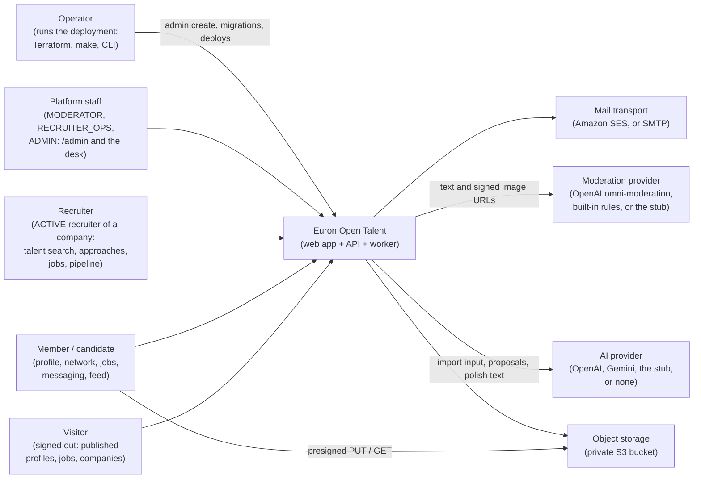
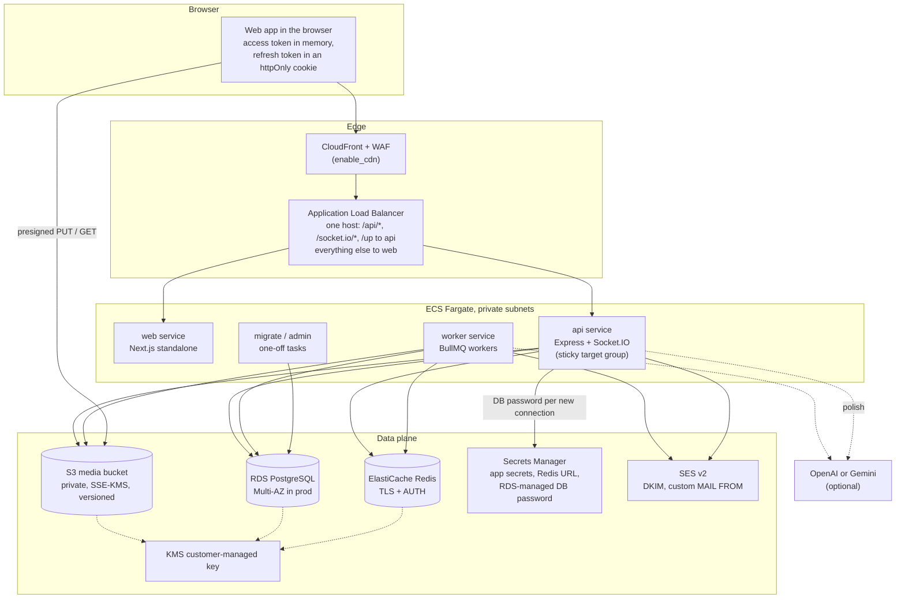
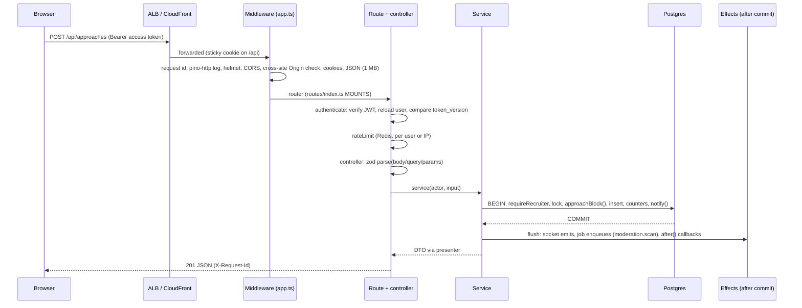
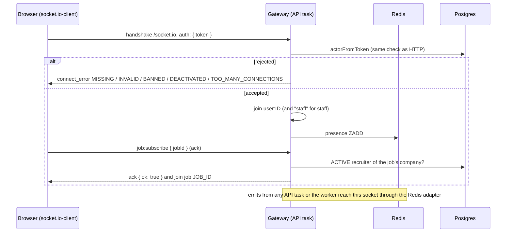

# High-level design

Euron Open Talent is a self-hosted professional talent network. One deployment runs one
network: talent profiles that their owners publish deliberately, a connection graph and
follows, company pages with verified recruiter teams, jobs with Easy Apply and a hiring
pipeline, recruiter approaches with consent-based contact unlock, direct messages, a feed
of posts, engagements with double-blind ratings, complaints, notifications, an optional
AI layer (profile import from text, files or voice, evidence-gated badges, polish) and
AI-assisted moderation. Everything a browser sees arrives over one origin, with Socket.IO
for live updates.

This page describes the system as it is built: what runs, where data lives, how a request
travels and what happens when a piece fails. Deeper topics have their own pages:

| Topic | Page |
| --- | --- |
| Modules, layers and conventions inside the API | [LLD.md](LLD.md) |
| Tables, enums and indexes | [data-model.md](data-model.md) |
| Approaches, contact unlock and what stays private | [privacy-and-contact-consent.md](privacy-and-contact-consent.md) |
| Jobs, applications and the pipeline board | [hiring-pipeline.md](hiring-pipeline.md) |
| The AI layer (import, badges, polish) | [ai.md](ai.md) |
| Socket events, rooms and presence | [realtime.md](realtime.md) |
| The moderation pipeline and desk | [moderation.md](moderation.md) |
| Uploads and media processing | [media.md](media.md) |
| Security controls and known limitations | [security.md](security.md) |
| STRIDE analysis | [threat-model.md](threat-model.md) |
| Decisions and their trade-offs | [adr/](adr/README.md) |

All code paths are relative to the repository root.

## 1. System context

Everyone uses the same web app. What a person can do depends on their platform role
(`users.role`) and, for hiring, on whether they hold an `ACTIVE` recruiter record for a
company (`recruiters.status`, with a company role `OWNER`, `ADMIN` or `RECRUITER`).

| Platform role | Can open | Defined in |
| --- | --- | --- |
| `USER` | The product: profile, network, jobs, messaging, feed. Becomes a recruiter by registering for a company and passing verification | `users.role` default |
| `MODERATOR` | `/admin` areas overview, moderation, people, jobs, complaints | [`domain/admin-permissions.ts`](../../apps/api/src/domain/admin-permissions.ts) |
| `RECRUITER_OPS` | `/admin` areas overview, recruiters (the approval queue), companies, jobs | same |
| `ADMIN` | Every area, including settings, role changes, erasure and the audit trail | same |

Every admin service function opens with `requireArea(actor, area)`
([`apps/api/src/core/context.ts`](../../apps/api/src/core/context.ts)), and the same table
is sent to the web app so its sidebar shows only the areas the operator may use.



Two flows bypass the API on purpose:

- **Media bytes** go straight between the browser and the bucket with presigned URLs. The
  API only hands out a URL for a declared, allowlisted file, then verifies what landed
  (size and magic bytes) before anything can use it. See [media.md](media.md).
- **Mail links** (email verification, password reset, digests) point at the web app
  (`APP_WEB_URL`), which calls the API. The recruiter work-email code is the exception:
  it is a six-digit code typed into the web app, never a link.

## 2. Containers

The repository builds three images. The API image carries four entry points (esbuild
bundles listed in [`apps/api/package.json`](../../apps/api/package.json)).

| Container | Source | Image | Listens | Role |
| --- | --- | --- | --- | --- |
| Web app | `apps/web` (Next.js, standalone) | [`infra/docker/web.Dockerfile`](../../infra/docker/web.Dockerfile) | 3000 (3520 on the host locally) | Pages, the `/env.js` runtime config, the CSP. In local compose it also proxies `/api/*` and `/socket.io/*` to the API. |
| API | [`apps/api/src/index.ts`](../../apps/api/src/index.ts) | [`infra/docker/api.Dockerfile`](../../infra/docker/api.Dockerfile) | 5016 | REST under `/api`, the Socket.IO gateway on `/socket.io`, `/up` and `/api/ready`. |
| Worker | [`apps/api/src/worker.ts`](../../apps/api/src/worker.ts) | API image, `node dist/worker.js` | none | BullMQ workers for the `moderation`, `media`, `notifications`, `maintenance`, `feed` and `import` queues, and the repeatable maintenance schedules. |
| Migrate (one-off) | [`db/migrate.ts`](../../db/migrate.ts) | API image, `node dist/migrate.js` | none | Applies pending SQL migrations under an advisory lock. |
| CLI (one-off) | [`apps/api/src/cli.ts`](../../apps/api/src/cli.ts) | API image, `node dist/cli.js` | none | `admin:create` and `demo:seed`. |
| AI stub (dev and tests) | [`apps/ai-stub`](../../apps/ai-stub/README.md) | [`infra/docker/ai-stub.Dockerfile`](../../infra/docker/ai-stub.Dockerfile) | 5109 | A deterministic fake of the OpenAI endpoints the API uses: moderations (`MODERATION_PROVIDER=stub`), chat completions with JSON schemas and audio transcription (`AI_PROVIDER=stub`). Never deployed to AWS. |

Shared packages:

| Package | Holds |
| --- | --- |
| [`packages/types`](../../packages/types/src/index.ts) | DTOs, enums and the Socket.IO event maps shared by the API and the web app ([`talent.ts`](../../packages/types/src/talent.ts) for profiles, hiring and trust, [`admin.ts`](../../packages/types/src/admin.ts) for the control plane) |
| [`packages/api-client`](../../packages/api-client/src/index.ts) | The HTTP client (single-flight refresh, cross-tab lock), the typed socket client, uploads, pagination helpers, the `/env.js` serialiser |
| [`packages/ui`](../../packages/ui/src/index.ts) | The component library the web app renders with |

### Deployed shape (AWS)



Without `enable_cdn` the browser reaches the load balancer directly. The composition lives
in one Terraform module,
[`infra/terraform/modules/deployment/main.tf`](../../infra/terraform/modules/deployment/main.tf);
`envs/aws-dev` and `envs/aws-prod` only pick sizes and safety switches. See
[ADR 0012](adr/0012-fargate-behind-one-alb-with-path-routing.md).

**One origin.** The ALB routes `/api/*`, `/socket.io/*` and `/up` to the API (listener
priority 100, sticky) and every other path on the host to the web app (priority 200).
The browser therefore only ever talks to `https://<domain>`, the refresh cookie (scoped to
`/api/auth`) is first-party, and the app itself needs no CORS. `CORS_ORIGINS` is still set
to the app URL and enforced (see [security.md](security.md)).

**Runtime configuration of the web app.** `NEXT_PUBLIC_*` values are inlined at build
time, so the web server renders `/env.js` per request from its own environment
([`apps/web/src/app/env.js/route.ts`](../../apps/web/src/app/env.js/route.ts),
[`apps/web/src/lib/runtime-env.ts`](../../apps/web/src/lib/runtime-env.ts)). One web image
runs in every environment. The CSP's media origins come from `MEDIA_ORIGINS` at run time
([`apps/web/src/middleware.ts`](../../apps/web/src/middleware.ts)).

### Local shape

`make up` starts the same containers with Docker Compose
([`deploy/compose/compose.yaml`](../../deploy/compose/compose.yaml) plus
[`compose.floci.yaml`](../../deploy/compose/compose.floci.yaml)): Postgres (host port
5482), Redis (6419), Mailpit (UI 8036, SMTP 1036), the AI stub (5109), the Floci AWS
emulator (S3, KMS, Secrets Manager, SES, Route53) provisioned by the production Terraform
modules, a one-shot `migrate`, then `api` (5016), `worker` and `web` (3520). Every host
port can be overridden through the `TALENT_*_PORT` variables at the top of the compose
file. In local compose the Next server proxies `/api/*` and `/socket.io/*` to the API
([`apps/web/next.config.ts`](../../apps/web/next.config.ts)), standing in for the ALB's path
rules. See [quickstart-local.md](../guides/quickstart-local.md) and
[ADR 0013](adr/0013-floci-for-local-aws.md).

### Web app pages

The web app is a client of the REST contract ([`docs/api/rest-contract.md`](../api/rest-contract.md))
and of the socket event map. It is still being built; the route tree it targets is:

| Area | Routes |
| --- | --- |
| Auth | `/login`, `/signup`, `/verify-email`, `/forgot-password`, `/reset-password`, `/goodbye` |
| Home and feed | `/` (home feed), `/posts/[id]`, `/saved` |
| Profiles | `/in/[username]` (the talent page; a renamed handle redirects), `/in/[username]/connections`, `/in/[username]/followers`, `/profile/setup` (the editor and AI import) |
| Network | `/network`, `/network/connections` |
| Jobs (candidate) | `/jobs`, `/jobs/applications` (my applications and their timelines), `/jobs/saved` |
| Companies and people | `/companies`, `/company/[slug]`, `/talent` (the directory), `/search` |
| Messaging | `/messaging`, `/messaging/[id]` |
| Notifications | `/notifications` |
| Candidate dashboard | `/dashboard` (approaches received, engagements, profile analytics) |
| Recruiter workspace | `/recruiter/*`: join (register and confirm the work email), jobs, the pipeline kanban per job, talent search, saved candidates, approaches, engagements |
| Moderation | `/moderation` (the desk), `/account/moderation`, `/account/moderation/[caseId]` (your own cases and appeals) |
| Administration | `/admin`, with areas overview, recruiters approval, companies, moderation, people, jobs, complaints, ratings, settings and audit |
| Account | `/settings` |

Notification links built by the API (`hrefFor` in
[`apps/api/src/services/notification.service.ts`](../../apps/api/src/services/notification.service.ts))
target these routes. This page does not describe the web app's internals.

## 3. The API process

One Node process serves HTTP and Socket.IO on the same port
([`apps/api/src/index.ts`](../../apps/api/src/index.ts)). Boot order:

1. Pin `TZ=UTC` before any import.
2. Load and validate configuration ([`apps/api/src/core/config.ts`](../../apps/api/src/core/config.ts)).
   Run `assertProductionConfig()`: it returns a list of problems (committed secrets,
   `STORAGE=local`, `MAIL_MODE=outbox`, stub providers, the default `VIEW_HASH_SALT`, ...);
   with `NODE_ENV=production` it throws, so a misconfigured deployment fails at boot.
   Elsewhere the problems are logged as warnings.
3. When `MIGRATE_ON_BOOT=true`, run the migration runner. The deployed stacks leave it off
   and run migrations as a separate step.
4. Register every job handler (needed for `JOBS_MODE=inline`).
5. Build the Express app (`createApp()` in [`apps/api/src/app.ts`](../../apps/api/src/app.ts),
   side-effect free so tests mount it in-process), attach the Socket.IO gateway
   ([`apps/api/src/realtime/gateway.ts`](../../apps/api/src/realtime/gateway.ts)) with the
   Redis adapter, and listen.
6. On `SIGTERM`/`SIGINT`: close the gateway, stop accepting HTTP, close queues, Redis and
   the pool. A 25 second timer forces exit.

The worker ([`apps/api/src/worker.ts`](../../apps/api/src/worker.ts)) boots the same way,
installs a [`@socket.io/redis-emitter`](../../apps/api/src/realtime/emitter.ts) as the
realtime transport, starts one BullMQ `Worker` per queue (concurrency 8 on `moderation`,
4 on every other queue) and registers the repeatable schedules:

| Job | Every | What it does |
| --- | --- | --- |
| `maintenance.expire-uploads` | 30 min | Deletes abandoned (PENDING over 24 h), rejected and never-attached (over 48 h) uploads and their objects |
| `maintenance.talent-housekeeping` | 15 min | Expires pending approaches past `expires_at`, completes engagements whose completion request went unanswered for `trust.autoConfirmDays`, reveals ratings whose window closed, purges AI import input older than `import.retentionHours`, deletes stale recruiter email codes ([`services/housekeeping.service.ts`](../../apps/api/src/services/housekeeping.service.ts)) |
| `maintenance.lift-suspensions` | 5 min | Ends timed account suspensions that ran out |
| `maintenance.reconcile-counters` | 6 h | Recomputes every denormalised counter from the rows and fixes only rows that drifted |
| `notifications.email` | 15 min | Emails "while you were away" digests of notifications unread for over an hour (at most one per user per 6 h, opt-out with `emailDigest`) |

Repeatable jobs are keyed by name and interval (`jobId: name`), so every worker task
registering them on boot leaves exactly one schedule. Each housekeeping step is a
conditional `UPDATE`, so a run on two workers at once is harmless.

## 4. Request lifecycle

### HTTP



The pieces, in order (all in [`apps/api/src/app.ts`](../../apps/api/src/app.ts) unless named):

1. **Request id.** A client `X-Request-Id` matching `^[\w-]{8,64}$` is kept, otherwise a new
   ULID. It is echoed in the response and in every error body.
2. **Access log.** `pino-http`, skipping `/up` and `/api/ready`; local signed media tokens in
   the URL are masked. Secret-bearing fields (passwords, tokens, one-time codes, cookies)
   are redacted by the logger ([`apps/api/src/core/logger.ts`](../../apps/api/src/core/logger.ts)).
3. **Headers.** Helmet with `default-src 'none'` and `frame-ancestors 'none'` (the API
   serves JSON only), cross-origin resource policy relaxed so signed local media can load.
4. **CORS** for `CORS_ORIGINS` (default: `APP_WEB_URL`) with credentials, plus a second check
   that rejects any non-GET request carrying a foreign `Origin` (`403 CORS_ORIGIN_DENIED`).
5. **Authentication** per route: `authenticate` or `optionalAuth`
   ([`apps/api/src/middleware/auth.ts`](../../apps/api/src/middleware/auth.ts)). The JWT is
   verified and then the user row is reloaded, so a ban, a deactivation or a
   `token_version` bump takes effect on the very next request. Identity always comes from
   the token, never from a body field.
6. **Rate limits** per route ([`apps/api/src/middleware/rate-limit.ts`](../../apps/api/src/middleware/rate-limit.ts)),
   stored in Redis so the budget is shared by every task.
7. **Controller**: parse input with strict zod schemas (`parse()` in
   [`apps/api/src/core/validate.ts`](../../apps/api/src/core/validate.ts)), call one service
   function with the `Actor`, send the DTO.
8. **Service**: business rules (pure decisions in `domain/`), usually inside
   `withTransaction`, then presenters build DTOs.
9. **Errors**: an `HttpError` becomes its status and stable `code`; body-parser errors become
   `400 BAD_REQUEST` or `413 PAYLOAD_TOO_LARGE`; anything else is logged and returned as
   `500 INTERNAL` with the request id and no detail. Express 5 forwards rejected promises
   from async handlers, so controllers need no wrapper.

### Socket



Clients never name a room. They ask to subscribe (`thread:`, `job:`, `post:`) and the
gateway applies the same rule the REST read applies. Delivery is at most once and only
after commit; a client that reconnects refetches what it shows. Details, including
presence and revalidation, are in [realtime.md](realtime.md).

## 5. After-commit effects

Writes that must also notify sockets, enqueue jobs or send notifications use the `Effects`
buffer in [`apps/api/src/core/effects.ts`](../../apps/api/src/core/effects.ts):

```ts
return withTransaction(async (trx, fx) => {
  const msg = await dmRepo.insertMessage(..., trx);
  fx.emit([rooms.user(recipientId)], "dm:message", { threadId, message });
  fx.job("moderation.scan", { targetType: "DM_MESSAGE", targetId: msg.id });
  return msg;
});
```

- `fx.emit`, `fx.disconnect`, `fx.job` and `fx.after` only queue a closure.
- `withTransaction` runs the transaction and calls `fx.flush()` only after a successful
  commit. A rolled-back transaction emits nothing and enqueues nothing: a pipeline move
  that lost a race (`APPLICATION_CHANGED`) never reaches a board.
- `flush()` runs the closures in order; a failing effect is logged and never fails the
  request, because the write already happened.
- `withEffects` gives the same contract for single-statement writes without a transaction.

The consequence is a clear delivery contract: realtime events and jobs are at most once,
never for data that does not exist. A crash between commit and flush loses the effects
(the socket event, the job). The maintenance jobs and client refetches cover the
important cases; there is no outbox table. See [ADR 0009](adr/0009-after-commit-effects.md).

`notify()` ([`apps/api/src/services/notification.service.ts`](../../apps/api/src/services/notification.service.ts))
writes the notification row inside the caller's transaction (never to yourself, never
across a block, collapsing duplicates within an hour) and registers an `fx.after` that
pushes `notification:new` and `counts:update`.

## 6. Background jobs: `JOBS_MODE`

Jobs are named handlers with a JSON payload
([`apps/api/src/jobs/registry.ts`](../../apps/api/src/jobs/registry.ts)). The queue is the
first segment of the name (`import.run` goes to the `import` queue).

| | `JOBS_MODE=queue` (default, every deployment) | `JOBS_MODE=inline` (tests, tiny installs) |
| --- | --- | --- |
| Where handlers run | The worker process | The API process, right after commit, inside `fx.flush()` |
| Retries | 5 attempts, exponential backoff from 5 s | None: an error is logged and swallowed |
| Scheduled jobs | Registered by the worker | None (no digests, approach expiry, rating reveal, upload expiry, counter reconcile) |
| Request latency | Unaffected | The request waits for the handler (a moderation call, an image re-encode, a whole AI import) |
| Production guard | OK | Flagged by `assertProductionConfig` |

The integration suite runs inline so assertions are deterministic
([`apps/api/test/integration/env.ts`](../../apps/api/test/integration/env.ts)).

Jobs in use:

| Job | Queue | Enqueued by | Handler |
| --- | --- | --- | --- |
| `moderation.scan` | moderation | Post, comment and DM message creates and edits; approach sends; jobs when they open or an open job's text changes; profile publishes and edits of a published profile; company page edits; account name and photo changes (target `USER`) | [`services/moderation/scan.service.ts`](../../apps/api/src/services/moderation/scan.service.ts) |
| `media.process` | media | `completeUpload` | `processUpload` in [`services/media.service.ts`](../../apps/api/src/services/media.service.ts) |
| `feed.fanout` | feed | A published post | `fanOut` in [`services/post.service.ts`](../../apps/api/src/services/post.service.ts): `feed:new-posts` to the author's connections and followers (capped) |
| `import.run` | import | `POST /api/profiles/me/imports` | `run` in [`services/import.service.ts`](../../apps/api/src/services/import.service.ts); the payload is only the import id |
| `notifications.email` | notifications | Schedule | [`jobs/messaging.jobs.ts`](../../apps/api/src/jobs/messaging.jobs.ts) |
| `maintenance.*` | maintenance | Schedule | [`jobs/messaging.jobs.ts`](../../apps/api/src/jobs/messaging.jobs.ts), [`jobs/talent.jobs.ts`](../../apps/api/src/jobs/talent.jobs.ts), [`jobs/moderation.jobs.ts`](../../apps/api/src/jobs/moderation.jobs.ts) |

See [ADR 0008](adr/0008-bullmq-on-redis.md).

## 7. Scaling model

| Component | How it scales | What makes that safe |
| --- | --- | --- |
| API tasks | Horizontally, CPU target tracking (aws-dev 1 to 2, aws-prod 2 to 10) | No in-process state that matters: sessions are in Postgres, rate limits and presence in Redis, socket fan-out through the Redis adapter. Each task has its own pool (`DB_POOL_MAX`, default 10). Settings are cached per process for 5 s. |
| Socket fan-out | Every emit is published through `@socket.io/redis-adapter`, so any task (or the worker's emitter) reaches sockets on every task | Rooms are names, not task-local objects |
| Long-polling fallback | ALB `lb_cookie` stickiness on the API target group | Socket.IO's polling transport needs every request of a session on the same task until it upgrades; the client tries WebSocket first |
| Worker tasks | Horizontally (aws-dev 1, aws-prod 2 to 6) | BullMQ locks jobs; handlers are idempotent or guarded (an import is claimed with `UPDATE ... WHERE status = 'QUEUED'`, housekeeping steps are conditional updates, upload transitions are guarded) |
| Repeatable schedules | Registered by every worker on boot | Keyed by name and interval, so one schedule exists |
| Web tasks | Horizontally (aws-dev 1 to 2, aws-prod 2 to 6) | Stateless; `/env.js` is rendered per request |
| Postgres | Vertically (instance class), storage autoscaling | Keyset pagination everywhere, partial indexes for hot lists (open jobs, the directory, pending approaches, the review queue), no `COUNT(*)` on lists ([data-model.md](data-model.md)) |
| Redis | Vertically; aws-prod runs two nodes with automatic failover | `noeviction` so queued jobs are never evicted |

Hot paths avoid per-row queries: presenters batch (one query per kind of related row), the
pipeline board reads every column with one windowed query, the DM inbox reads the last
message per thread with one `DISTINCT ON`, and the facts `canMessage` needs are loaded for
a whole page of people at once.

## 8. Failure modes

| Failure | Effect | Recovery |
| --- | --- | --- |
| Postgres unavailable | `/api/ready` returns 503; the ALB takes tasks out of rotation; requests fail with 500 | RDS Multi-AZ failover in aws-prod; new connections resolve the password from Secrets Manager |
| RDS rotates the master password | New connections fetch the new password (cached briefly) | Automatic, no restart ([`apps/api/src/db/connection-config.ts`](../../apps/api/src/db/connection-config.ts)) |
| Redis unavailable | `/api/ready` fails; rate limits fall back to in-memory insurance limiters (enforced per task, not 500); jobs cannot be enqueued (logged, the write still commits); socket fan-out across tasks stops; presence is unknown | ElastiCache failover in aws-prod. Jobs lost while Redis was down are not replayed; housekeeping and reconciliation catch up on their next run, but a missed `moderation.scan` leaves that item `UNCHECKED` and a missed `import.run` leaves the import `QUEUED` (the owner starts a new one) |
| Worker down | Jobs queue in Redis; uploads stay `COMPLETE` (images are not shown to anyone but the uploader until re-encoded and `READY`); content stays `UNCHECKED`; imports wait in `QUEUED`; approaches are not expired and ratings not revealed until it returns; no digests | Jobs run when a worker returns (5 attempts each) |
| Moderation provider down or slow | The provider retries inside one attempt (10 s timeout each); the job fails and BullMQ retries it; the item stays visible and `UNCHECKED` | Automatic retry; after 5 attempts the job is kept in the failed set. `MODERATION_PROVIDER=openai` without a real key falls back to the rules provider with a logged warning |
| AI provider down, slow or misconfigured | An import moves to `FAILED` with a readable reason (requests time out after 90 s); a badge failure is swallowed and the import still becomes `READY`; polish answers `502 AI_FAILED`. With no usable key (`aiAvailable()` false) `GET /api/meta` reports `ai.import: false`, the wizard and polish are hidden and `POST /me/imports` answers `503 AI_UNAVAILABLE` | The owner retries or uses the manual editor; nothing was applied to the profile. See [ai.md](ai.md) |
| An import's input cannot be read | `FAILED` with "We could not read any text in that file" (or nothing work-related found) | The owner pastes text instead |
| Mail transport fails | `sendMail` logs and returns `delivered: false`; the request succeeds | The user can resend verification, request another reset or ask for another recruiter code; a failed digest is not retried (the rows are claimed before sending) |
| An API task dies | Its sockets drop and reconnect to another task; its presence entries stop counting after 90 s | Clients reconnect and refetch |
| Crash between commit and effect flush | The write is durable, its socket event or job is lost | Clients refetch on navigation and reconnect; counters reconcile every 6 h |
| A deploy rolls out a bad image | ECS deployment circuit breaker rolls back automatically | Redeploy a previous image tag |

## 9. What is deliberately not here

- **Multi-tenancy.** One deployment is one network; there is no tenant column anywhere
  ([ADR 0001](adr/0001-single-network-per-deployment.md)).
- **Mass publishing or scraping-friendly listings.** A profile is public only after its
  owner publishes it, and contact details are never in a public DTO
  ([ADR 0019](adr/0019-explicit-publish.md), [privacy-and-contact-consent.md](privacy-and-contact-consent.md)).
- **An outbox or exactly-once delivery** for socket events and jobs (section 5).
- **Payments, payroll or applicant tracking integrations.** Engagements record that work
  happened so ratings can follow; money never moves through the system.
- **SMS or phone verification.** Recruiters verify a work email; there is no SMS surface.
- **Federation, mobile push, or a public API for third parties.** The API serves the web
  app; there are no API keys or OAuth clients.
- **Hard deletion of accounts.** `DELETE /api/users/me` deactivates and anonymises the
  account, revokes every contact unlock and withdraws open applications, but keeps the row
  and its content (shown as "Deleted user"); `GET /api/users/me/export` is the data export
  (see [security.md](security.md)).
