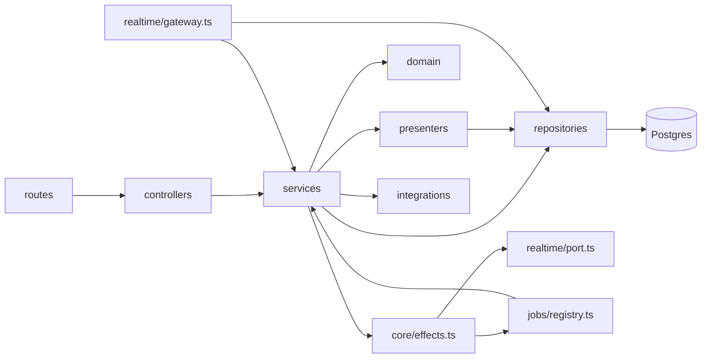
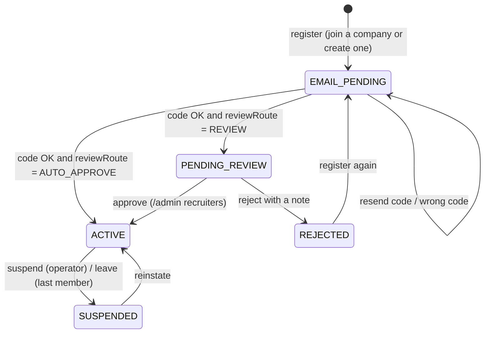
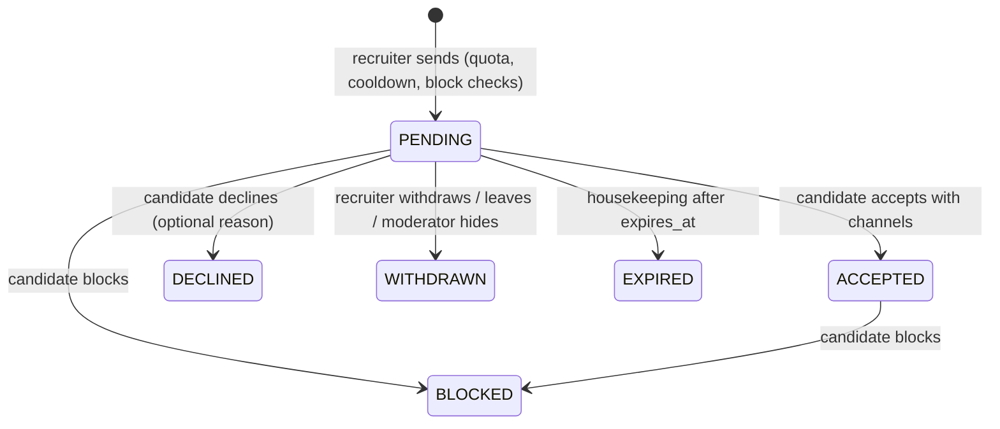
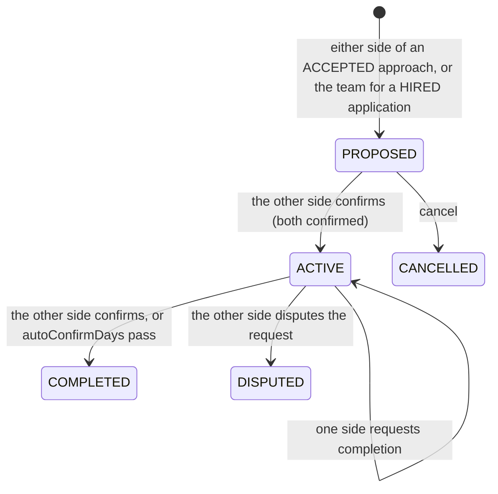

# Low-level design

How the API is built, layer by layer and module by module. The [HLD](HLD.md) covers the
system around it; [privacy-and-contact-consent.md](privacy-and-contact-consent.md),
[hiring-pipeline.md](hiring-pipeline.md), [ai.md](ai.md), [realtime.md](realtime.md),
[moderation.md](moderation.md) and [media.md](media.md) go deeper on those subsystems.
Paths are relative to `apps/api/src/` unless they start with a repository folder (`db/`,
`packages/`, `infra/`).

## 1. Layout

```
src/
  index.ts  worker.ts  cli.ts  app.ts      entry points and the Express factory
  core/            config, errors, ids, cursor, effects, context (Actor, requireArea), logger, validate, aws, data-dir
  db/              kysely.ts (the pool), connection-config.ts, types.ts (generated)
  routes/          one router per area, mounted in routes/index.ts
  middleware/      auth.ts, rate-limit.ts, http.ts
  controllers/     parse input with zod, call one service function, send JSON
  services/        business rules, transactions, effects; moderation/ has its own folder
  repositories/    SQL, plus visibility.ts, keyset.ts, text-search.ts, messaging-facts.ts
  presenters/      rows to DTOs, batched; sign media URLs; decide what each viewer sees
  domain/          pure rules: canMessage, pipeline, profile, trust, badges, safeUrl, ...
  integrations/    redis.ts, storage.ts (S3 / local), mail/ (mailer, templates), ai/ (providers)
  realtime/        port.ts (rooms + transport), gateway.ts, emitter.ts, presence.ts
  jobs/            registry.ts (queues), index.ts, *.jobs.ts handlers
  security/        passwords.ts, tokens.ts, totp.ts
  demo/seed.ts     the demo network
```



Rules the layers keep ([ADR 0003](adr/0003-layered-repository-pattern.md)):

- **Routes** declare the path, the auth middleware and rate limits, nothing else. They are
  also the input to [`scripts/gen-openapi.ts`](../../scripts/gen-openapi.ts), which
  regenerates [`docs/api/openapi.yaml`](../api/openapi.yaml) (`make openapi`).
- **Controllers** never contain rules. They parse `req.body`, `req.query` and `req.params`
  with zod and pass an `Actor` (not the request) to the service.
- **Services** take an `Actor` ([`core/context.ts`](../../apps/api/src/core/context.ts)), so the
  same function serves HTTP, sockets, jobs, the CLI, the demo seed and tests. They throw
  `HttpError`s and own transactions.
- **Repositories** hold reusable SQL. Every method takes an optional `Executor` (the pool
  or a transaction) as its last argument. Talent services also build Kysely queries
  directly inside their transactions; the visibility and keyset helpers are shared.
- **Presenters** turn rows into the DTOs of [`packages/types`](../../packages/types/src/index.ts),
  loading related rows in batches (one query per kind, never one per row). They are where
  privacy decisions about a response are made (section 5).
- **Domain** modules are pure functions with no I/O. The service gathers fresh facts, the
  domain function decides, the service acts on the decision.

## 2. Conventions, with the real code

**Configuration.** One zod schema parses `process.env` once
([`core/config.ts`](../../apps/api/src/core/config.ts)). `assertProductionConfig()` lists
insecure settings and throws when `NODE_ENV=production`; `aiAvailable()` decides whether
the AI features exist at all. Every variable is documented in
[configuration.md](../guides/configuration.md). Runtime-tunable policy (quotas, cooldowns,
thresholds) lives in the `settings` table, not the environment (section 4.14).

**Identifiers.** ULIDs from a monotonic factory ([`core/ids.ts`](../../apps/api/src/core/ids.ts)),
stored as `text`, validated by `ID_PATTERN`. Routes reject anything that is not an id with
`400 VALIDATION_FAILED` before a query runs.

**Identity from the token only.** The acting user is `req.actor`, set by `authenticate`
from the access token. No service accepts a user id, recruiter id or company id from a
body to decide who is acting: a recruiter's company comes from their own `recruiters` row
(`requireRecruiter`), a candidate's approaches are filtered by `candidate_id = actor.id`.

**Validation.** `parse(schema, input)` ([`core/validate.ts`](../../apps/api/src/core/validate.ts))
turns a zod failure into `400 VALIDATION_FAILED` with `details.fields`. Talent, hiring,
trust and admin controllers declare their bodies with `.strict()`, so an unknown field (a
smuggled `userId`, `status` or `companyId`) is a 400 rather than silently ignored:

```ts
const { channels } = parse(z.object({ channels: z.array(z.enum(CONTACT_CHANNELS)).min(1).max(3) }).strict(), req.body);
```

Shared helpers: `id()`, `idParam`, `text(max, min)`, `optionalText(max)` and
`pageQuery` (`cursor` up to 200 characters, `limit` 1 to 50).

**Errors.** Services throw the helpers in [`core/errors.ts`](../../apps/api/src/core/errors.ts)
(`badRequest`, `forbidden`, `notFound`, `conflict`, `unprocessable`, `tooMany`, or
`new HttpError(status, message, code, details)`). The `code` is stable and the web app
switches on it; the message is for people. Anything that is not an `HttpError` becomes
`500 INTERNAL` with only the request id. Section 7 lists the codes.

**404 over 403 for hidden things.** A profile behind a block, a draft profile, a job of a
suspended company, an approach the classifier flagged (to the candidate) or an
application of another company is `404`, so its existence is not confirmed. A recruiter
blocked by a candidate gets `409 APPROACH_NOT_PUBLISHED`, the same answer as for an
unpublished profile. `403` is used only when the caller already knows the thing exists
(`RECRUITER_REQUIRED`, `NOT_COMPANY_ADMIN`, `FORBIDDEN_AREA`).

**Writes need an ACTIVE account.** `requireActive(actor)` throws `403 ACCOUNT_RESTRICTED`
for suspended accounts; suspended users can still read and appeal.

**Transactions and effects.** Every multi-statement write runs in `withTransaction`; socket
emits, jobs and notification pushes are queued on the `Effects` buffer and flushed after
commit ([`core/effects.ts`](../../apps/api/src/core/effects.ts), [ADR 0009](adr/0009-after-commit-effects.md)).

**Conditional updates instead of read-then-write.** State changes carry their expected
state in the `WHERE` clause and check the row count:

```ts
const res = await trx.updateTable("approaches").set({ status: "ACCEPTED", ... })
  .where("id", "=", a.id).where("status", "=", "PENDING").executeTakeFirst();
if (Number(res.numUpdatedRows) !== 1) throw conflict("This approach is no longer open", "APPROACH_NOT_PENDING");
```

The same pattern guards pipeline moves (`WHERE stage = <the stage we read>`, else
`409 APPLICATION_CHANGED`), engagement transitions, contact revocation
(`WHERE revoked_at IS NULL`), import claiming (`WHERE status = 'QUEUED'`), rating hiding
and every housekeeping step.

**Locking.** A write that reads a quota, a counter or a state and then changes it locks
the parent row first (`forUpdate()`): the sender's `recruiters` row for approach sends (so
the daily quota and the pending check are exact), the approach for accept, decline and
block, the application for moves and withdrawals, the engagement for confirm, complete
and rate, the recruiter row for code verification and leaving, the user row for username
changes, posts for reactions and comments, DM threads for sends.

**Insert once with `ON CONFLICT`.** Unique constraints make "insert once" race-free:
`ON CONFLICT DO NOTHING ... RETURNING` on approaches (partial unique on pending pairs),
applications (`job_id, candidate_id`), engagements (`approach_id`, `application_id`),
badges (`profile_id, slug`), username history, DM direct keys, connections (`pair_key`),
reports, appeals, follows, reactions and bookmarks. An empty `RETURNING` becomes the
matching `409` (`APPROACH_ALREADY_PENDING`, `ALREADY_APPLIED`, `ENGAGEMENT_EXISTS`).

**Blocks applied everywhere.** `isBlockedEitherWay` and the `notBlocked` expression
([`repositories/visibility.ts`](../../apps/api/src/repositories/visibility.ts)) are checked
on profile reads, view counting, directory and search, approach sends and accepts,
contact reveals, applying, job invites, opening application threads, messaging,
connections, mentions, notifications and presence. Creating a block ends follows, the
connection, live contact unlocks both ways and pending approaches between the two
([`repositories/block.repository.ts`](../../apps/api/src/repositories/block.repository.ts)).

**Counters.** Denormalised counts move in the same transaction as the row they count.
`reconcileCounters()` ([`services/counters.service.ts`](../../apps/api/src/services/counters.service.ts))
recomputes all of them from the rows every 6 hours and updates only rows that drifted
(definitions in [data-model.md](data-model.md#counters)).

**Pagination.** Keyset cursors only, never `OFFSET` and never `COUNT(*)` (section 6).

## 3. Auth and sessions

Files: [`services/auth.service.ts`](../../apps/api/src/services/auth.service.ts),
[`controllers/auth.controller.ts`](../../apps/api/src/controllers/auth.controller.ts),
[`security/tokens.ts`](../../apps/api/src/security/tokens.ts),
[`security/totp.ts`](../../apps/api/src/security/totp.ts),
[`security/passwords.ts`](../../apps/api/src/security/passwords.ts),
[`middleware/auth.ts`](../../apps/api/src/middleware/auth.ts),
[`repositories/session.repository.ts`](../../apps/api/src/repositories/session.repository.ts).

| | Access token | Refresh token |
| --- | --- | --- |
| Form | JWT, HS256, carrying the user id and `token_version` | 32 random bytes |
| Lifetime | `ACCESS_TOKEN_TTL_SECONDS` (900) | `REFRESH_TOKEN_TTL_DAYS` (30) |
| Where the browser keeps it | Memory only | An `httpOnly` cookie scoped to `/api/auth`, `Secure` when `APP_WEB_URL` is https (or `COOKIE_SECURE=true`) |
| What the server stores | Nothing | `sessions.token_hash` = SHA-256 of the token, with `family_id`, user agent, IP, expiry |

- **Per request** `actorFromToken()` verifies the JWT, reloads the user and rejects a
  stale `token_version`, a `BANNED` or a `DEACTIVATED` account. Bumping `token_version`
  ("sign out everywhere", password change or reset, ban) invalidates every outstanding
  access token on the next request. The socket gateway uses the same function.
- **Refresh rotation with reuse detection.** Each refresh rotates the token inside its
  family; presenting a token that was already rotated (outside a short grace window for
  two tabs racing) revokes the whole family. See
  [ADR 0005](adr/0005-refresh-rotation-cookie-and-memory-token.md).
- **Sign-in throttling, never locking.** Two Redis budgets count failures (5 per account
  and IP per 15 minutes, 50 per account per hour). Once either is spent every attempt
  answers `429 RATE_LIMITED`, right password or not, and an unknown login is counted under
  its own name, so the answer never confirms that an account exists.
- **TOTP** (RFC 6238) with the secret stored as AES-256-GCM ciphertext keyed from
  `TOTP_ENCRYPTION_KEY` and bound to the user id; `totp_last_step` makes each code
  single-use; ten HMAC-stored recovery codes per enrolment.
- **Sign-up** honours `settings.registration` (`OPEN` or `CLOSED`, `403 REGISTRATION_CLOSED`).
  With `REQUIRE_EMAIL_VERIFICATION` (default true) the account is `PENDING_VERIFICATION`
  until the emailed token is used. The display name is cleaned at write time
  ([`domain/display-name.ts`](../../apps/api/src/domain/display-name.ts)): email addresses,
  phone numbers and URLs are stripped, so a name can never carry contact details. Every
  account gets exactly one `talent_profiles` row in `DRAFT`.
- **Account deletion and export** ([`services/account.service.ts`](../../apps/api/src/services/account.service.ts)):
  `DELETE /api/users/me` anonymises in one transaction (identity fields replaced, profile
  reset to an empty `DRAFT`, contact details nulled, every contact unlock revoked, pending
  approaches withdrawn or declined, open applications `WITHDRAWN`, graph rows removed,
  recruiter row `SUSPENDED`). Being the only `OWNER` of a company with other members is
  `409 OWNER_MUST_TRANSFER`; the last admin is `409 LAST_ADMIN`. `GET /api/users/me/export`
  streams the caller's data as one JSON document read in pages.

## 4. Modules

Each module below names its files, its rules and the pure functions it relies on.

### 4.1 Identity and account

Files: [`services/user.service.ts`](../../apps/api/src/services/user.service.ts),
[`services/auth.service.ts`](../../apps/api/src/services/auth.service.ts),
[`services/account.service.ts`](../../apps/api/src/services/account.service.ts),
[`repositories/user.repository.ts`](../../apps/api/src/repositories/user.repository.ts).

- `PATCH /api/users/me` edits the display name, avatar, cover, `messageRequestPolicy`
  (`ANYONE`, `RECRUITERS` default, `NOBODY`) and `emailDigest`. A name or photo change
  enqueues `moderation.scan` for target `USER`.
- Follows, blocks and sessions live here. A block in either direction turns the other
  person's profile into a `404`, never a `403`.
- `UserSummary` carries `openToWork` (only when the viewer may see it) and `recruiterAt`
  (when the person is an `ACTIVE` recruiter), so every surface that shows a person shows
  the same card.

### 4.2 Talent profile

Files: [`services/profile.service.ts`](../../apps/api/src/services/profile.service.ts),
[`repositories/profile.repository.ts`](../../apps/api/src/repositories/profile.repository.ts),
[`presenters/profile.presenter.ts`](../../apps/api/src/presenters/profile.presenter.ts),
[`domain/profile.ts`](../../apps/api/src/domain/profile.ts),
[`domain/months.ts`](../../apps/api/src/domain/months.ts),
[`domain/username.ts`](../../apps/api/src/domain/username.ts),
[`domain/safe-url.ts`](../../apps/api/src/domain/safe-url.ts).

- **Editor endpoints** under `/api/profiles/me`: basics (headline, about, current title
  and company, location, country, timezone, years, languages, rate), open-to-work
  (`OFF`, `RECRUITERS`, `PUBLIC` plus roles, employment and workplace types,
  availability), private contact (email, an E.164 phone, an E.164 WhatsApp number),
  per-section visibility, cover, and `PUT /me/sections/:section` for `experience`,
  `education`, `projects`, `skills`, `certifications` and `links`.
- **Sections are replaced whole.** A section save deletes and re-inserts the list in one
  transaction (positions are the list order), then `refreshDerived` rebuilds
  `search_text`, `skill_names` and `completeness` from the rows, so search and the
  progress ring cannot drift from the page.
- **Structured months.** Months are `YYYY-MM` on the wire and the first of the month (a
  `DATE`) in the database (`parseYearMonth`, `toYearMonth`); `end_month` NULL is the
  current role, and the schema checks `end_month >= start_month`. `yearsFromRoles`
  merges overlapping roles before counting.
- **URLs** on projects, certifications and links go through `safeUrl()`: http(s) only, a
  real host, no credentials, no control characters. YouTube links get a click-to-load
  `embedId` (`youtubeId`).
- **Per-section audience.** `section_visibility` maps a section to `PUBLIC`,
  `CONNECTIONS` or `RECRUITERS`. `canSeeSection` lets the owner and staff see everything,
  `CONNECTIONS` sections the owner's connections, and `RECRUITERS` sections connections
  plus `ACTIVE` recruiters. Hidden sections are emptied and listed in `hiddenSections`.
- **Explicit publish.** `POST /me/status` with `PUBLISHED`, `UNLISTED` or `DRAFT`.
  Publishing recomputes completeness and asks `publishBlock`: `SUSPENDED`
  (`403 PROFILE_SUSPENDED`), below `settings.profile.publishThreshold` (default 55,
  `422 PUBLISH_INCOMPLETE` with `details.completeness` and `threshold`) or no private
  contact channel (`422 PUBLISH_NO_CONTACT`). Nothing else ever publishes a profile
  ([ADR 0019](adr/0019-explicit-publish.md)). `UNLISTED` opens by link but stays out of the
  directory and search.
- **Completeness** (`COMPLETENESS_WEIGHTS`, summing to 100): headline 15, about 15, photo
  10, skills 15, experience 20, projects 10, education 5, links 5, contact 5.
- **Usernames.** `GET /username-check` answers `INVALID`, `RESERVED` or `TAKEN` with free
  suggestions. `PUT /me/username` is allowed once per `settings.profile.usernameCooldownDays`
  (default 30, `429 USERNAME_COOLDOWN` with `retryAt`); the old handle goes to
  `username_history` and stays reserved for its owner. `GET /api/profiles/:username` for a
  renamed handle answers `301 PROFILE_MOVED` with `details.username`, and the web app
  redirects `/in/<old>` to the new handle.
- **Reads.** `PUBLISHED` and `UNLISTED` profiles of `ACTIVE` (or suspended) accounts are
  readable by anyone not blocked; `DRAFT` and `SUSPENDED` ones by the owner and staff.
- **Views** (`POST /:username/view`) count once per viewer per profile per UTC day; a
  signed-out viewer is keyed by an HMAC of the IP with `VIEW_HASH_SALT`, never the IP.
  An `ACTIVE` recruiter's company is recorded so `GET /me/analytics` can list which
  companies looked.
- **Endorsements** are allowed only between connections (`403 NOT_CONNECTED`), never on
  your own skills.
- **Resume export** `GET /me/resume.pdf|docx` ([`services/resume.service.ts`](../../apps/api/src/services/resume.service.ts)):
  generated in-process (pdfkit, docx), owner only, logged in `resume_exports`
  ([ADR 0018](adr/0018-in-process-resume-export.md)).

### 4.3 Network

Files: [`services/network.service.ts`](../../apps/api/src/services/network.service.ts),
[`repositories/connection.repository.ts`](../../apps/api/src/repositories/connection.repository.ts),
[`repositories/follow.repository.ts`](../../apps/api/src/repositories/follow.repository.ts),
[`repositories/block.repository.ts`](../../apps/api/src/repositories/block.repository.ts).

- One `connections` row per pair, keyed by `pair_key = pairKey(a, b)` (the two ids
  sorted, [`domain/can-message.ts`](../../apps/api/src/domain/can-message.ts)). Two people
  requesting each other at once is one row: the second request accepts the first.
- A request may carry a note (300 characters). No requests across a block (`404`) or to
  accounts that are not `ACTIVE`; at most 100 per day per sender, plus the route limit.
- An ignored request stays `IGNORED` for `IGNORE_COOLDOWN_DAYS` (21): the requester still
  sees it as pending, so ignoring is quiet.
- Accepting or removing moves `users.connection_count` for both sides in the same
  transaction. Lists: connections, invitations (received and sent), suggestions (people
  you may know) and mutual connections.

### 4.4 Companies and recruiters

Files: [`services/company.service.ts`](../../apps/api/src/services/company.service.ts),
[`services/recruiter.service.ts`](../../apps/api/src/services/recruiter.service.ts),
[`domain/recruiter-verification.ts`](../../apps/api/src/domain/recruiter-verification.ts),
[`domain/slug.ts`](../../apps/api/src/domain/slug.ts).
Operator guide: [recruiter-verification.md](../guides/recruiter-verification.md).



- **Register** (`POST /api/recruiter/register`): join an existing company page by slug or
  create one (you become its `OWNER`; the company's `domains` start as the website's base
  domain and the work email's, unless it is free mail). A user recruits for at most one
  company (`recruiters.user_id` unique) and a work email belongs to one recruiter
  (`409 WORK_EMAIL_TAKEN`).
- **Work-email code.** Six digits from `crypto.randomInt`, valid for 15 minutes, stored
  only as an HMAC bound to the recruiter id, and mailed directly (never through a queue,
  so it never sits in Redis). Verifying increments `attempts` with one
  `UPDATE ... RETURNING` before comparing (timing-safe): more than 5 attempts is
  `429 CODE_LOCKED`, a wrong code `400 CODE_WRONG` with `attemptsLeft`, an expired one
  `400 CODE_EXPIRED`.
- **Review route.** `reviewRoute()` returns `AUTO_APPROVE` only when the company is
  `VERIFIED`, has `auto_approve_domain` on, the platform allows it
  (`settings.recruiter.allowDomainAutoApprove`) and the confirmed email is on one of the
  company's domains (sub-domains count) and is not free mail. Everything else waits in the
  approval queue, where `domainMatches` and `freeMail` are shown as evidence
  ([ADR 0015](adr/0015-recruiter-verification-work-email-and-review.md)).
- **`requireRecruiter(actor)`** returns the actor's `ACTIVE` recruiter row joined with its
  company, or `403 RECRUITER_REQUIRED` (also when the company is `SUSPENDED`). Everything
  recruiter-only starts with it. `requireCompanyAdmin` adds `OWNER` or `ADMIN`
  (`403 NOT_COMPANY_ADMIN`).
- **Company pages.** Page admins edit presentation; domains and the auto-approve switch
  are management fields visible to page admins and staff only; only operators verify or
  suspend a company. A `SUSPENDED` company is a 404 to everyone but staff and its team,
  and its jobs and posts drop out of every list.
- **Leaving** (`DELETE /api/recruiter/me`) withdraws pending approaches, revokes live
  contact unlocks (the candidate consented to this recruiter at this company), hands
  posted jobs to another active member or closes them. The last `OWNER` of a team with
  other members must hand over first (`409 OWNER_MUST_TRANSFER`).
- **Workspace extras:** saved candidates, saved searches (a stored `DirectoryQuery`) and
  team notes about candidates (`candidate_notes`, never shown to the candidate).

### 4.5 Approaches and contact unlock

Files: [`services/approach.service.ts`](../../apps/api/src/services/approach.service.ts),
[`presenters/approach.presenter.ts`](../../apps/api/src/presenters/approach.presenter.ts),
[`domain/trust.ts`](../../apps/api/src/domain/trust.ts). Full design:
[privacy-and-contact-consent.md](privacy-and-contact-consent.md),
[ADR 0014](adr/0014-consent-based-contact-unlock.md).



- **Send** (`POST /api/approaches`): `requireRecruiter`, then lock the recruiter row and
  ask `approachBlock()` with fresh facts: `SELF`, `BLOCKED` (reported as
  `409 APPROACH_NOT_PUBLISHED`), `NOT_PUBLISHED` (only `PUBLISHED` or `UNLISTED` profiles),
  `ALREADY_PENDING`, `COOLDOWN` (within `declineCooldownDays` of the last decline, with
  `details.cooldownUntil`) or `QUOTA` (`429`). The daily quota is the recruiter's
  `approach_quota_daily` or `settings.recruiter.approachesPerDay` (25), counted from today's
  rows excluding `FLAGGED` ones, so an approach the classifier takes down is refunded.
  The message is 30 to 3000 characters; an attached job must be an `OPEN` job of the
  same company. `expires_at` is `approachExpiryDays` (14) out. The insert uses
  `ON CONFLICT` on the partial unique index of pending pairs. A `moderation.scan` follows.
- **Accept** with `channels` (at least one of `EMAIL`, `PHONE`, `WHATSAPP`, each one the
  candidate has filled in, else `400 CHANNEL_NOT_SET`). In one transaction: check
  `expires_at` (`409 APPROACH_EXPIRED`), open an `APPROACH` DM thread with both sides
  `ACTIVE`, conditionally move to `ACCEPTED`, insert the `contact_unlocks` row with exactly
  those channels, notify and audit.
- **Reveal** (`GET /api/approaches/:id/contact`, 120 per hour): requires the same
  recruiter record, an `ACCEPTED` approach, an unrevoked unlock and no block either way;
  returns only the shared channels (plus a `wa.me` link for WhatsApp) and writes one
  `contact_access_log` row per channel shown, with an HMAC of the IP. The candidate reads
  the log at `GET /api/profiles/me/contact-log`.
- **Revoke** sets `revoked_at` (`WHERE revoked_at IS NULL`, else `409 NOTHING_SHARED`);
  the thread stays, reveals stop.
- A candidate never sees an approach whose `moderation_state` is `FLAGGED`.

### 4.6 Jobs and applications

Files: [`services/job.service.ts`](../../apps/api/src/services/job.service.ts),
[`services/application.service.ts`](../../apps/api/src/services/application.service.ts),
[`presenters/job.presenter.ts`](../../apps/api/src/presenters/job.presenter.ts),
[`presenters/application.presenter.ts`](../../apps/api/src/presenters/application.presenter.ts),
[`domain/pipeline.ts`](../../apps/api/src/domain/pipeline.ts),
[`domain/screening.ts`](../../apps/api/src/domain/screening.ts). Full design:
[hiring-pipeline.md](hiring-pipeline.md), [ADR 0016](adr/0016-pipeline-transitions-as-pure-domain-function.md).

- **Jobs** are posted by any `ACTIVE` recruiter of the company, `DRAFT` until opened.
  Every move to `OPEN` (create with publish, or reopen) checks
  `settings.recruiter.maxOpenJobsPerCompany` (`409 JOB_CAP_REACHED`). `DRAFT` jobs and jobs
  a moderator hid (`content_status`) are visible to the team and staff only.
- **Screening questions**: at most 10, each `TEXT` or `YES_NO`, optional or required.
  `checkAnswers` reports `MISSING`, `NOT_YES_NO`, `TOO_LONG` or `UNKNOWN_QUESTION`
  (`422 ANSWERS_INVALID` with `details.problems`).
- **Easy Apply** (`POST /api/jobs/:id/apply`): the job must be `OPEN`, published and
  before `closes_at`; you cannot apply to your own company (`OWN_COMPANY`) or across a
  block with the poster (`404`). The application stores a `profile_snapshot` (headline,
  location, years, up to 10 roles, 5 schools, skills), an optional resume upload claimed
  by id (purpose `RESUME`), answers, a cover note and `matchScore` (share of the job's
  skills the candidate lists). `source` is `INVITE`, `APPROACH` or `DIRECT`. One per job
  per person (`409 ALREADY_APPLIED`).
- **Moves** (`POST /api/applications/:id/move`, `POST /bulk-move` for up to 100, all or
  nothing) ask `canMoveStage(from, to, "TEAM", { reason })`, then update
  `WHERE stage = from`, write an `application_events` row (the team note stays team-only),
  notify the candidate (`APPLICATION_STAGE` with `STAGE_COPY` wording), emit
  `application:stage` to the candidate and `pipeline:card` to `job:<id>`.
- **Withdraw** is the candidate's only move (`canMoveStage(..., "CANDIDATE")`).
- **Board** (`GET /api/jobs/:id/pipeline`): every stage with its count and its first 30
  cards from one windowed query; `GET /pipeline/:stage` pages one column.
- **Invites**: published profiles only, never across a block, one per job and candidate.

### 4.7 Trust: engagements, ratings, complaints

Files: [`services/trust.service.ts`](../../apps/api/src/services/trust.service.ts),
[`domain/trust.ts`](../../apps/api/src/domain/trust.ts),
[`domain/profile.ts`](../../apps/api/src/domain/profile.ts) (`displayRating`).



- **Ratings**: one per side per engagement (`UNIQUE (engagement_id, direction)`), a score
  of 1 to 5 with optional sub-scores (communication, quality, reliability,
  professionalism) and a comment, accepted from completion until
  `settings.trust.ratingWindowDays` (60). Double-blind: a rating is hidden until both are
  in (`shouldReveal`) or the window closes (housekeeping reveals it). Before reveal a
  rating can be edited once (`409 RATING_ALREADY_EDITED`); after reveal never
  (`409 RATING_REVEALED`).
- **Averages**: a revealed rating refreshes the ratee's stored mean (`averageScore`):
  candidates on `talent_profiles.rating_avg`, recruiters rolled up to
  `companies.rating_avg`. Displays use `displayRating`, a Bayesian average with a prior of
  4.0 worth 3 ratings. An operator can hide a rating (`/admin` complaints area), which
  recomputes the average.
- **Complaints** must name someone the complainant actually dealt with through an
  approach, an application or an engagement (`404 NO_RELATIONSHIP` otherwise); evidence is
  upload ids of purpose `EVIDENCE`, never URLs; at most `trust.complaintsPer30Days` (3) per
  complainant, and one open complaint per engagement (partial unique index).

### 4.8 Feed: posts, comments, reactions

Files: [`services/post.service.ts`](../../apps/api/src/services/post.service.ts),
[`services/feed.service.ts`](../../apps/api/src/services/feed.service.ts),
[`services/comment.service.ts`](../../apps/api/src/services/comment.service.ts),
[`services/reaction.service.ts`](../../apps/api/src/services/reaction.service.ts),
[`repositories/post.repository.ts`](../../apps/api/src/repositories/post.repository.ts),
[`domain/ranking.ts`](../../apps/api/src/domain/ranking.ts),
[`domain/mentions.ts`](../../apps/api/src/domain/mentions.ts).

- **Kinds** `POST`, `HIRING`, `OPEN_TO_WORK`, `JOB`, `MILESTONE`; **visibility** `PUBLIC`
  or `CONNECTIONS`. Posting as a company page needs an `ACTIVE` `OWNER` or `ADMIN`
  recruiter of a company that is not suspended. A `JOB` or `HIRING` post may attach an
  `OPEN` job of the author's company.
- **Reposts** are of `PUBLIC` posts only and always of the original, so `CONNECTIONS`
  text never travels further.
- **Pre-moderation** ([`services/premoderation.service.ts`](../../apps/api/src/services/premoderation.service.ts)):
  when enabled, the first posts of young accounts are `PENDING_REVIEW` with a case opened
  in the same transaction; mentions are sent on approval
  ([`services/post-mentions.service.ts`](../../apps/api/src/services/post-mentions.service.ts)).
- **Every list reads through `postRepo.visible()`**: `PUBLISHED`, `CONNECTIONS` posts for
  connections only, blocks both ways, suspended company pages hidden. The home feed is your
  own posts, connections, people and companies you follow and the company you recruit
  for, topped up with suggested public posts when thin; "top" ranks the last 7 days by
  `reactions + 2 * comments`.
- **Fan-out** (`feed.fanout`) emits `feed:new-posts` to the author's connections and
  followers, capped at 2000 recipients.
- Comments have one level of replies; reactions are one per person per item (six types)
  with the parent row locked for the change.

### 4.9 Messaging

Files: [`services/dm.service.ts`](../../apps/api/src/services/dm.service.ts),
[`domain/can-message.ts`](../../apps/api/src/domain/can-message.ts),
[`domain/dm-send.ts`](../../apps/api/src/domain/dm-send.ts),
[`domain/unread.ts`](../../apps/api/src/domain/unread.ts),
[`repositories/messaging-facts.ts`](../../apps/api/src/repositories/messaging-facts.ts),
[`repositories/dm.repository.ts`](../../apps/api/src/repositories/dm.repository.ts),
[`presenters/thread.presenter.ts`](../../apps/api/src/presenters/thread.presenter.ts).
Decision: [ADR 0006](adr/0006-can-message-rule.md).

- 1:1 threads only, found or created by `direct_key` (the sorted pair). `context` records
  why the thread exists: `CONNECTION`, `APPROACH`, `APPLICATION`, `REQUEST`, `SUPPORT`.
- **`canMessage(facts)`** decides who may start a conversation, first match wins: self,
  restricted sender, unavailable recipient, a block either way (staff included), staff may
  message anyone, then connected OR an accepted approach OR an application link means a
  normal thread; otherwise a request allowed only by the recipient's policy (`ANYONE`,
  `RECRUITERS` default for `ACTIVE` recruiters only, `NOBODY`).
- **`directSendDecision`** decides each send into an existing thread from fresh facts:
  blocks and account status are never waived; "not connected" is waived once the
  counterpart is `ACTIVE` in the thread; while a request is pending the sender may send
  `settings.messaging.requestMessageCap` (3) messages (`409 DM_REQUEST_PENDING` after);
  a declined request reads as `RECIPIENT_CLOSED_REQUESTS`.
- Threads opened by an accepted approach or an application (`openContextThread`) start
  `ACTIVE` on both sides: accepting, or applying, is the consent.
- Folders: inbox, requests, archived (`archived_at` per participant). Mute, read cursors,
  edit, delete (tombstones), emoji reactions, in-thread search and a media drawer.
- Delivery is a socket emit after commit; email is only the periodic digest.

### 4.10 Notifications

Files: [`services/notification.service.ts`](../../apps/api/src/services/notification.service.ts),
[`repositories/notification.repository.ts`](../../apps/api/src/repositories/notification.repository.ts),
[`presenters/notification.presenter.ts`](../../apps/api/src/presenters/notification.presenter.ts).

- `notify()` runs inside the caller's transaction: never to yourself, never across a
  block, and the same (recipient, actor, type, entity) within an hour updates the existing
  row instead of stacking.
- `hrefFor()` builds the web path for each of the 28 notification types (approaches go to
  `/dashboard/approaches` or `/recruiter/approaches` depending on `data.audience`).
- `GET /api/notifications/counts` returns notifications, messages, message requests and
  connection requests; every change pushes the same object as `counts:update`.
- A snippet quoting a `CONNECTIONS` post is withheld once the recipient is no longer
  connected to its author.

### 4.11 Moderation

Files under [`services/moderation/`](../../apps/api/src/services/moderation/scan.service.ts)
(`scan.service.ts`, `cases.service.ts`, `actions.service.ts`, `reports.service.ts`,
`appeals.service.ts`, `targets.ts`, `providers.ts`, `removal.ts`),
[`domain/moderation-decision.ts`](../../apps/api/src/domain/moderation-decision.ts),
[`domain/report-threshold.ts`](../../apps/api/src/domain/report-threshold.ts).
Full design: [moderation.md](moderation.md).

- Targets: `POST`, `COMMENT`, `DM_MESSAGE`, `USER`, `PROFILE`, `COMPANY`, `JOB`,
  `APPROACH`, each with an adapter in `targets.ts` (load, visibleTo, setStatus). Hiding a
  profile suspends it and revokes its live contact unlocks; hiding a pending approach
  withdraws it.
- `decideModeration(scores, thresholds, ctx)` gives `CLEAN`, `REVIEW` or `HIDE`; staff
  content never auto-hides. Three reporters older than a day hide content (never an
  account, profile or company page) pending review.
- One `OPEN` case per target; reporters never appear in any DTO; appeals go to a
  different staff member.

### 4.12 Media

Files: [`services/media.service.ts`](../../apps/api/src/services/media.service.ts),
[`services/media-attach.service.ts`](../../apps/api/src/services/media-attach.service.ts),
[`domain/media-rules.ts`](../../apps/api/src/domain/media-rules.ts),
[`integrations/storage.ts`](../../apps/api/src/integrations/storage.ts).
Full design: [media.md](media.md).

Presign, browser PUT, complete (HEAD for the size, sniff the first bytes against the
declared type), then `media.process` re-encodes images (EXIF and GPS stripped, a
thumbnail written). Content references media only by upload id, of the right purpose,
owned by the caller and not already attached. SVG, HTML and anything scriptable are
refused. Import files and complaint evidence are visible only to their owner and staff.

### 4.13 AI import, badges and polish

Files: [`services/import.service.ts`](../../apps/api/src/services/import.service.ts),
[`integrations/ai/`](../../apps/api/src/integrations/ai/provider.ts) (`provider.ts`,
`index.ts`, `openai.ts`, `gemini.ts`, `schema.ts`, `prompts.ts`, `extract-text.ts`),
[`domain/badges.ts`](../../apps/api/src/domain/badges.ts).
Full design: [ai.md](ai.md), [ADR 0017](adr/0017-pluggable-ai-providers.md).

- `POST /me/imports` takes pasted text (at least 60 characters on its own) and/or an
  upload id of purpose `IMPORT`; the job payload is only the import id.
- `QUEUED -> EXTRACTING -> GENERATING -> SCORING -> READY -> APPLIED` (or `FAILED`), each
  pushed as `import:status`.
- The proposal is sanitised (`sanitizeProposal`: `safeUrl`, `parseYearMonth`, clamped
  lengths, contact details stripped). Badges survive `gateBadges` only with a verbatim
  quote from the input and confidence of at least 0.6, at most 5; the seniority badge is a
  `SYSTEM` badge computed from the dates.
- Applying replaces only the sections the owner picked and purges the raw input; it never
  publishes. Unapplied input is purged after `import.retentionHours` (72).

### 4.14 Search and the directory

Files: [`services/directory.service.ts`](../../apps/api/src/services/directory.service.ts),
[`domain/search-text.ts`](../../apps/api/src/domain/search-text.ts),
[`repositories/text-search.ts`](../../apps/api/src/repositories/text-search.ts).

- `GET /api/search/people` lists `PUBLISHED` profiles of `ACTIVE` accounts minus blocks,
  filtered by `q`, `skills` (exact, array containment on `skill_names`), `location`,
  `openToWork`, employment and workplace types and a years range, sorted by relevance,
  recency or experience. The open-to-work filter includes `RECRUITERS`-mode profiles only
  for `ACTIVE` recruiters.
- Text matching uses the generated `tsvector` columns with a prefix `to_tsquery` built by
  `prefixTsQuery`, or an escaped trigram `ILIKE` (`likeContains`), never raw user input in
  query syntax. Relevance is `ts_rank + 0.5 * similarity(name) + completeness / 1000`.
- `GET /api/search/facets` returns top skills and locations; `GET /api/search?q=` is a
  typeahead across people, jobs and companies. Job search lives in `job.service.ts` with
  its own filters (workplace, employment, seniority, skills, company, salary floor,
  posted within).

### 4.15 Admin control plane and settings

Files: [`services/admin.service.ts`](../../apps/api/src/services/admin.service.ts),
[`domain/admin-permissions.ts`](../../apps/api/src/domain/admin-permissions.ts),
[`services/settings.service.ts`](../../apps/api/src/services/settings.service.ts),
[`services/audit.service.ts`](../../apps/api/src/services/audit.service.ts).

| Area | ADMIN | MODERATOR | RECRUITER_OPS | Functions |
| --- | --- | --- | --- | --- |
| `overview` | yes | yes | yes | `stats`, `statsCsv` |
| `recruiters` | yes | | yes | `listRecruiters`, `reviewRecruiter`, `suspendRecruiter`, `reinstateRecruiter`, `setRecruiterQuota` |
| `companies` | yes | | yes | `listCompanies`, `updateCompany` (verify, suspend, domains, auto-approve) |
| `moderation` | yes | yes | | the case desk (`/api/moderation`) |
| `people` | yes | yes | | `listUsers`, account actions, `suspendProfile`, `restoreProfile`, `grantBadge`, `revokeBadge` |
| `jobs` | yes | yes | yes | `listJobs`, `closeJob` |
| `complaints` | yes | yes | | `listComplaints`, `resolveComplaint`, `hideRating` |
| `settings` | yes | | | `readSettings`, `updateSettings`, `changeRole`, `eraseUser` |
| `audit` | yes | | | `listAudit` |

Every admin change writes an `audit_log` row with the operator's id and, where a person is
affected, notifies them. Account actions go through `moderation/actions.service.ts` so the
console and the desk leave the same trail. Platform settings are one JSON document
(`settings.key = 'platform'`) merged over `DEFAULT_SETTINGS` and cached for 5 seconds per
process:

| Group | Keys (defaults) |
| --- | --- |
| top level | `networkName` (`PRODUCT_NAME`), `registration` (`OPEN`) |
| `profile` | `publishThreshold` 55, `usernameCooldownDays` 30 |
| `recruiter` | `approachesPerDay` 25, `approachExpiryDays` 14, `declineCooldownDays` 30, `maxOpenJobsPerCompany` 50, `freeMailDomains` (a built-in list), `allowDomainAutoApprove` true |
| `messaging` | `requestsPerDay` 20, `requestMessageCap` 3 |
| `trust` | `autoConfirmDays` 14, `ratingWindowDays` 60, `complaintsPer30Days` 3 |
| `import` | `enabled` true, `perDay` 5, `retentionHours` 72 |
| `analytics` | `timezone` `UTC` |
| `moderation` | `enabled`, `provider`, per-category `thresholds`, `premoderateNewAccounts`, `blockedTerms` |

## 5. Domain functions

Every rule that can be stated without I/O is a pure function in `domain/`:

| File | Functions | Decides |
| --- | --- | --- |
| [`can-message.ts`](../../apps/api/src/domain/can-message.ts) | `canMessage`, `toEligibility`, `pairKey` | Who may start a conversation, and the canonical pair key |
| [`dm-send.ts`](../../apps/api/src/domain/dm-send.ts) | `directSendDecision` | Whether a send into an existing thread is allowed (request cap) |
| [`pipeline.ts`](../../apps/api/src/domain/pipeline.ts) | `canMoveStage`, `matchScore`, `STAGE_COPY`, `OPEN_STAGES` | Allowed stage changes by team or candidate; skill overlap; candidate wording |
| [`screening.ts`](../../apps/api/src/domain/screening.ts) | `readQuestions`, `checkAnswers` | Shape of screening questions and answer problems |
| [`profile.ts`](../../apps/api/src/domain/profile.ts) | `completeness`, `publishBlock`, `canSeeSection`, `hiddenSections`, `showsOpenToWork`, `displayRating` | Publish gate, section audiences, open-to-work visibility, Bayesian rating |
| [`trust.ts`](../../apps/api/src/domain/trust.ts) | `approachBlock`, `ratingEditBlock`, `ratingWindowOpen`, `shouldReveal`, `averageScore` | Approach eligibility; rating edit, window and reveal rules |
| [`recruiter-verification.ts`](../../apps/api/src/domain/recruiter-verification.ts) | `emailDomain`, `isFreeMail`, `domainMatches`, `reviewRoute`, `newEmailCode` | Work-email evidence and the auto-approve route |
| [`badges.ts`](../../apps/api/src/domain/badges.ts) | `gateBadges`, `seniorityBadge` | Which AI badges survive; the system seniority badge |
| [`safe-url.ts`](../../apps/api/src/domain/safe-url.ts) | `safeUrl`, `baseDomain`, `youtubeId` | Which URLs may appear on a page |
| [`months.ts`](../../apps/api/src/domain/months.ts) | `parseYearMonth`, `toYearMonth`, `yearsFromRoles` | Structured months and years of experience |
| [`username.ts`](../../apps/api/src/domain/username.ts) | `USERNAME_PATTERN`, `isReservedUsername`, `usernameSuggestions` | Handle shape and the reserved list |
| [`display-name.ts`](../../apps/api/src/domain/display-name.ts) | `cleanDisplayName` | Strips emails, phones and URLs from public names |
| [`slug.ts`](../../apps/api/src/domain/slug.ts) | `slugify` | Company slugs |
| [`search-text.ts`](../../apps/api/src/domain/search-text.ts) | `searchTerms`, `prefixTsQuery`, `likeContains`, `uniqueSkills` | Escaping user text for tsquery and ILIKE |
| [`mentions.ts`](../../apps/api/src/domain/mentions.ts) | `parseMentions` | @mentions in posts and comments |
| [`ranking.ts`](../../apps/api/src/domain/ranking.ts) | `engagementScore`, `hotScore`, `inTopWindow`, `compareRanked` | Feed ranking |
| [`unread.ts`](../../apps/api/src/domain/unread.ts) | `isUnread`, `inboxTotals` | Unread messages and inbox badges |
| [`moderation-decision.ts`](../../apps/api/src/domain/moderation-decision.ts) | `baselineVerdict`, `decideModeration`, `adjustForContext` | Scores to `CLEAN`, `REVIEW` or `HIDE` |
| [`report-threshold.ts`](../../apps/api/src/domain/report-threshold.ts) | `shouldAutoHideFromReports`, `bumpPriority` | When reports alone hide content |
| [`media-rules.ts`](../../apps/api/src/domain/media-rules.ts) | allowlist, size limits, magic-byte sniffing | What may be uploaded |
| [`admin-permissions.ts`](../../apps/api/src/domain/admin-permissions.ts) | `canOpenArea`, `permissionsFor`, `isOperator` | Which `/admin` areas a role opens |

Unit tests for these live in [`apps/api/test/unit`](../../apps/api/test/unit/hardening.test.ts);
see [testing.md](../guides/testing.md).

## 6. Presenters and what each viewer sees

Presenters ([`presenters/`](../../apps/api/src/presenters/profile.presenter.ts)) take a page
of rows and a viewer and return DTOs with a fixed number of queries. Several privacy rules
live only here, so no endpoint can forget them:

| Presenter | Viewer-dependent decisions |
| --- | --- |
| `profile.presenter.ts` | Empties sections outside the viewer's audience and lists them in `hiddenSections`; shows open-to-work per mode; never puts contact details in a `Profile` (they exist only in `MyProfile` and a logged `ContactReveal`); hides badges the owner hid; fills `viewer.recruiter` (saved, why an approach is blocked now, a live unlock) for `ACTIVE` recruiters |
| `application.presenter.ts` | Two views never mixed: the team's (`Application`: snapshot, answers with prompts, match, notes count, average note rating) and the candidate's (`MyApplication`: stage and timeline only) |
| `approach.presenter.ts` | Batched recruiters, candidates, companies, jobs and unlocks; `unlockedChannels` and `unlockRevoked` |
| `job.presenter.ts` | The viewer's saved flag, own application, skill match and `canManage` |
| `thread.presenter.ts` | `canSend` from the same rule the send endpoint enforces, with fresh facts |
| `message.presenter.ts` | Tombstones for deleted messages; a hidden message's text only to its sender |
| `post.presenter.ts` | Drops mentions across a block; a shared post only if the viewer may see it |
| `moderation.presenter.ts` | No reporter identities ever; the author view drops raw AI scores and the moderator |
| `notification.presenter.ts` | Withholds a `CONNECTIONS` snippet after disconnection |
| `media.presenter.ts` | Signs every URL per response (`SIGNED_URL_TTL_SECONDS`) |

## 7. Keyset pagination

Lists return `Page<T> = { items, nextCursor }`; the client passes `nextCursor` back as
`?cursor=` until it is null ([ADR 0004](adr/0004-keyset-pagination.md)). Queries ask for
`limit + 1` rows to know whether a next page exists, so no `COUNT(*)` runs.

[`repositories/keyset.ts`](../../apps/api/src/repositories/keyset.ts) defines three opaque
base64url JSON shapes:

| Shape | Encodes | Used by |
| --- | --- | --- |
| time `[at, id]` | `(created_at, id)` or another timestamp, read as exact text with `atKey()` | approaches, applications, pipeline columns (`stage_changed_at`), saved jobs and candidates, directory by recency (`published_at`) |
| score `[score, id]` | a float8 from SQL | directory and job search by relevance or experience, "top" feed |
| hot `[score, ref, id]` | score plus a pinned "now" | hot ranking, so a page boundary does not move while scores decay |

[`core/cursor.ts`](../../apps/api/src/core/cursor.ts) is the Date-based helper used by
messaging, moderation and admin lists; it is exact because every timestamp column is
`timestamptz(3)`. A malformed cursor is `400 INVALID_CURSOR`.

## 8. Error codes

Every error body is `{ error, code, details?, requestId }`. The codes a client is most
likely to switch on:

| Area | Status and codes |
| --- | --- |
| Generic | `400 VALIDATION_FAILED`, `BAD_REQUEST`, `INVALID_CURSOR`; `401 UNAUTHENTICATED`; `403 FORBIDDEN`, `ACCOUNT_RESTRICTED`, `CORS_ORIGIN_DENIED`; `404 NOT_FOUND`; `413 PAYLOAD_TOO_LARGE`; `429 RATE_LIMITED`; `500 INTERNAL` |
| Auth | `401 INVALID_CREDENTIALS`, `INVALID_TOTP`, `INVALID_RECOVERY_CODE`, `SESSION_EXPIRED`; `403 EMAIL_NOT_VERIFIED`, `REGISTRATION_CLOSED`, `ACCOUNT_BANNED`, `ACCOUNT_DEACTIVATED`; `409 EMAIL_TAKEN`, `USERNAME_TAKEN`, `LAST_ADMIN` |
| Profile | `301 PROFILE_MOVED`; `403 PROFILE_SUSPENDED`, `NOT_CONNECTED`; `404 PROFILE_NOT_FOUND`; `409 USERNAME_INVALID`, `USERNAME_RESERVED`, `USERNAME_TAKEN`; `422 PUBLISH_INCOMPLETE`, `PUBLISH_NO_CONTACT`; `429 USERNAME_COOLDOWN`; `400 MONTH_INVALID`, `DATES_INVALID`, `URL_INVALID`, `RATE_INVALID` |
| Recruiter | `400 COMPANY_CHOICE`, `EMAIL_INVALID`, `NOT_EMAIL_PENDING`, `CODE_WRONG`, `CODE_EXPIRED`; `403 RECRUITER_REQUIRED`, `NOT_COMPANY_ADMIN`, `COMPANY_SUSPENDED`; `404 NOT_A_RECRUITER`, `COMPANY_NOT_FOUND`; `409 ALREADY_RECRUITER`, `WORK_EMAIL_TAKEN`, `OWNER_MUST_TRANSFER`; `429 CODE_LOCKED` |
| Approaches | `409 APPROACH_NOT_PUBLISHED`, `APPROACH_ALREADY_PENDING`, `APPROACH_COOLDOWN`, `APPROACH_NOT_PENDING`, `APPROACH_EXPIRED`, `NOTHING_SHARED`; `429 APPROACH_QUOTA`; `400 CHANNELS_REQUIRED`, `CHANNEL_NOT_SET`, `JOB_NOT_SHAREABLE`, `SALARY_INVALID`; `403 CONTACT_NOT_SHARED`; `404 APPROACH_NOT_FOUND` |
| Jobs and applications | `404 JOB_NOT_FOUND`, `APPLICATION_NOT_FOUND`; `409 JOB_NOT_OPEN`, `JOB_CAP_REACHED`, `ALREADY_APPLIED`, `ALREADY_INVITED`, `APPLICATION_CHANGED`, `APPLICATION_WITHDRAWN`, `STAGE_FINAL`, `STAGE_NOT_ALLOWED`, `REASON_REQUIRED`, `SAME_STAGE`; `422 ANSWERS_INVALID`; `400 OWN_COMPANY`, `TOO_MANY` |
| Trust | `400 SOURCE_REQUIRED`; `403 NOT_HIRING_TEAM`; `404 ENGAGEMENT_NOT_FOUND`; `409 APPROACH_NOT_ACCEPTED`, `NOT_HIRED`, `ENGAGEMENT_EXISTS`, `ENGAGEMENT_STATE`, `ENGAGEMENT_NOT_COMPLETE`, `RATING_WINDOW_CLOSED`, `RATING_REVEALED`, `RATING_ALREADY_EDITED`, `COMPLAINT_EXISTS`; `404 NO_RELATIONSHIP`; `429 COMPLAINT_LIMIT` |
| Messaging | `403 DM_NOT_ALLOWED` (with `details.reason`); `409 DM_REQUEST_PENDING`; `404 THREAD_NOT_FOUND`, `MESSAGE_NOT_FOUND`; `400 MESSAGE_EMPTY`, `MESSAGE_TOO_LONG`, `TOO_MANY_ATTACHMENTS` |
| AI import | `503 AI_UNAVAILABLE`, `IMPORT_DISABLED`; `502 AI_FAILED`; `400 IMPORT_EMPTY`, `IMPORT_TOO_SHORT`; `404 IMPORT_NOT_FOUND`; `409 IMPORT_NOT_READY` |
| Media | `400 MEDIA_INVALID`, `MEDIA_NOT_READY`, `MEDIA_TYPE_NOT_ALLOWED`, `MEDIA_EXTENSION_MISMATCH`, `MEDIA_TOO_LARGE`, `MEDIA_PURPOSE_MISMATCH`; `409 MEDIA_IN_USE`; `422 MEDIA_SIZE_MISMATCH`, `MEDIA_TYPE_MISMATCH` |
| Admin and moderation | `403 FORBIDDEN_AREA`, `SELF_MODERATION`, `TARGET_PROTECTED`, `CANNOT_CHANGE_OWN_ROLE`; `404 CASE_NOT_FOUND`; `409 CASE_RESOLVED`, `ALREADY_APPEALED`, `NOT_APPEALABLE`, `NOT_PENDING_REVIEW`, `NOT_REINSTATABLE` |

The exact status of a code is whatever the service throws; the list above is a reading
aid, and [rest-contract.md](../api/rest-contract.md) gives the codes per endpoint.

## 9. Rate limits

Route-level limits from `rateLimit(name, points, seconds, keyBy?)` in
[`middleware/rate-limit.ts`](../../apps/api/src/middleware/rate-limit.ts). The subject is the
user when signed in and the IP otherwise; `ip` forces the IP. Budgets live in Redis with
an in-memory fallback, and `RATE_LIMITS=off` disables them (the default under
`NODE_ENV=test`).

| Name | Budget | Routes |
| --- | --- | --- |
| `auth` (IP) | 10 per minute | signup, verify-email, login, reset-password, change-password, TOTP enable, disable and recovery codes |
| `auth-mail` (IP) | 5 per hour | resend-verification, forgot-password |
| `auth-refresh` (IP) | 60 per minute | refresh |
| `profile-edit` | 120 per 10 min | every `PATCH`/`PUT` under `/api/profiles/me` |
| `username-change` | 5 per day | `PUT /api/profiles/me/username` |
| `username-check` (IP) | 60 per minute | `GET /api/profiles/username-check` |
| `profile-view` (IP) | 120 per minute | `POST /api/profiles/:username/view` |
| `resume-export` | 20 per hour | `GET /api/profiles/me/resume.:format` |
| `endorse` | 120 per hour | skill endorsements |
| `connect` | 60 per hour | `POST /api/network/connections` |
| `follows` | 60 per minute | user and company follows |
| `company-edit` | 60 per 10 min | `PATCH /api/companies/:slug` |
| `recruiter-register` | 10 per day | `POST /api/recruiter/register` |
| `recruiter-code` | 5 per hour | `POST /api/recruiter/me/code` |
| `recruiter-verify` | 20 per hour | `POST /api/recruiter/me/verify` |
| `notes` | 200 per hour | `POST /api/recruiter/notes` |
| `approach-send` | 60 per hour | `POST /api/approaches` (plus the daily quota) |
| `contact-reveal` | 120 per hour | `GET /api/approaches/:id/contact` |
| `job-search` (IP) | 120 per minute | `GET /api/jobs` |
| `job-create` | 30 per day | `POST /api/jobs` |
| `job-invite` | 100 per day | `POST /api/jobs/:id/invites` |
| `apply` | 50 per day | `POST /api/jobs/:id/apply` |
| `pipeline-move` | 600 per hour | single and bulk moves |
| `engagement` | 30 per day | `POST /api/trust/engagements` |
| `complaints` | 5 per day | `POST /api/trust/complaints` |
| `search` (IP) | 90 per minute | `GET /api/search`, `/api/search/people` |
| `posts` | 10 per minute | create and edit posts |
| `comments` | 30 per minute | create and edit comments |
| `reactions` | 120 per minute | post and comment reactions |
| `dm-send` | 30 per minute | `POST /api/dms/threads/:id/messages` |
| `media-create` | 60 per 10 min | `POST /api/media/uploads` |
| `reports` | 20 per hour | `POST /api/reports` |
| `appeals` | 10 per hour | `POST /api/moderation/cases/:id/appeal` |
| `account-delete` | 5 per hour | `DELETE /api/users/me` |
| `account-export` | 3 per day | `GET /api/users/me/export` |

Services add their own budgets with `consume()` where the limit is policy rather than
abuse protection: `profile-import` (`settings.import.perDay`), `ai-polish` (50 per day),
`apply` and `recruiter-register` again inside the service, and the sign-in failure budgets.

## 10. Realtime, jobs and integrations

- **Realtime** ([`realtime/port.ts`](../../apps/api/src/realtime/port.ts)): services queue
  emits on `Effects`; rooms are `user:<id>`, `thread:<id>`, `job:<id>`, `post:<id>` and
  `staff`. `leaveRooms` drops users from rooms they lost access to (a block, removal from
  a team). See [realtime.md](realtime.md).
- **Jobs** ([`jobs/registry.ts`](../../apps/api/src/jobs/registry.ts)): typed `JobDefinitions`,
  queues `moderation`, `media`, `notifications`, `maintenance`, `feed`, `import`; handlers
  registered by [`jobs/index.ts`](../../apps/api/src/jobs/index.ts).
- **Mail** ([`integrations/mail/mailer.ts`](../../apps/api/src/integrations/mail/mailer.ts)):
  `outbox`, `smtp` or `ses`; sending never throws into the caller. Templates escape every
  interpolated value.
- **Storage** ([`integrations/storage.ts`](../../apps/api/src/integrations/storage.ts)): a
  private S3 bucket or, in development, files under the data directory served through
  HMAC-signed URLs.
- **Redis** ([`integrations/redis.ts`](../../apps/api/src/integrations/redis.ts)): BullMQ
  connections, the adapter's publisher and subscriber, and one general client for rate
  limits and presence.
