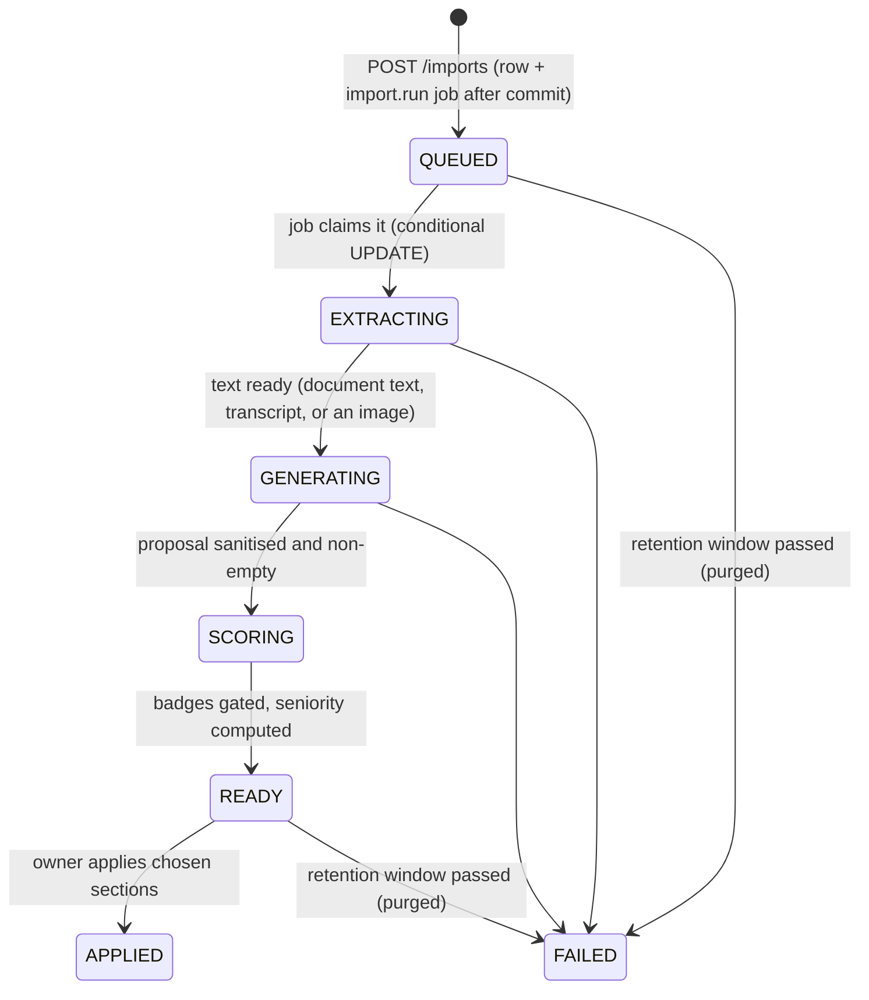
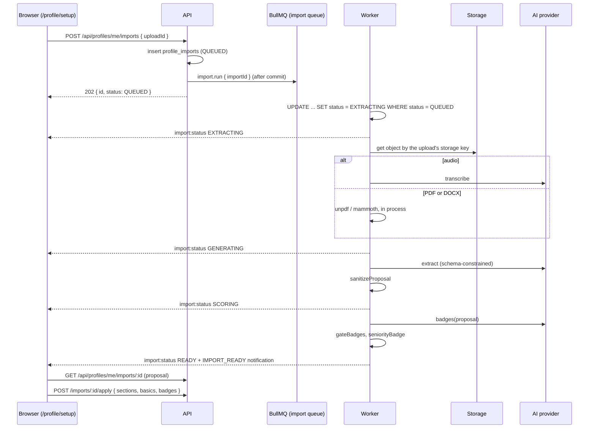

# AI

Euron Open Talent uses a language model for three things, all on the candidate's own
profile: turning pasted text, a document or a voice note into a proposed profile
(**import**), proposing a few evidence-backed badges for that proposal (**badges**), and
rewriting one field on request (**polish**). Every one of them produces a suggestion the
owner reviews; nothing the model writes reaches a profile unchecked, and nothing is ever
published by it.

The AI layer is optional. A deployment can run with OpenAI (the default), Gemini, a
deterministic stub for tests, or no AI at all, in which case the import wizard and the
polish buttons disappear and the manual editor is the only path.

Content moderation is a separate pipeline with its own provider setting
([moderation.md](moderation.md)). Related pages: [media.md](media.md) (the `IMPORT`
upload), [privacy-and-contact-consent.md](privacy-and-contact-consent.md) (why the model
never writes contact details), [security.md](security.md),
[ADR 0017](adr/0017-pluggable-ai-providers.md), [ADR 0019](adr/0019-explicit-publish.md).

| Piece | File |
| --- | --- |
| Provider port | [`integrations/ai/provider.ts`](../../apps/api/src/integrations/ai/provider.ts) |
| Selection | [`integrations/ai/index.ts`](../../apps/api/src/integrations/ai/index.ts), `aiAvailable()` in [`core/config.ts`](../../apps/api/src/core/config.ts) |
| OpenAI-compatible client (also used for the stub) | [`integrations/ai/openai.ts`](../../apps/api/src/integrations/ai/openai.ts) |
| Gemini client | [`integrations/ai/gemini.ts`](../../apps/api/src/integrations/ai/gemini.ts) |
| Output schemas and the sanitiser | [`integrations/ai/schema.ts`](../../apps/api/src/integrations/ai/schema.ts) |
| Prompts (versioned) | [`integrations/ai/prompts.ts`](../../apps/api/src/integrations/ai/prompts.ts) |
| Document text extraction | [`integrations/ai/extract-text.ts`](../../apps/api/src/integrations/ai/extract-text.ts) |
| Import lifecycle, apply, polish, purge | [`services/import.service.ts`](../../apps/api/src/services/import.service.ts) |
| Badge gate | [`domain/badges.ts`](../../apps/api/src/domain/badges.ts) |
| URL safety | [`domain/safe-url.ts`](../../apps/api/src/domain/safe-url.ts) |
| Job registration | [`jobs/talent.jobs.ts`](../../apps/api/src/jobs/talent.jobs.ts) |
| Test double | [`apps/ai-stub`](../../apps/ai-stub/README.md) |

## 1. The provider port

```ts
interface AiProvider {
  name: string;
  transcribe(audio): Promise<{ text; usage }>;      // speech to text, before extract
  extract(input: { text?; image? }): Promise<{ raw; usage }>;  // proposal JSON
  badges(proposalJson: string): Promise<{ raw; usage }>;       // badge JSON
  polish(field: string, text: string): Promise<{ text; usage }>;
}
```

Every provider returns raw JSON and token usage. The caller sanitises the JSON
([`schema.ts`](../../apps/api/src/integrations/ai/schema.ts)), so a provider, whether a real model or a
misbehaving one, can never write unchecked data to a profile.

### Selection

| `AI_PROVIDER` | Client | Needs | Notes |
| --- | --- | --- | --- |
| `openai` (default) | Chat completions with `response_format: json_schema` (strict) at `OPENAI_BASE_URL`, model `OPENAI_MODEL` (default `gpt-4o-mini`); transcription at `/audio/transcriptions` with `OPENAI_TRANSCRIBE_MODEL` (default `whisper-1`) | `OPENAI_API_KEY`, not the placeholder `set-me` | Images go as a `data:` URL to a vision-capable model |
| `gemini` | `generateContent` at `GEMINI_BASE_URL` with `responseMimeType: application/json` and a `responseSchema`, model `GEMINI_MODEL` (default `gemini-2.5-flash`), key in the `x-goog-api-key` header | `GEMINI_API_KEY`, not `set-me` | Images and audio are sent as inline data; nothing is uploaded to a provider-side file store, so nothing is left there |
| `stub` | The OpenAI client pointed at `{AI_STUB_URL}/v1` | Nothing | Deterministic, for tests and the local stack. Refused as a production setting by `assertProductionConfig` |
| `none` | None | Nothing | AI features off |

`aiAvailable()` is true for `stub`, for `openai` with a real key and for `gemini` with a
real key, and false otherwise. `aiProvider()` throws `AiUnavailableError` when it is
false, which the import and polish endpoints turn into `503 AI_UNAVAILABLE`.

The web app learns what to show from `GET /api/meta`
([`meta.controller.ts`](../../apps/api/src/controllers/meta.controller.ts)):

```json
{ "networkName": "...", "registration": "OPEN", "ai": { "import": true, "polish": true } }
```

`ai.import` is `aiAvailable() && settings.import.enabled`; `ai.polish` is
`aiAvailable()`. When either is false the matching UI hides itself.

Defaults by environment:

| Environment | `AI_PROVIDER` |
| --- | --- |
| Local compose ([`deploy/compose/compose.yaml`](../../deploy/compose/compose.yaml)) | `stub` (the `ai-stub` container on port 5109), so the wizard works with no key |
| AWS ([`modules/deployment/main.tf`](../../infra/terraform/modules/deployment/main.tf)) | `openai` when an OpenAI key is configured, otherwise `none`; `gemini` when the `ai_provider` variable says so and `GEMINI_API_KEY` is passed as an extra secret |
| Integration tests | A provider set in the test (`setAiProviderForTests`) or the stub |

Every variable is listed in [configuration.md](../guides/configuration.md).

## 2. Import

### Endpoints

| Method and path | Body | Answer |
| --- | --- | --- |
| `POST /api/profiles/me/imports` | `{ text?, uploadId? }` (text up to 30000 characters; an `IMPORT` upload) | `202` with the `ProfileImport` (status `QUEUED`) |
| `GET /api/profiles/me/imports/latest` | | The newest import, or `null` |
| `GET /api/profiles/me/imports/:id` | | The import, with the proposal once `READY` |
| `POST /api/profiles/me/imports/:id/apply` | `{ sections: ProfileSection[], basics: boolean, badges: boolean }` | The import, now `APPLIED` |

Only the owner can read or apply an import (every query filters on `user_id`). Starting
one requires an `ACTIVE` account and checks, in order: `settings.import.enabled`
(`503 IMPORT_DISABLED`), AI availability (`503 AI_UNAVAILABLE`), some input
(`400 IMPORT_EMPTY`), at least 60 characters when only text is given
(`400 IMPORT_TOO_SHORT`), and the daily budget `settings.import.perDay` (default 5;
`429 RATE_LIMITED`). An upload must belong to the caller, have purpose `IMPORT` and be
`COMPLETE` or `READY` (`MEDIA_INVALID`, `MEDIA_NOT_READY`); its kind sets the source
(`AUDIO` for a voice note, `FILE` otherwise, `TEXT` with no upload).

### Lifecycle





- **The job payload is only the import id.** `import.run` runs on the `import` queue
  ([`jobs/registry.ts`](../../apps/api/src/jobs/registry.ts)); the worker loads the row, then reads the file
  from storage by its upload's storage key. Resumes and voice notes never sit in Redis.
- **Idempotent pickup.** `run()` claims the row with `UPDATE ... WHERE status =
  'QUEUED'`; a retried or duplicated job finds nothing to claim and returns. Failures
  inside `run()` are caught and recorded as `FAILED`, so BullMQ does not retry an import.
- **Live progress.** Every stage emits `import:status { importId, status }` to the
  owner's `user:` room through the realtime port (the worker's Redis emitter), so the
  wizard shows real progress ([realtime.md](realtime.md)). Reaching `READY` also creates an
  `IMPORT_READY` notification.
- **Usage is recorded** on the row: `provider`, `model`, `tokens_in`, `tokens_out`.

### Reading the input

| Input | How it becomes model input |
| --- | --- |
| Pasted or typed text | As is (up to 30000 characters at the endpoint) |
| PDF | `unpdf` text extraction, pages merged, in process |
| DOCX | `mammoth` raw text, in process |
| `text/plain`, `text/csv` | UTF-8 text |
| Image (a photo of a resume) | Sent to the model as an image (vision) |
| Voice note | `transcribe` first (OpenAI: the transcription endpoint with `OPENAI_TRANSCRIBE_MODEL`; Gemini: the audio as inline data with a "transcribe verbatim" instruction), transcript capped at 30000 characters |

Extracted document text has NUL bytes removed, whitespace collapsed and is clamped to
`MAX_TEXT` (30000 characters), so a huge document cannot blow the model's context or the
bill. Other office formats an `IMPORT` upload allows (XLSX, PPTX) yield no text, and the
import fails with "We could not read any text in that file". Text typed alongside an
upload is joined with what was extracted.

### Schema-constrained output and the sanitiser

The model is asked for exactly the `PORTFOLIO_SCHEMA` shape: headline, about, current
title, location, years of experience, and lists of experience, education, projects,
skills, certifications and links, plus `missingInfo` (what the owner should still add).
OpenAI enforces it with strict structured outputs and Gemini with a response schema, at
temperature 0.2 and with a 90 second timeout per call.

The schema is a request, not a guarantee. `sanitizeProposal` trusts nothing:

| Field kind | Treatment |
| --- | --- |
| Every free-text field | `cleanText`: email addresses and phone-number-like digit runs removed, whitespace collapsed, clamped to the column's length (headline 160, about 4000, titles 120, descriptions 3000, and so on) |
| Months | `parseYearMonth` then `toYearMonth`: only valid `YYYY-MM` between 1900 and 2100 survive; an end month before its start becomes "current" |
| Years | Integers within range (experience 0 to 70, education years 1900 to 2100, skill years 0 to 60) |
| Enums | Employment type, workplace type and link kind must be known values (an unknown link kind becomes `WEBSITE`) |
| URLs (project, repository, credential, links) | `safeUrl`: only `http`/`https` with a real host, no credentials, no control characters, at most 500 characters; `javascript:`, `data:`, `file:` and protocol-relative tricks are dropped |
| Skills | De-duplicated case-insensitively, at most 50 (20 per role or project) |
| List sizes | Experience 30, education 15, projects 20, certifications 30, links 15, missing-info hints 8 |
| Required fields | A role without title, company or start month, an education without an institution, a project or certification without a name, a link without a valid URL: dropped |

A proposal with no experience, no skills and no headline fails the import ("We could not
find anything about your work in that input").

**Contact details are never part of a proposal.** `ProposedProfile` has no contact
fields, and the text cleaner strips anything that looks like an email or a phone number
from every field it keeps. A profile's private channels (`contact_email`,
`contact_phone`, `whatsapp_phone`) are entered only by their owner in the editor; see
[privacy-and-contact-consent.md](privacy-and-contact-consent.md).

### Evidence-gated badges

After the proposal, the provider is asked for badges (`BADGES_SCHEMA`: kind `ROLE_FIT`,
`DOMAIN` or `ACHIEVEMENT`, slug, label, rationale, evidence quote, confidence).
`readBadges` normalises them (slug to `[a-z0-9-]`, clamps, confidence into 0..1, at most
8), then `gateBadges` in [`domain/badges.ts`](../../apps/api/src/domain/badges.ts) keeps only badges that:

- quote evidence that appears **verbatim** (ignoring case and runs of whitespace) in what
  the person gave, or in the sanitised proposal built from it, and is at least 3
  characters long: a badge for an award the person never mentioned is dropped;
- have `confidence >= MIN_CONFIDENCE` (0.6);
- survive de-duplication by slug, highest confidence first, capped at `MAX_AI_BADGES` (5).

**Seniority is never the model's call.** Years of experience come from the proposal's
own value or, failing that, from the role dates (`yearsFromRoles`, overlapping periods
counted once), and `seniorityBadge` derives a `SYSTEM` badge from them (3+, 5+, 10+ or 15+
years). A badge failure never fails the import: the proposal is still `READY`, with no AI
badges.

### Applying

The owner reviews the proposal in the wizard and applies section by section:

- `basics: true` updates headline, about, current title, location and years through the
  same `updateBasics` the editor uses.
- Each section named in `sections` (`experience`, `education`, `projects`, `skills`,
  `certifications`, `links`) **replaces** that section exactly like saving it in the
  editor (`replaceSection` in [`profile.service.ts`](../../apps/api/src/services/profile.service.ts)), with the editor's
  validators, `safeUrl` again, and the derived search text and completeness rebuilt.
  Sections not named are untouched.
- `badges: true` replaces earlier `AI` and `SYSTEM` badges with the proposed ones;
  `ADMIN` badges stay. The owner can hide any badge later
  (`PATCH /api/profiles/me/badges/:badgeId`).
- Applying is allowed once, from `READY` only (`409 IMPORT_NOT_READY` otherwise), and is
  audited (`profile.import_apply`).

**Applying never publishes.** The profile keeps its status; a `DRAFT` stays a draft until
its owner publishes it, which needs the completeness threshold and a contact channel
([ADR 0019](adr/0019-explicit-publish.md)).

### Purging personal data

| When | What is cleared | Where |
| --- | --- | --- |
| On apply, in the same transaction | `input_text` and `upload_id` set to NULL, `purged_at` stamped (the sanitised proposal stays, so the owner can see what was applied) | `apply` in [`import.service.ts`](../../apps/api/src/services/import.service.ts) |
| After `settings.import.retentionHours` (default 72) for anything not applied | `input_text`, `upload_id`, `extracted`, `proposed_badges` set to NULL; status `FAILED` with error "Expired" | `purgeExpired`, run by `maintenance.talent-housekeeping` every 15 minutes ([`housekeeping.service.ts`](../../apps/api/src/services/housekeeping.service.ts)) |
| Once the upload is unreferenced and older than 48 hours | The `media_uploads` row and the stored object | `maintenance.expire-uploads` ([media.md](media.md)) |

While it exists, an `IMPORT` upload is readable only by its owner and platform staff.

## 3. Polish

`POST /api/profiles/me/polish { field, text }` with `field` one of `headline`, `about`,
`experience`, `project` and 3 to 4000 characters of text. It returns `{ text }`, trimmed
and clamped (160 characters for a headline, 4000 otherwise). The result is a suggestion
the editor shows; nothing is saved by this endpoint. Rate limit: 50 per user per day
(`ai-polish`). Errors: `503 AI_UNAVAILABLE`, `502 AI_FAILED`.

## 4. Prompts and versioning

The system prompts (`PORTFOLIO_SYSTEM`, `BADGES_SYSTEM`, `POLISH_SYSTEM`) describe the
task; the JSON schemas constrain the output; the sanitiser decides what is kept.
`PROMPT_VERSION` (currently `talent-import-v1`) is stored inside each import's
`extracted` document, so a change in behaviour can be traced to the prompt that produced
it. Change the version whenever a prompt changes.

## 5. The stub

[`apps/ai-stub/server.mjs`](../../apps/ai-stub/server.mjs) speaks the OpenAI wire format with no network
and no key, and is deterministic, so tests can assert on its output:

- `POST /v1/chat/completions` picks the task from `response_format.json_schema.name`:
  `talent_portfolio` builds a proposal from the text with simple patterns ("Title at
  Company (2019-2023)", known skills, URLs, schools); `talent_badges` returns one badge
  quoting the text verbatim and one decoy whose quote is not in the text, which the API
  must drop; `polish` returns the text tidied.
- `POST /v1/audio/transcriptions` returns a fixed transcript for any audio.
- The marker `[[ai:fail]]` anywhere in the input answers 500, for error paths.
- The same server answers `/v1/moderations` for `MODERATION_PROVIDER=stub`
  ([moderation.md](moderation.md)).

## 6. Failure modes

| Failure | Effect | Recovery |
| --- | --- | --- |
| No provider configured (`none`, or no usable key) | `GET /api/meta` reports `ai.import: false`, `ai.polish: false`; the endpoints answer `503 AI_UNAVAILABLE` | Configure a provider and key |
| Import turned off (`settings.import.enabled = false`) | `ai.import: false`; `503 IMPORT_DISABLED` | Turn it on in `/admin` settings |
| Provider error, timeout or refusal during extraction | Import `FAILED` with "The AI could not process this input. Try pasting the text instead." | The owner retries, or pastes text |
| Unreadable file | `FAILED` with "We could not read any text in that file" | Upload a PDF or DOCX, or paste text |
| Nothing usable in the output | `FAILED` with "We could not find anything about your work in that input" | More detailed input |
| Badge call fails | Logged; import still `READY`, without AI badges | None needed |
| Worker down | Imports stay `QUEUED`; the wizard shows no progress | Jobs run when a worker returns; under `JOBS_MODE=inline` the import runs in the API right after commit |
| Owner never applies | Purged after `import.retentionHours` | Start a new import |

## 7. What the AI never does

- **Publish anything.** Applying writes sections of the owner's own profile; publishing
  is a separate, explicit action gated on completeness and a contact channel.
- **Write contact details.** Proposals have no contact fields and emails and phone
  numbers are stripped from every text field.
- **Decide seniority.** The seniority badge comes from dates, not from the model.
- **Award a badge without evidence.** Every AI badge quotes the person's own words, with
  confidence of at least 0.6.
- **Touch other people's data.** Import and polish act only on the caller's own profile.
- **Moderate content.** That is the moderation pipeline, configured separately.
