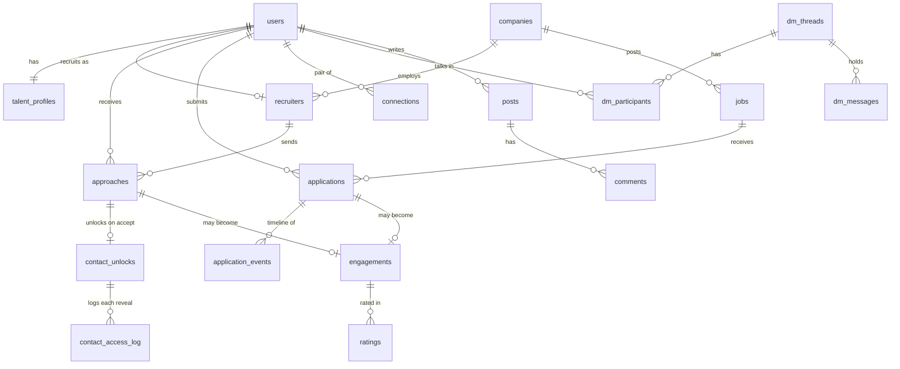
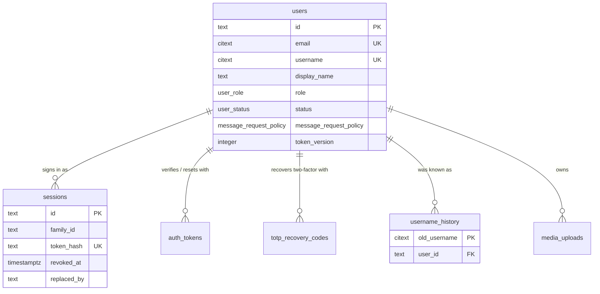
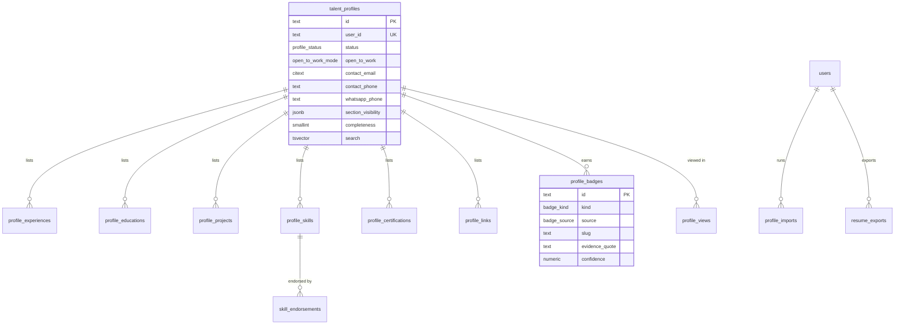
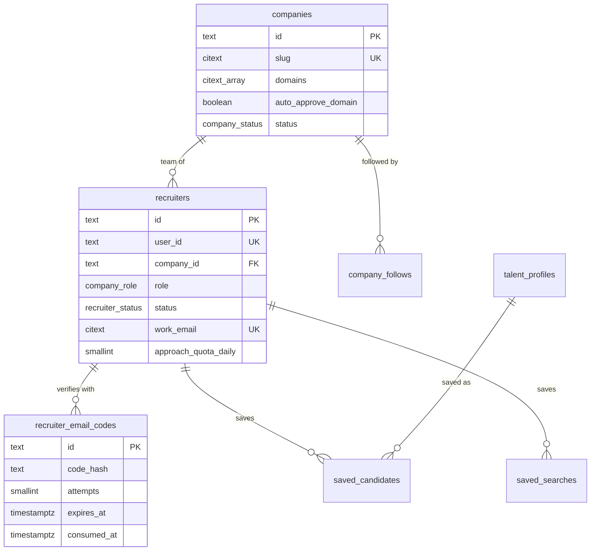
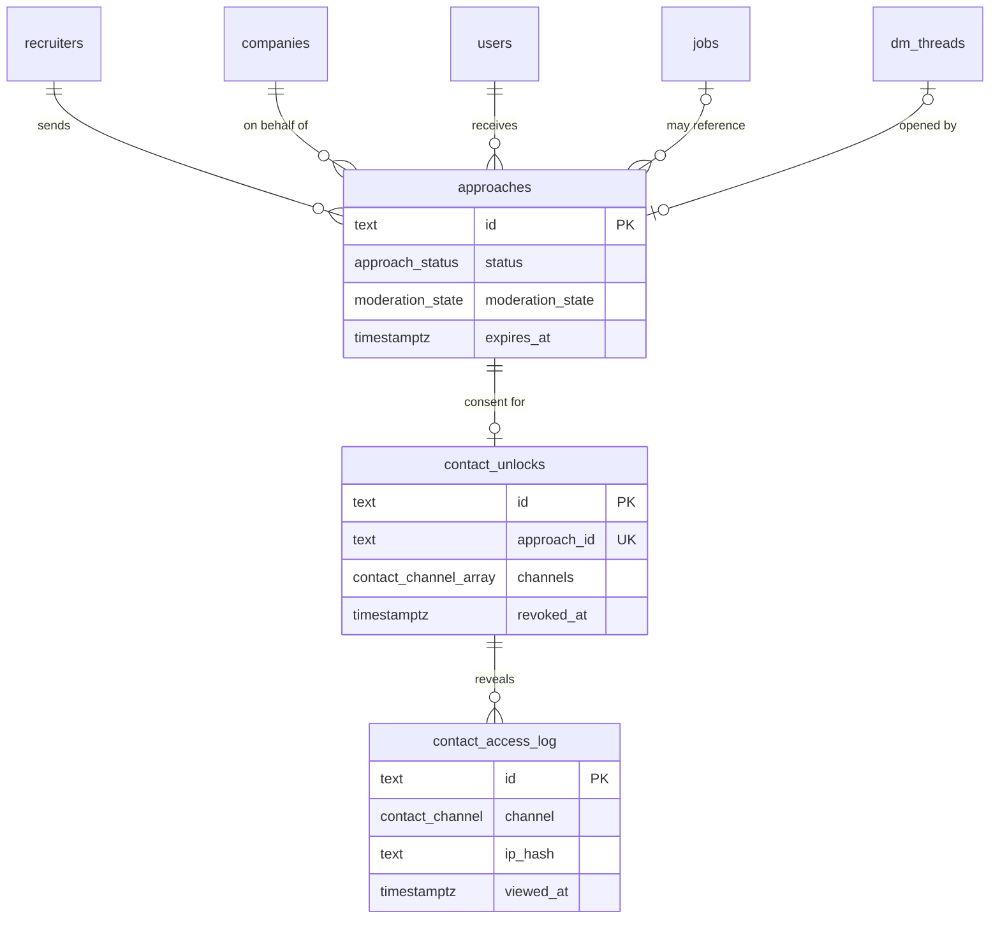
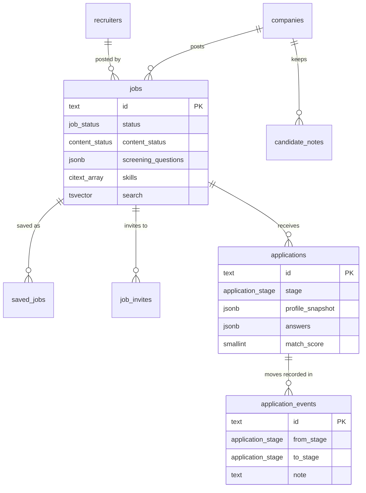
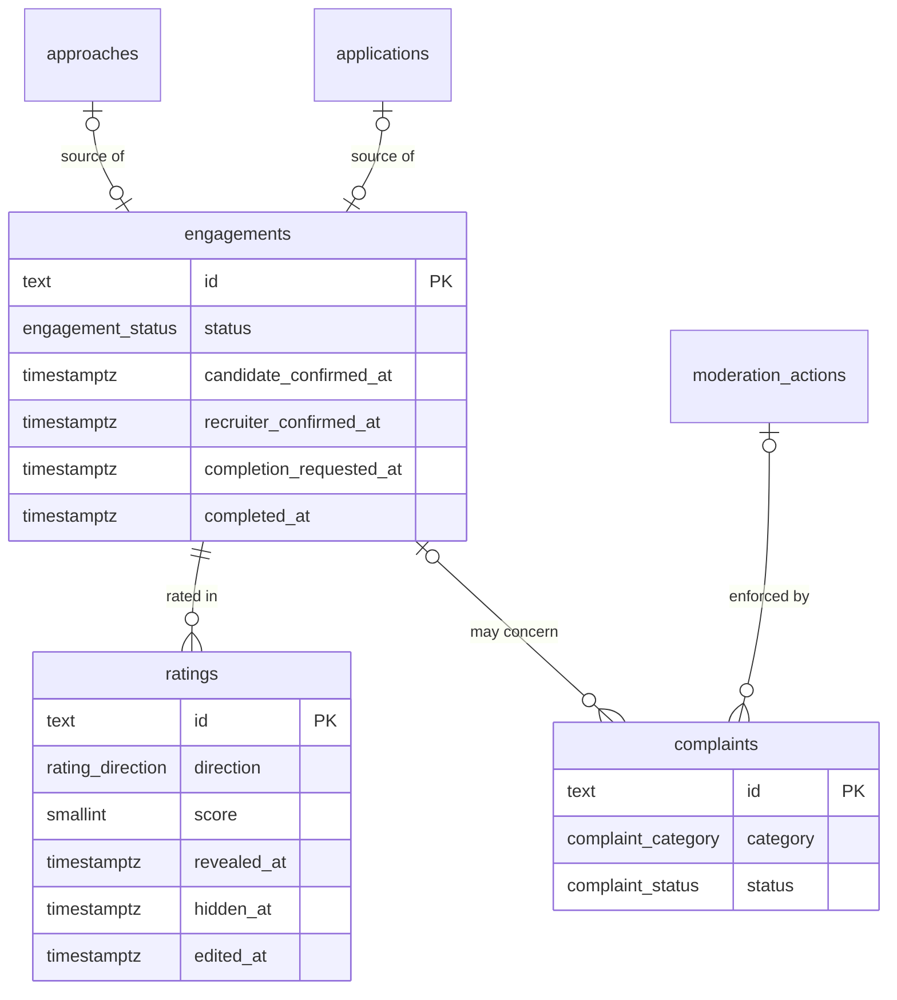

# Data model

The whole schema is one forward-only migration,
[`db/migrations/0001_init.sql`](../../db/migrations/0001_init.sql), applied by
[`db/migrate.ts`](../../db/migrate.ts). The Kysely types the API compiles against are
generated from it into [`apps/api/src/db/types.ts`](../../apps/api/src/db/types.ts)
(`pnpm --filter @open-talent/api db:types`). There are 60 application tables plus the
runner's own `schema_migrations`.

## Conventions

| Convention | Why |
| --- | --- |
| Primary keys are ULIDs stored as `text` | Sortable by creation time, generated in the API ([`core/ids.ts`](../../apps/api/src/core/ids.ts)), safe to expose. Composite natural keys where a row is a relationship (`follows`, `blocks`, `post_reactions`, `dm_participants`, `saved_candidates`) |
| Every timestamp is `timestamptz(3)`, the API runs with `TZ=UTC` | Millisecond precision is exactly what a JS `Date` holds, so a keyset cursor built from a `Date` equals the stored value and pages never repeat or skip rows ([ADR 0002](adr/0002-relational-schema-timestamptz3-ulids.md)) |
| Months are `date` columns holding the first of the month | `start_month`, `end_month`, `issued_month`, `expires_month`: sortable and checkable (`end_month >= start_month`); `YYYY-MM` on the wire ([`domain/months.ts`](../../apps/api/src/domain/months.ts)) |
| `citext` for emails, usernames, slugs, domains and skill names | Case-insensitive uniqueness and matching without `lower()` everywhere |
| Denormalised counters on the parent row | Lists show counts without `COUNT(*)`; maintained in the same transaction and reconciled every 6 hours (see [Counters](#counters)) |
| One `content_status` enum for user-generated items | Posts, comments, DM messages and jobs (`jobs.content_status`) share one moderation lifecycle; profiles, companies and approaches keep their own and the moderation adapters map them |
| Private contact details live in exactly three columns | `talent_profiles.contact_email`, `contact_phone`, `whatsapp_phone`, revealed per channel only through `contact_unlocks` and logged in `contact_access_log` ([privacy-and-contact-consent.md](privacy-and-contact-consent.md)) |
| Phone numbers are E.164, checked in SQL | `CHECK (... ~ '^\+[1-9][0-9]{6,14}$')` on profile, WhatsApp and recruiter phones |
| Pair keys for symmetric relationships | `connections.pair_key` and `dm_threads.direct_key` are `"<lowerId>:<higherId>"`, so A to B and B to A are the same row (`pairKey()` in [`domain/can-message.ts`](../../apps/api/src/domain/can-message.ts)) |
| Lists page with keyset cursors, never `OFFSET` | Each list has a matching index; see [ADR 0004](adr/0004-keyset-pagination.md) |
| Foreign keys cascade from users, profiles and companies | The application never hard-deletes users (account deletion anonymises the row); cascades matter for manual operations and keep child rows consistent |
| No tenant column anywhere | One deployment is one network ([ADR 0001](adr/0001-single-network-per-deployment.md)) |

Extensions: `citext` and `pg_trgm`.

## Enums

| Enum | Values |
| --- | --- |
| `user_role` | `USER`, `MODERATOR`, `RECRUITER_OPS`, `ADMIN` |
| `user_status` | `PENDING_VERIFICATION`, `ACTIVE`, `SUSPENDED`, `BANNED`, `DEACTIVATED` |
| `message_request_policy` | `ANYONE`, `RECRUITERS` (default), `NOBODY` |
| `auth_token_type` | `VERIFY_EMAIL`, `RESET_PASSWORD` |
| `upload_purpose` | `POST`, `COMMENT`, `DM`, `AVATAR`, `COVER`, `COMPANY_LOGO`, `COMPANY_COVER`, `PROJECT_COVER`, `RESUME`, `IMPORT`, `EVIDENCE` |
| `upload_kind` | `IMAGE`, `VIDEO`, `AUDIO`, `PDF`, `DOCUMENT`, `OTHER` |
| `upload_status` | `PENDING`, `COMPLETE`, `READY`, `REJECTED`, `DELETED` |
| `content_status` | `PUBLISHED`, `PENDING_REVIEW`, `HIDDEN` (taken down pending review, restorable), `REMOVED` (moderator removal, final unless an appeal wins), `DELETED` (the author deleted it) |
| `moderation_state` | `UNCHECKED`, `CLEAN`, `REVIEW`, `FLAGGED` |
| `profile_status` | `DRAFT`, `PUBLISHED`, `UNLISTED`, `SUSPENDED` |
| `open_to_work_mode` | `OFF`, `RECRUITERS` (only verified recruiters see and filter on it), `PUBLIC` |
| `employment_type` | `FULL_TIME`, `PART_TIME`, `CONTRACT`, `FREELANCE`, `INTERNSHIP`, `TEMPORARY` |
| `workplace_type` | `ONSITE`, `HYBRID`, `REMOTE` |
| `seniority` | `INTERN`, `ENTRY`, `MID`, `SENIOR`, `LEAD`, `DIRECTOR`, `EXECUTIVE` |
| `pay_period` | `HOUR`, `DAY`, `MONTH`, `YEAR`, `PROJECT` |
| `link_kind` | `WEBSITE`, `GITHUB`, `LINKEDIN`, `X`, `YOUTUBE`, `MEDIUM`, `KAGGLE`, `HUGGINGFACE`, `BEHANCE`, `DRIBBBLE`, `OTHER` |
| `badge_kind` | `SENIORITY`, `ROLE_FIT`, `SKILL_PERCENTILE`, `DOMAIN`, `ACHIEVEMENT`, `VERIFICATION` |
| `badge_source` | `AI`, `SYSTEM`, `ADMIN` |
| `import_source` | `TEXT`, `FILE`, `AUDIO` |
| `import_status` | `QUEUED`, `EXTRACTING`, `GENERATING`, `SCORING`, `READY`, `APPLIED`, `FAILED` |
| `contact_channel` | `EMAIL`, `PHONE`, `WHATSAPP` |
| `company_status` | `UNVERIFIED`, `VERIFIED`, `SUSPENDED` |
| `company_role` | `OWNER`, `ADMIN`, `RECRUITER` |
| `recruiter_status` | `EMAIL_PENDING`, `PENDING_REVIEW`, `ACTIVE`, `REJECTED`, `SUSPENDED` |
| `approach_status` | `PENDING`, `ACCEPTED`, `DECLINED`, `WITHDRAWN`, `EXPIRED`, `BLOCKED` |
| `job_status` | `DRAFT`, `OPEN`, `CLOSED`, `FILLED` |
| `invite_status` | `SENT`, `VIEWED`, `INTERESTED`, `DECLINED` |
| `application_stage` | `APPLIED`, `SCREENING`, `INTERVIEW`, `OFFER`, `HIRED`, `REJECTED`, `WITHDRAWN` |
| `application_source` | `DIRECT`, `INVITE`, `APPROACH` |
| `connection_status` | `PENDING`, `ACCEPTED`, `IGNORED` |
| `dm_participant_state` | `ACTIVE`, `REQUESTED`, `DECLINED` |
| `thread_context` | `CONNECTION`, `APPROACH`, `APPLICATION`, `REQUEST`, `SUPPORT` |
| `post_kind` | `POST`, `HIRING`, `OPEN_TO_WORK`, `JOB`, `MILESTONE` |
| `post_visibility` | `PUBLIC`, `CONNECTIONS` |
| `reaction_type` | `LIKE`, `CELEBRATE`, `SUPPORT`, `INSIGHTFUL`, `LOVE`, `FUNNY` |
| `engagement_status` | `PROPOSED`, `ACTIVE`, `COMPLETED`, `CANCELLED`, `DISPUTED` |
| `rating_direction` | `RECRUITER_TO_CANDIDATE`, `CANDIDATE_TO_RECRUITER` |
| `complaint_category` | `HARASSMENT`, `NON_PAYMENT`, `NO_SHOW`, `MISREPRESENTATION`, `SPAM`, `SCAM`, `DISCRIMINATION`, `OTHER` |
| `complaint_status` | `OPEN`, `UNDER_REVIEW`, `ACTION_TAKEN`, `DISMISSED` |
| `notification_type` | 28 values: `CONNECTION_REQUEST`, `CONNECTION_ACCEPTED`, `FOLLOW`, `COMPANY_FOLLOW`, `POST_COMMENT`, `COMMENT_REPLY`, `POST_REACTION`, `COMMENT_REACTION`, `MENTION`, `REPOST`, `ENDORSEMENT`, `DM_REQUEST`, `APPROACH_RECEIVED`, `APPROACH_ACCEPTED`, `APPROACH_DECLINED`, `CONTACT_REVOKED`, `JOB_INVITE`, `APPLICATION_RECEIVED`, `APPLICATION_STAGE`, `ENGAGEMENT_PROPOSED`, `ENGAGEMENT_UPDATED`, `RATING_RECEIVED`, `RECRUITER_APPROVED`, `RECRUITER_REJECTED`, `IMPORT_READY`, `COMPLAINT_UPDATED`, `MODERATION_ACTION`, `APPEAL_DECIDED` |
| `moderation_target` | `POST`, `COMMENT`, `DM_MESSAGE`, `USER`, `PROFILE`, `COMPANY`, `JOB`, `APPROACH` |
| `report_reason` | `SPAM`, `HARASSMENT`, `HATE`, `VIOLENCE`, `SEXUAL`, `SELF_HARM`, `MISINFORMATION`, `IMPERSONATION`, `SCAM`, `FAKE_PROFILE`, `OTHER` |
| `case_source` | `AI`, `REPORT`, `PREMODERATION` |
| `case_status` | `OPEN`, `RESOLVED` |
| `moderation_action_type` | `APPROVE`, `HIDE`, `REMOVE`, `RESTORE`, `WARN`, `SUSPEND`, `BAN`, `UNBAN`, `DISMISS` |
| `appeal_status` | `PENDING`, `UPHELD`, `OVERTURNED` |

The enums are mirrored as TypeScript unions in
[`packages/types/src/index.ts`](../../packages/types/src/index.ts) and
[`packages/types/src/talent.ts`](../../packages/types/src/talent.ts).

## Overview

The core entities and how they connect (key relationships only; the per-domain sections
below list every table):

## Tables by domain

Each diagram shows key columns only; the migration is the reference for the rest.

### Identity

| Table | Holds | Notes |
| --- | --- | --- |
| `users` | The account: email, username, display name, password hash, role, status, TOTP ciphertext and last used step, suspension end, `token_version`, avatar and cover uploads, `message_request_policy`, `email_digest`, counters (`connection_count`, `follower_count`, `following_count`, `post_count`), `last_seen_at` | `username` is checked in SQL against `^[a-zA-Z0-9][a-zA-Z0-9-]{1,38}[a-zA-Z0-9]$`; `display_name` 1 to 80 characters, cleaned at write time so it never holds an email or phone ([`domain/display-name.ts`](../../apps/api/src/domain/display-name.ts)). Trigram index on `display_name || ' ' || username` |
| `sessions` | One row per refresh token: SHA-256 hash, `family_id` shared by every rotation of one sign-in, user agent, IP, expiry, `revoked_at`, `replaced_by` | Partial index on live sessions per user |
| `auth_tokens` | Email verification and password reset tokens, SHA-256 hashed, single use (`used_at`) | |
| `totp_recovery_codes` | HMACs of the ten recovery codes, `used_at` | PK `(user_id, code_hash)` |
| `username_history` | Every handle a user gave up | PK `old_username`, so an old handle stays reserved and `/in/<old>` answers `301 PROFILE_MOVED` |
| `media_uploads` | Every upload: owner, purpose, kind, declared and verified size, storage and thumbnail keys, dimensions, duration, status, moderation state | Partial index on `PENDING` uploads for the expiry job. See [media.md](media.md) |

### Network graph

| Table | Holds | Notes |
| --- | --- | --- |
| `connections` | One row per pair: requester, addressee, `status` (`PENDING`, `ACCEPTED`, `IGNORED`), optional note (300), `responded_at` | `pair_key` UNIQUE makes simultaneous requests one row; `CHECK (requester_id <> addressee_id)`; indexes per requester and per addressee for invitation lists |
| `follows` | Follower and followee | PK `(follower_id, followee_id)`, no self-follow |
| `blocks` | Blocker and blocked | One-directional in storage, symmetric in effect: every visibility query checks both directions ([`repositories/visibility.ts`](../../apps/api/src/repositories/visibility.ts)) |

### Talent profile

| Table | Holds | Notes |
| --- | --- | --- |
| `talent_profiles` | Exactly one per account (created `DRAFT` with the account): headline (160), about (4000), current title and company, location, country code, timezone, years of experience, languages, open-to-work mode with roles, employment and workplace types and `available_from`, a rate range with currency and period, the three private contact columns, `section_visibility`, `completeness`, `rating_avg` and `rating_count`, `view_count`, `approach_count`, `suspended_reason`, `published_at`, `search_text` and `skill_names` | `section_visibility` is `{ "experience": "PUBLIC" \| "CONNECTIONS" \| "RECRUITERS", ... }`, read by `readAudience` in [`domain/profile.ts`](../../apps/api/src/domain/profile.ts) (a missing key means `PUBLIC`). `CHECK (rate_max >= rate_min)`. `search_text` and `skill_names` are rebuilt from the sections on every section save (`refreshDerived`) |
| `profile_experiences` | Title, company name and optional `company_id`, employment and workplace type, location, `start_month`, `end_month` (NULL = current), description, skills, position | `CHECK (end_month IS NULL OR end_month >= start_month)` |
| `profile_educations` | Institution, degree, field, start and end year (1900 to 2100), grade, description, position | |
| `profile_projects` | Name, description, `url`, `repo_url`, cover upload, skills, months, position | URLs pass `safeUrl()` before they are stored |
| `profile_skills` | Name (citext, 60), category, years, `endorsement_count`, position | `UNIQUE (profile_id, name)` |
| `skill_endorsements` | Skill and endorser | PK `(skill_id, endorser_id)`; only connections can endorse (enforced in the service) |
| `profile_certifications` | Name, issuer, issued and expiry months, credential id and URL, position | |
| `profile_links` | Kind, URL (500), label, `featured`, position | |
| `profile_badges` | Kind, source, slug, label, rationale, `evidence_quote`, `confidence`, `percentile`, `is_visible`, `granted_by` | `UNIQUE (profile_id, slug)`; slug `^[a-z0-9-]{1,80}$`. AI badges carry a verbatim quote and confidence ([ai.md](ai.md)); `is_visible` is the owner's switch |
| `profile_imports` | One AI import: source, status, upload id, `input_text` (30000), `extracted` (the proposal and prompt version), `proposed_badges`, `missing_info`, error, provider, model, token counts, `applied_at`, `purged_at` | Partial index `profile_imports_purge_idx` on rows not yet purged; housekeeping nulls the input after `import.retentionHours` ([`services/housekeeping.service.ts`](../../apps/api/src/services/housekeeping.service.ts)) |
| `profile_views` | One row per viewer per profile per day: `viewer_key` (user id, or a salted hash of the IP), `viewer_id`, `viewer_company` (when the viewer is an active recruiter) | PK `(profile_id, viewer_key, day)`, so refreshing does not inflate counts |
| `resume_exports` | Who exported a resume and in which format (`PDF`, `DOCX`) | Analytics only |

Section tables are ordered by `position` (the list order the owner saved) with an index on
`(profile_id, position)`.

### Companies and recruiters

| Table | Holds | Notes |
| --- | --- | --- |
| `companies` | Slug, name, tagline, about, website, industry, size band, headquarters, founded year, `domains`, `auto_approve_domain`, logo and cover, status with `verified_at`/`verified_by` and `suspended_reason`, counters (`follower_count`, `member_count`, `open_job_count`), `rating_avg`, `rating_count`, `created_by` | Slug `^[a-z0-9][a-z0-9-]{1,58}[a-z0-9]$`; `size_band` from a fixed list; GIN index on `domains`, trigram index on `name`, generated `search` |
| `company_follows` | User and company | PK `(user_id, company_id)` |
| `recruiters` | The team membership and the verification record in one row: company, company role, status, title, `work_email` and `work_email_verified_at`, phone fields (unused unless a deployment adds a provider), application and review notes, reviewer, `approach_quota_daily` (NULL = the platform default), `suspended_reason`, `approaches_sent` | `user_id` UNIQUE (one company at a time), `work_email` UNIQUE; partial index `recruiters_review_idx` on `PENDING_REVIEW` rows feeds the approval queue |
| `recruiter_email_codes` | HMAC of a six-digit code, the email it was sent to, `attempts`, expiry, `consumed_at` | Attempts are counted with one `UPDATE ... RETURNING` so parallel guesses cannot exceed the cap. See [recruiter-verification.md](../guides/recruiter-verification.md) |
| `saved_candidates` | A recruiter's shortlist with a note | PK `(recruiter_id, profile_id)` |
| `saved_searches` | A named directory query (`jsonb`) | |

### Direct messages

| Table | Holds | Notes |
| --- | --- | --- |
| `dm_threads` | One 1:1 thread: `direct_key`, `context` (why it exists), `context_id` (the approach or application that opened it), creator, `last_message_at` | `direct_key` UNIQUE makes find-or-create race-free |
| `dm_participants` | Per participant: `state` (`ACTIVE`, or `REQUESTED` for an unaccepted message request, or `DECLINED`), `last_read_at`, `muted_until`, `archived_at`, `joined_at` | PK `(thread_id, user_id)`; index on `(user_id, state)` for the inbox and requests folders |
| `dm_messages` | Body (8000), reply-to, status, moderation state, `edited_at` | Index `(thread_id, created_at DESC, id DESC)` for keyset history |
| `dm_message_media` | Attached uploads with position | |
| `dm_reactions` | Emoji reactions | PK `(message_id, user_id, emoji)` |

### Approaches and contact consent

| Table | Holds | Notes |
| --- | --- | --- |
| `approaches` | Recruiter, company, candidate, optional job, role title (2 to 120), message (30 to 3000), employment type, salary range, status, moderation state, decline reason, thread, `viewed_at`, `responded_at`, `expires_at` | `approaches_pending_pair_idx`: UNIQUE `(recruiter_id, candidate_id) WHERE status = 'PENDING'`, one pending approach per pair, used as the `ON CONFLICT` target of a send. `approaches_expiry_idx` on pending rows feeds housekeeping |
| `contact_unlocks` | The candidate's consent: approach (UNIQUE), recruiter, candidate, `channels` (at least one, `CHECK (cardinality(channels) > 0)`), `revoked_at`, `revoked_reason` | Partial index on live unlocks per candidate |
| `contact_access_log` | Every reveal: unlock, recruiter, candidate, channel, `ip_hash`, user agent (300), `viewed_at` | The candidate's "who has seen your details" list ([`services/approach.service.ts`](../../apps/api/src/services/approach.service.ts)) |

### Jobs and applications

| Table | Holds | Notes |
| --- | --- | --- |
| `jobs` | Company, poster, title (3 to 120), description (30 to 12000), employment and workplace type, seniority, location, country, salary range, `skills`, `openings` (1 to 500), `screening_questions`, `status`, `content_status`, moderation state, `application_count`, `view_count`, `opened_at`, `closes_at`, `closed_at` | `screening_questions` is `[{ id, prompt, kind: "TEXT" \| "YES_NO", required }]` ([`domain/screening.ts`](../../apps/api/src/domain/screening.ts)). `jobs_open_idx` on `(opened_at DESC, id DESC) WHERE status = 'OPEN' AND content_status = 'PUBLISHED'` serves job search by recency |
| `saved_jobs` | A candidate's saved jobs | PK `(user_id, job_id)` |
| `job_invites` | A recruiter's invitation to apply, with message and status | `UNIQUE (job_id, candidate_id)` |
| `applications` | Job, company, candidate, `source`, `profile_snapshot`, resume upload, cover note (3000), `answers` (`[{ questionId, answer }]`), `stage`, `rejection_reason`, `match_score` (0 to 100) and `match_detail`, thread, `stage_changed_at` | `UNIQUE (job_id, candidate_id)`; `applications_pipeline_idx` on `(job_id, stage, stage_changed_at DESC)` serves the board. See [hiring-pipeline.md](hiring-pipeline.md) |
| `application_events` | Every stage change: actor, `from_stage`, `to_stage`, team-only `note`, time | The candidate's timeline shows stage and time only |
| `candidate_notes` | A hiring team's private notes about a candidate, optionally on one application, with an optional 1 to 5 rating | Index `(company_id, candidate_id, created_at DESC)` |

### Feed

| Table | Holds | Notes |
| --- | --- | --- |
| `posts` | Author, optional `company_id` (posted as the company page), `kind`, `visibility`, body (6000), optional `job_id` and `shared_post_id`, status, moderation state, `reaction_count` and `reaction_counts` (`{ "LIKE": 3 }`), `comment_count`, `repost_count`, `edited_at` | `posts_feed_idx` on `(created_at DESC, id DESC) WHERE status = 'PUBLISHED'`; per-author and per-company keyset indexes; generated `search` |
| `post_media` | Attached uploads with position | Index on `upload_id` for "is it attached?" |
| `post_mentions` | Mentioned users | |
| `post_reactions` | One reaction per person per post | PK `(post_id, user_id)` |
| `post_bookmarks` | Saved posts | |
| `post_hides` | "Not interested" on your own feed (not moderation) | |
| `comments` | Post, author, optional `parent_id` (one level of replies), body (4000), one upload, status, moderation state, `reply_count`, reaction counts | Partial indexes for top-level comments and for replies |
| `comment_mentions`, `comment_reactions` | As for posts | |

### Trust: engagements, ratings, complaints

| Table | Holds | Notes |
| --- | --- | --- |
| `engagements` | Work that came out of an accepted approach or a hire: `approach_id` or `application_id` (each UNIQUE, at least one set), company, recruiter user, candidate, title, status, proposer, both confirmation times, completion request (who and when), `completed_at`, `disputed_at` | `engagements_autoconfirm_idx` on `ACTIVE` rows with a completion request feeds housekeeping (auto-complete after `trust.autoConfirmDays`) |
| `ratings` | Engagement, direction, rater, ratee, score (1 to 5), `sub_scores` (`{ communication, quality, reliability, professionalism }`, each 1 to 5), comment (1000), `revealed_at`, `hidden_at` and `hidden_reason`, `edited_at` | `UNIQUE (engagement_id, direction)`: one per side. Hidden until both are in or the window closes; editable once before reveal, never after ([`domain/trust.ts`](../../apps/api/src/domain/trust.ts)). `ratings_ratee_idx` covers revealed, visible ratings |
| `complaints` | Complainant, the person complained about, optional engagement, approach or application, category, description (20 to 3000), `evidence_upload_ids`, status, admin note, `action_id` (the enforcement taken), resolver | `CHECK (complainant_id <> against_user_id)`. `complaints_open_engagement_idx`: UNIQUE `(complainant_id, engagement_id) WHERE engagement_id IS NOT NULL AND status IN ('OPEN', 'UNDER_REVIEW')`, one open complaint per engagement per person |

### Notifications

| Table | Holds | Notes |
| --- | --- | --- |
| `notifications` | Recipient, actor, type, `entity_type` and `entity_id`, snippet (200), `data` (for example `audience`, `jobId`, `threadId`), `read_at`, `emailed_at` | `notifications_inbox_idx` for keyset lists; partial `notifications_unread_idx` for the badge |

### Moderation

| Table | Holds | Notes |
| --- | --- | --- |
| `moderation_cases` | Target type and id, author, source (`AI`, `REPORT`, `PREMODERATION`), status, priority, AI provider, scores and categories, `report_count`, `snapshot` (the content as it was), assignee, resolution | `moderation_cases_open_target_idx`: UNIQUE `(target_type, target_id) WHERE status = 'OPEN'`, one open case per target, so new reports and re-scans attach to it. `moderation_cases_queue_idx` orders the queue by priority |
| `reports` | Reporter, target, reason, details, case | `UNIQUE (reporter_id, target_type, target_id)`: one report per person per target |
| `moderation_actions` | The append-only action log: case, actor (NULL = the automated pipeline), action, target, reason, data | Indexed per target (moderation history) and per case |
| `appeals` | Case, appellant, statement (10 to 2000), status, decider and note | `UNIQUE (case_id, appellant_id)` |

See [moderation.md](moderation.md).

### Platform

| Table | Holds | Notes |
| --- | --- | --- |
| `settings` | One JSON document per key; the platform settings live under `platform` | Merged over code defaults ([`services/settings.service.ts`](../../apps/api/src/services/settings.service.ts)) |
| `audit_log` | Actor, action (for example `approach.accept`, `recruiter.email_verified`, `application.move`, `complaint.action_taken`), entity, IP, data | Indexed by time, by entity and by actor; read by the `/admin` audit area |

## Important indexes

### Uniqueness that carries a rule

| Constraint | Rule it enforces |
| --- | --- |
| `connections.pair_key` UNIQUE | One connection row per pair, whoever asked first |
| `dm_threads.direct_key` UNIQUE | One 1:1 thread per pair |
| `approaches_pending_pair_idx` (partial) | One pending approach per recruiter and candidate |
| `contact_unlocks.approach_id` UNIQUE | One consent record per approach |
| `applications (job_id, candidate_id)` UNIQUE | One application per job per person |
| `job_invites (job_id, candidate_id)` UNIQUE | One invite per job per person |
| `engagements.approach_id`, `engagements.application_id` UNIQUE | One engagement per source |
| `ratings (engagement_id, direction)` UNIQUE | One rating per side |
| `complaints_open_engagement_idx` (partial) | One open complaint per engagement per complainant |
| `recruiters.user_id`, `recruiters.work_email` UNIQUE | One company at a time; a work email proves one recruiter |
| `profile_skills (profile_id, name)`, `profile_badges (profile_id, slug)` UNIQUE | No duplicate skills or badges |
| `username_history.old_username` PK | An old handle is never reissued to someone else |
| `moderation_cases_open_target_idx` (partial) | One open case per target |
| `reports (reporter_id, target_type, target_id)` UNIQUE | One report per person per target |
| `appeals (case_id, appellant_id)` UNIQUE | One appeal per case |

### Keyset lists

| Index | List |
| --- | --- |
| `talent_profiles_directory_idx` on `(published_at DESC, id DESC) WHERE status = 'PUBLISHED'` | The talent directory by recency |
| `jobs_open_idx` (partial) | Open jobs by recency |
| `jobs_company_idx` on `(company_id, status, created_at DESC)` | A company's jobs |
| `applications_pipeline_idx` | Pipeline columns by `stage_changed_at` |
| `applications_candidate_idx`, `approaches_candidate_idx`, `approaches_recruiter_idx` | My applications, approaches received, approaches sent |
| `posts_feed_idx`, `posts_author_idx`, `posts_company_idx` | Feeds |
| `dm_messages_thread_idx` | Thread history |
| `notifications_inbox_idx` | The inbox |
| `saved_jobs_list_idx`, `saved_candidates_list_idx`, `post_bookmarks_feed_idx` | Saved lists |
| `audit_log_recent_idx` | The audit trail |

### Search

| Column or index | Used for |
| --- | --- |
| `talent_profiles.search` (generated `tsvector`: headline and current title weight A, location and current company B, about and `search_text` C) with a GIN index | Directory text search and relevance ranking |
| `talent_profiles_skills_idx` (GIN on `skill_names`) | Exact skill filters (`skill_names @> ARRAY[...]`) |
| `talent_profiles_location_trgm_idx`, `users_name_trgm_idx` | Escaped `ILIKE` on location and on name or username |
| `companies.search` (name A, tagline and industry B, about C), `companies_name_trgm_idx`, `companies_domains_idx` | Company search; domain lookups |
| `jobs.search` (title A, location B, description C), `jobs_skills_idx`, `jobs_title_trgm_idx` | Job search |
| `posts.search` | Post search |

All `tsvector` columns use the `simple` configuration (no stemming, language neutral).
Predicates are written to match these indexes exactly
([`repositories/text-search.ts`](../../apps/api/src/repositories/text-search.ts),
[`domain/search-text.ts`](../../apps/api/src/domain/search-text.ts)).

## Counters

Every counter moves in the same transaction as the row it counts. `reconcileCounters()`
([`services/counters.service.ts`](../../apps/api/src/services/counters.service.ts)) runs as
`maintenance.reconcile-counters` every 6 hours, recomputes each one from the rows and
updates only rows that drifted.

| Counter | Counts |
| --- | --- |
| `users.post_count` | `PUBLISHED` posts by the user |
| `users.connection_count` | `ACCEPTED` connections |
| `users.follower_count`, `users.following_count` | `follows` rows |
| `posts.comment_count` | `PUBLISHED` comments on the post, replies included |
| `posts.repost_count` | `PUBLISHED` posts sharing it |
| `comments.reply_count` | `PUBLISHED` replies |
| `reaction_count`, `reaction_counts` (posts, comments) | Reaction rows |
| `companies.member_count` | `ACTIVE` recruiters |
| `companies.follower_count` | `company_follows` rows |
| `companies.open_job_count` | `OPEN`, `PUBLISHED` jobs |
| `jobs.application_count` | Applications that were not `WITHDRAWN` |
| `profile_skills.endorsement_count` | `skill_endorsements` rows |
| `talent_profiles.approach_count` | Approaches received |

Not counters in this sense: `talent_profiles.rating_avg`/`rating_count` and
`companies.rating_avg`/`rating_count` are recomputed from revealed, unhidden ratings
whenever a rating is revealed or hidden ([`services/trust.service.ts`](../../apps/api/src/services/trust.service.ts));
`recruiters.approaches_sent` is a running total, while the daily quota is always counted
from the `approaches` rows themselves; `completeness` is recomputed from the sections on
every save.

## Why `timestamptz(3)`

PostgreSQL stores microseconds by default; JavaScript dates hold milliseconds. A cursor
carrying `2026-01-02T03:04:05.678Z` compared with a stored `...05.678912` treats the row as
newer than the cursor, so the last row of a page reappears on the next page (or, in the
other direction, is skipped). Declaring every column `timestamptz(3)` makes the stored
value exactly representable as a `Date`, so the `Date`-based cursors in
[`core/cursor.ts`](../../apps/api/src/core/cursor.ts) are exact. The talent lists use
[`repositories/keyset.ts`](../../apps/api/src/repositories/keyset.ts), which reads the column
as text (`atKey()`) and would be exact at any precision. The API pins `TZ=UTC` and
registers a UTC parser for `timestamp without time zone` (never used by the schema) in
[`db/kysely.ts`](../../apps/api/src/db/kysely.ts).

## Migrations

- Files are `db/migrations/NNNN_name.sql`, applied in name order, each in its own
  transaction, recorded with a checksum in `schema_migrations`. Changing an applied file
  stops the runner; add a new migration instead.
- A Postgres advisory lock serialises concurrent runs: two deploys, or several API tasks
  booting with `MIGRATE_ON_BOOT=true`.
- `pnpm db:migrate --status` lists applied and pending files without changing anything.
- Locally the compose `migrate` one-shot runs before `api` and `worker`; on AWS
  `make aws-deploy` runs the migrate task before rolling out services, and `make aws-migrate`
  runs it alone. See [operations.md](../guides/operations.md).
