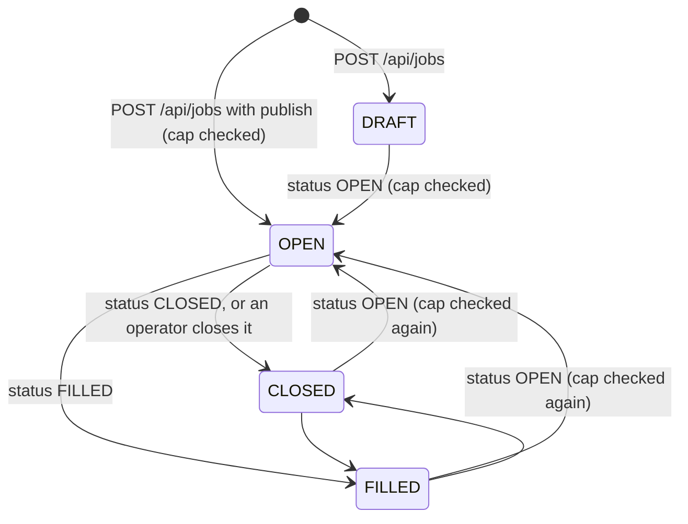
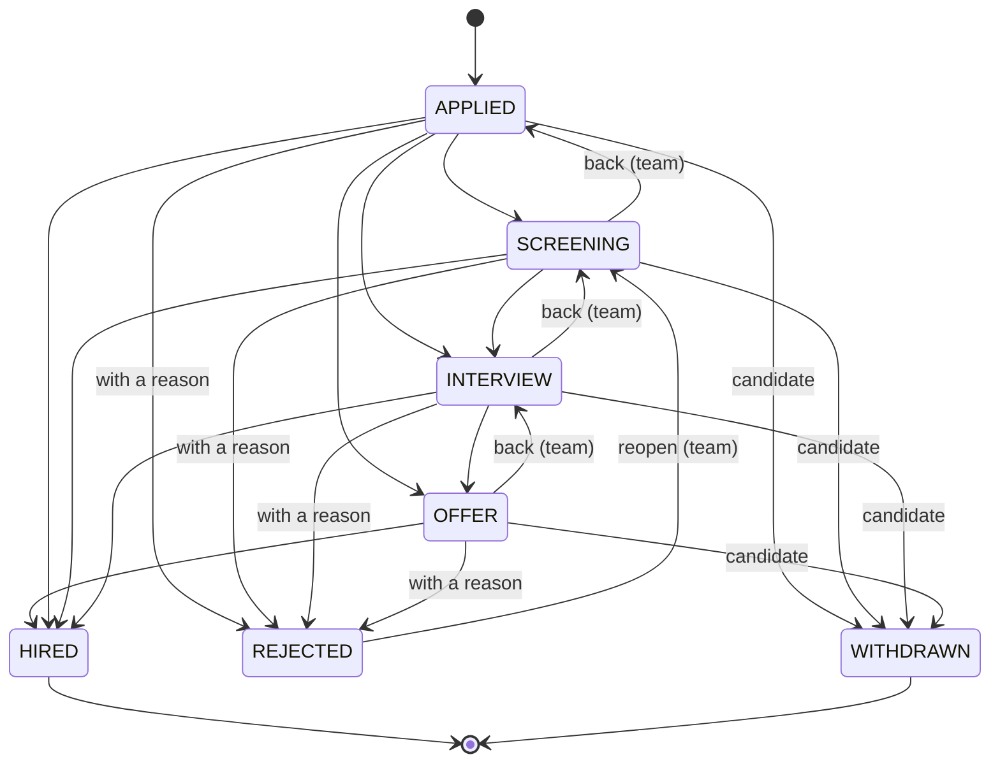
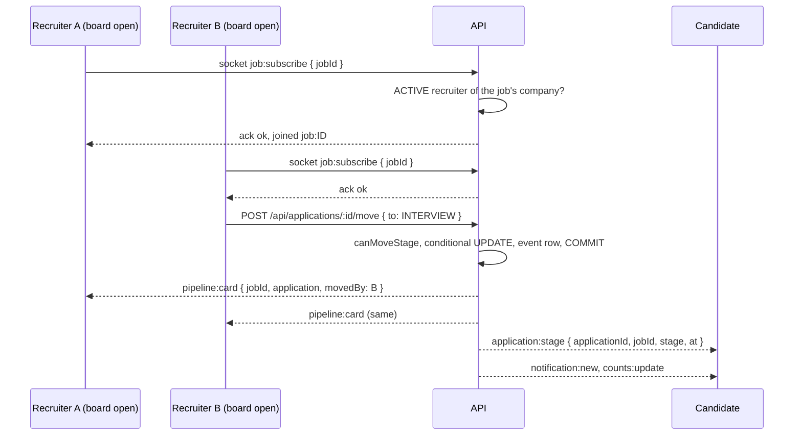
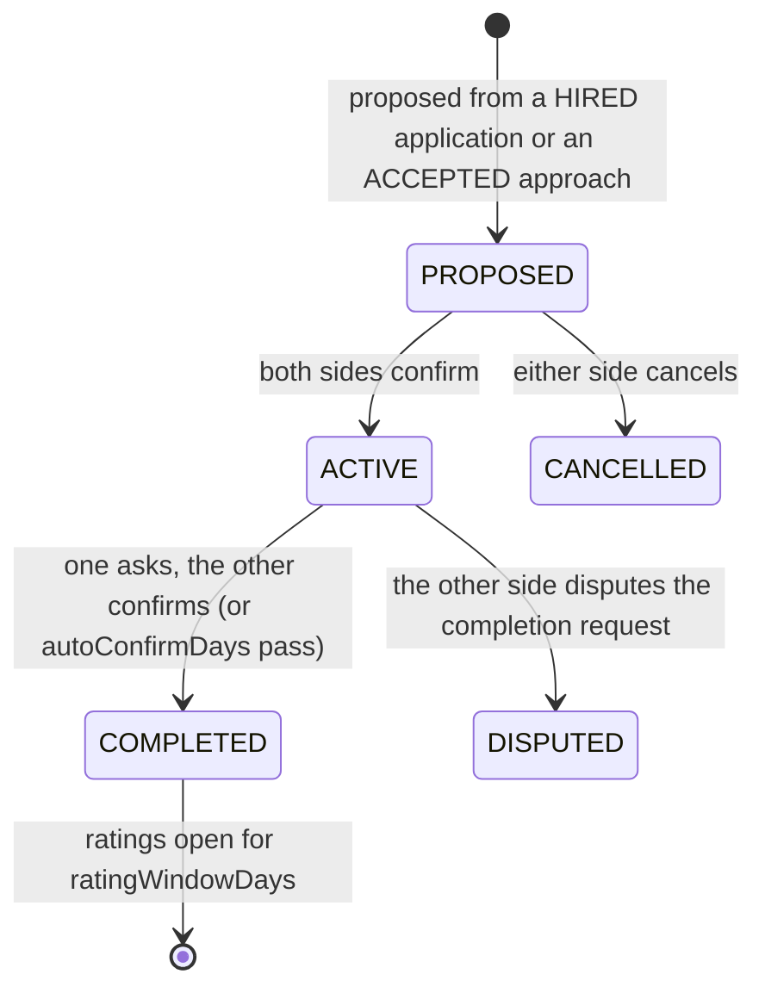

# Hiring pipeline

How a job goes from a draft to a hire: posting and the open-job cap, screening questions,
Easy Apply, the stage rules, the live kanban board, team notes, conversations about an
application, invitations, and how a hire turns into an engagement that both sides can
rate. Paths are relative to the repository root.

Related pages: [privacy-and-contact-consent.md](privacy-and-contact-consent.md) (approaches,
the other way a recruiter reaches someone), [realtime.md](realtime.md) (the `job:` room),
[moderation.md](moderation.md) (the `JOB` target), and
[ADR 0016](adr/0016-pipeline-transitions-as-pure-domain-function.md) (why the stage rules
are one pure function).

## 1. Who can do what

| Actor | Can | Check |
| --- | --- | --- |
| ACTIVE recruiter of the company (any team role) | Post, edit, open, close and fill the company's jobs; see their pipelines; move cards; write notes; invite people; message applicants | `requireRecruiter()` in [`apps/api/src/services/recruiter.service.ts`](../../apps/api/src/services/recruiter.service.ts), then every job and application query is filtered by `company_id = recruiter.company_id` |
| A candidate (any ACTIVE member) | Search and save jobs, apply, withdraw, see their own timeline, answer invitations, message the team about their application | Ownership: `candidate_id = actor.id` |
| Platform staff (`MODERATOR`, `ADMIN`) and `RECRUITER_OPS` | Read any job (including drafts and hidden ones); close a job from `/admin` (area `jobs`) | `readableJob()` in [`apps/api/src/services/job.service.ts`](../../apps/api/src/services/job.service.ts), `closeJob()` in [`apps/api/src/services/admin.service.ts`](../../apps/api/src/services/admin.service.ts) |

A recruiter whose status is not `ACTIVE`, or whose company is `SUSPENDED`, gets 403
`RECRUITER_REQUIRED` on every team endpoint. A job or application of another company is
404 (`JOB_NOT_FOUND`, `APPLICATION_NOT_FOUND`), never 403, so ids cannot be probed across
companies. Becoming a recruiter is described in
[recruiter-verification.md](../guides/recruiter-verification.md).

## 2. Jobs

### Lifecycle



`setStatus()` in [`apps/api/src/services/job.service.ts`](../../apps/api/src/services/job.service.ts)
accepts `OPEN`, `CLOSED` and `FILLED` (the controller's schema); a published job never goes
back to `DRAFT` (400 `JOB_STATUS_INVALID`). Every status change writes an audit row
(`job.open`, `job.closed`, `job.filled`) and refreshes `companies.open_job_count`.

Independently of `status`, `jobs.content_status` is the moderation state
(`PUBLISHED`, `HIDDEN`, `REMOVED`). A job is shown to the public only when it is not a
draft, its `content_status` is `PUBLISHED` and its company is not `SUSPENDED`; the company
team and staff can still open it. A job a moderator hid cannot be opened (403
`JOB_UNDER_REVIEW`) and a removed one cannot be edited (403 `JOB_REMOVED`). Opening a job,
and editing the title or description of an open one, enqueues a `moderation.scan` for
target `JOB`.

### The open-job cap

A company may have at most `settings.recruiter.maxOpenJobsPerCompany` (default 50) `OPEN`
jobs. `assertOpenCapacity()` runs **on every move to `OPEN`**: creating with `publish`, opening
a draft, and reopening a `CLOSED` or `FILLED` job. Checking only at creation would let a
company close and reopen its way past the cap. The company row is locked `FOR UPDATE` first,
so two concurrent publishes cannot both slip under it. Over the cap is 409
`JOB_CAP_REACHED` with `details.cap`.

### Fields and screening questions

A job has a title (3 to 120), a description (30 to 12000), employment and workplace types,
optional seniority, location, country, salary range (`min <= max`, currency, pay period),
up to 30 skills (de-duplicated case-insensitively), openings (1 to 500), an optional
`closesAt`, and up to **10 screening questions** (`MAX_QUESTIONS` in
[`apps/api/src/domain/screening.ts`](../../apps/api/src/domain/screening.ts)):

```json
[{ "id": "01J...", "prompt": "Are you able to work in the EU?", "kind": "YES_NO", "required": true },
 { "id": "01J...", "prompt": "Link a project you are proud of", "kind": "TEXT", "required": false }]
```

Prompts are 3 to 300 characters; ids are generated by the server when absent. The same
`readQuestions()` reads them on create, edit and apply, so a malformed stored value cannot
reach a candidate.

### Search and saved jobs

`GET /api/jobs` searches `OPEN`, `PUBLISHED` jobs of non-suspended companies by text
(tsvector, or escaped trigram `ILIKE`), location, workplace, employment, seniority, skills,
company and minimum salary, keyset paginated by recency or by relevance. `GET
/api/jobs/recommended` ranks open jobs by skill overlap with the viewer's profile (and their open-to-work roles), newest first on ties. Saving is
`PUT`/`DELETE /api/jobs/:id/save`; `GET /api/jobs/saved` lists them. Details are in
[rest-contract.md](../api/rest-contract.md).

## 3. Easy Apply

`POST /api/jobs/:id/apply` (`apply()` in
[`apps/api/src/services/application.service.ts`](../../apps/api/src/services/application.service.ts)),
rate limited to 50 per day per user:

```json
{ "coverNote": "...", "answers": [{ "questionId": "01J...", "answer": "YES" }], "resumeUploadId": "01J..." }
```

Steps, in one transaction:

1. **Resume.** If given, the upload is claimed by id with purpose `RESUME` (`claimSingle` in
   [`apps/api/src/services/media-attach.service.ts`](../../apps/api/src/services/media-attach.service.ts)):
   the caller must own it, it must have finished uploading, and it must be a PDF or a
   document ([`apps/api/src/domain/media-rules.ts`](../../apps/api/src/domain/media-rules.ts)).
   No URL is ever accepted. See [media.md](media.md).
2. **The job must be open**: `status = OPEN`, `content_status = PUBLISHED`, not past
   `closes_at` (409 `JOB_NOT_OPEN`).
3. **Not your own company**: an ACTIVE or pending recruiter of the job's company cannot
   apply (400 `OWN_COMPANY`).
4. **No block** with the job's poster (404 `JOB_NOT_FOUND`, the block is not revealed).
5. **Screening answers** are checked by `checkAnswers()` in
   [`apps/api/src/domain/screening.ts`](../../apps/api/src/domain/screening.ts). Each problem
   names the question:

   | Problem | Meaning |
   | --- | --- |
   | `MISSING` | A required question has no answer |
   | `NOT_YES_NO` | A `YES_NO` question was answered with something other than `YES` or `NO` |
   | `TOO_LONG` | An answer over 2000 characters |
   | `UNKNOWN_QUESTION` | An answer to a question the job does not have |

   Any problem is **422 `ANSWERS_INVALID`** with `details.problems`.
6. **Profile snapshot.** The headline, location, years of experience, up to 10 roles, up to
   5 educations and the skill list are copied into `applications.profile_snapshot`
   (`ProfileSnapshot` in [`packages/types/src/talent.ts`](../../packages/types/src/talent.ts)).
   The team reviews what the candidate submitted, even if the profile changes later. The
   snapshot carries no contact details.
7. **Match score.** `matchScore()` in [`apps/api/src/domain/pipeline.ts`](../../apps/api/src/domain/pipeline.ts):
   the share of the job's skills the candidate lists (case-insensitive), 0 to 100, with the
   matched and missing names stored in `match_detail`. A job with no skills scores `null`.
8. **Source.** `INVITE` when the candidate had a job invitation, `APPROACH` when an
   ACCEPTED approach named this job, `DIRECT` otherwise.
9. **One application per job per person.** The insert uses `ON CONFLICT (job_id,
   candidate_id) DO NOTHING` against the unique constraint, so a double click or two tabs
   produce one row and the second request gets 409 `ALREADY_APPLIED`.
10. An `application_events` row (`null -> APPLIED`), `jobs.application_count + 1`, an
    invitation (if any) marked `INTERESTED`, an `APPLICATION_RECEIVED` notification to the
    poster, and after commit a `pipeline:card` to the job's board.

The candidate's lists are `GET /api/applications/mine` (`?open=true` for open stages only)
and the web app's `/jobs/applications`.

## 4. Stages



The diagram shows the common moves; the rule is broader. The team may move a card to **any**
open stage, forward or back (a mistaken drag is easy to undo), or to `HIRED`. Every decision
comes from one pure function, `canMoveStage(from, to, by, { reason })` in
[`apps/api/src/domain/pipeline.ts`](../../apps/api/src/domain/pipeline.ts), evaluated in this
order:

| # | Condition | Result |
| --- | --- | --- |
| 1 | `from === to` | `SAME_STAGE` |
| 2 | `from` is `HIRED` or `WITHDRAWN` | `STAGE_FINAL` |
| 3 | Mover is the candidate | allowed only for `to = WITHDRAWN` from an open stage (`APPLIED`, `SCREENING`, `INTERVIEW`, `OFFER`); otherwise `STAGE_NOT_ALLOWED` |
| 4 | Mover is the team and `to = WITHDRAWN` | `STAGE_NOT_ALLOWED` (only the candidate withdraws) |
| 5 | `from = REJECTED` | allowed only to `SCREENING` (reopen); otherwise `STAGE_NOT_ALLOWED` |
| 6 | `to = REJECTED` | allowed only with a non-blank reason; otherwise `REASON_REQUIRED` |
| 7 | Anything else | allowed when `to` is an open stage or `HIRED` |

A refused move is 409 with the code above. The function has no I/O, so
[`apps/api/test/unit/pipeline.test.ts`](../../apps/api/test/unit/pipeline.test.ts) pins the rules, and the single, bulk and candidate paths all share them (see
[ADR 0016](adr/0016-pipeline-transitions-as-pure-domain-function.md)).

The candidate sees stages in plain words (`STAGE_COPY`): Application sent, Under review,
Interviewing, Offer extended, Hired, Not selected, Withdrawn.

### Moving a card

`POST /api/applications/:id/move` with `{ to, reason?, note? }` (reason up to 500, note up to
1000 characters), rate limited by `pipeline-move` (600 per hour). `moveOne()`:

1. Loads the application `FOR UPDATE`, filtered by the recruiter's company.
2. Asks `canMoveStage`.
3. Writes the stage with a **conditional update**: `UPDATE applications SET stage = :to ...
   WHERE id = :id AND stage = :from`. If a teammate moved the card meanwhile, no row
   changes and the request is 409 `APPLICATION_CHANGED` ("This card moved meanwhile;
   refresh"), never a silent overwrite. `rejection_reason` is set when rejecting and cleared
   otherwise.
4. Appends an `application_events` row (`from_stage`, `to_stage`, the actor and the team
   note).
5. Notifies the candidate (`APPLICATION_STAGE`, snippet "<job title>: <stage copy>"),
   emits `application:stage` to the candidate's `user:` room, and `pipeline:card` to the
   job room. All three run after commit.
6. Writes an `application.move` audit row.

The candidate withdraws with `POST /api/applications/:id/withdraw`, the same conditional
update and event, and `jobs.application_count` goes down by one (the counter counts
applications that were not withdrawn).

### Bulk moves

`POST /api/applications/bulk-move` with `{ ids, to, reason?, note? }`: at most 100 ids (the
schema and the service both check), de-duplicated, each moved by `moveOne` inside **one
transaction**. Any refusal (one card already final, one moved by a teammate) rolls the whole
batch back, so the board never ends half-moved. One `application.bulk_move` audit row records
the target stage and the count.

## 5. The board

`GET /api/jobs/:id/pipeline` returns every stage with its count and the 30 most recently
moved cards of each (one window query, `row_number() OVER (PARTITION BY stage)`); `GET
/api/jobs/:id/pipeline/:stage` pages one column with a `(stage_changed_at, id)` keyset
cursor. A card is the team's `Application` DTO
([`apps/api/src/presenters/application.presenter.ts`](../../apps/api/src/presenters/application.presenter.ts)):
snapshot, resume, cover note, answers with their prompts, match score and detail, rejection
reason, thread id, and the team's note count and average note rating.

### Live updates



The `job:<id>` room is joined only through `job:subscribe`, which the gateway grants to an
ACTIVE recruiter of the job's company (`canSubscribeJob` in
[`apps/api/src/realtime/gateway.ts`](../../apps/api/src/realtime/gateway.ts)); anyone else
gets `NOT_FOUND`. New applications, withdrawals, moves and new notes all emit
`pipeline:card` to the room. The candidate's event carries the stage and time only; team
notes and ratings never reach the candidate's room. Delivery is after commit and at most
once ([ADR 0009](adr/0009-after-commit-effects.md)): a board that reconnects refetches.

## 6. What the candidate sees

`presentMyApplications` builds the candidate view (`MyApplication`): the job summary, the
current stage, a **timeline of stage changes with times**, and the thread id. It never
includes `application_events.note`, `candidate_notes`, ratings, the match detail or the
rejection reason. The team's working notes stay with the team.

## 7. Team notes

`POST /api/recruiter/notes` with `{ applicationId?, candidateId?, body, rating? }` (body 1
to 3000 characters, rating 1 to 5; rate limited 200 per hour). Notes belong to the
**company**, not the author: `candidate_notes.company_id` is the recruiter's company, and
`GET /api/recruiter/notes/:candidateId` lists the team's notes about a person across all
their applications plus general notes. A note on an application refreshes that card on the
board. Notes from another company are never visible.

## 8. Conversations about an application

`POST /api/applications/:id/thread` opens (or finds) a DM thread with context `APPLICATION`
between the candidate and the team. Either side may start it: the candidate talks to the
job's poster, a team member talks to the candidate. Both participants start `ACTIVE`,
because applying is the consent to hear back
([ADR 0006](adr/0006-can-message-rule.md)). It is refused for a withdrawn application (409
`APPLICATION_WITHDRAWN`) and answers 404 across a block. The thread id is stored on the
application.

## 9. Invitations

A recruiter can invite a person to an `OPEN` job: `POST /api/jobs/:id/invites` with `{
username, message? }`, 100 per day per recruiter. Only `PUBLISHED` or `UNLISTED` profiles of
ACTIVE accounts can be invited, never across a block (all 404 `PROFILE_NOT_FOUND`); someone
who already applied cannot be invited (409 `ALREADY_APPLIED`); one invitation per job and
person (`ON CONFLICT`, 409 `ALREADY_INVITED`). The candidate gets `JOB_INVITE`, lists
invitations with `GET /api/jobs/invites`, and answers `VIEWED`, `INTERESTED` or `DECLINED`
(`POST /api/jobs/invites/:id/respond`); `INTERESTED` hands them to Easy Apply, and the
application then records source `INVITE`. An invitation reveals nothing about the candidate
to the recruiter.

## 10. From hire to rating

A `HIRED` application can become an **engagement**, the record that two parties worked
together and may rate each other ([`apps/api/src/services/trust.service.ts`](../../apps/api/src/services/trust.service.ts)):



- Only the hiring team can propose from an application, and only once it is `HIRED` (409
  `NOT_HIRED`). One engagement per application or approach (unique columns, 409
  `ENGAGEMENT_EXISTS`).
- It becomes `ACTIVE` only when **both** sides confirm. Completion needs one side to ask and
  the other to confirm; unanswered requests complete after `settings.trust.autoConfirmDays`
  (default 14) through housekeeping.
- Ratings (1 to 5 overall, optional communication, quality, reliability and professionalism
  sub-scores, an optional comment) open at completion and stay open for
  `settings.trust.ratingWindowDays` (default 60). They are **double blind**: hidden until both
  sides have rated or the window closes; editable once before reveal (409
  `RATING_ALREADY_EDITED` after that) and never after (409 `RATING_REVEALED`).
- Revealed candidate ratings update `talent_profiles.rating_avg` and `rating_count`;
  candidate-to-recruiter ratings update the company's. Pages show a Bayesian average with a
  prior of 4.0 worth three ratings (`displayRating()` in
  [`apps/api/src/domain/profile.ts`](../../apps/api/src/domain/profile.ts)), so one glowing
  review does not outrank a long record.
- An operator can hide a rating with a reason (`POST /api/admin/ratings/:id/hide`, area
  `complaints`).

Complaints (`POST /api/trust/complaints`) must name an approach, application or engagement
that actually links the two people; see [security.md](security.md#5-controls) and the
[moderation playbook](../guides/moderation-playbook.md).

## 11. Web routes

The recruiter workspace in `apps/web` is being built. At route level it has `/recruiter/jobs`
(the company's jobs and the job editor), a pipeline kanban per job, talent search, saved
candidates, sent approaches and engagements. Candidates use `/jobs`, `/jobs/saved` and
`/jobs/applications`. This page does not describe the UI beyond that.

## 12. Failure modes

| Situation | What happens |
| --- | --- |
| Two teammates drag the same card at once | One conditional update wins; the other gets 409 `APPLICATION_CHANGED` and refetches |
| A bulk move contains one card that cannot move | The whole batch rolls back with that card's code |
| Two publishes race for the last open-job slot | The company row lock serialises them; the second gets `JOB_CAP_REACHED` |
| The candidate applies twice at once | One row; the other request gets `ALREADY_APPLIED` |
| A crash between commit and the socket emit | The move is durable; boards and the candidate catch up on refetch; the notification row exists |
| The job is closed while someone fills in the form | Apply answers `JOB_NOT_OPEN` |
| A recruiter leaves the company | Their jobs pass to another active teammate (preferring owners); with nobody left, their open jobs close |
