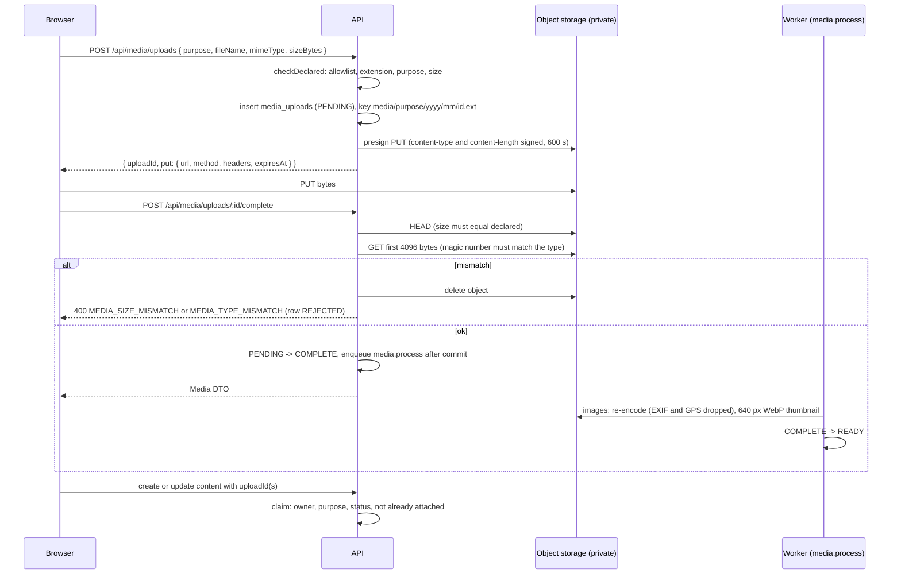
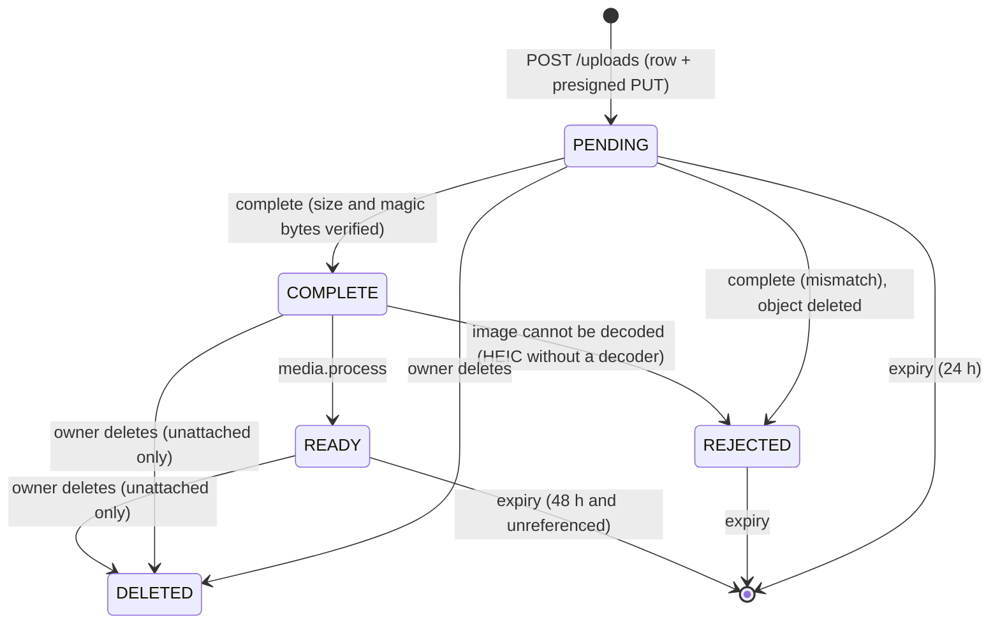

# Media

Every file in Euron Open Talent arrives the same way: avatars and covers, company logos
and covers, project covers, post and comment images, files sent in messages, resumes
sent with an application, documents and voice notes fed to the AI import, and screenshots
attached to a complaint. The browser uploads straight to private object storage with a
presigned URL; the API decides what may be uploaded, verifies what actually landed, strips
image metadata, and hands out short-lived read URLs only to people allowed to see the
thing the file is attached to.

Related pages: [HLD.md](HLD.md) (why bytes bypass the API), [ai.md](ai.md) (what the
import does with an `IMPORT` upload), [hiring-pipeline.md](hiring-pipeline.md) (resumes on
applications), [security.md](security.md), [ADR 0010](adr/0010-presigned-uploads-by-upload-id.md).

| Piece | File |
| --- | --- |
| Policy (allowlist, sizes, purposes, magic bytes, keys) | [`domain/media-rules.ts`](../../apps/api/src/domain/media-rules.ts) |
| Upload, complete, read, process, expire | [`services/media.service.ts`](../../apps/api/src/services/media.service.ts) |
| Attaching uploads to content | [`services/media-attach.service.ts`](../../apps/api/src/services/media-attach.service.ts) |
| Storage backends (S3, local) | [`integrations/storage.ts`](../../apps/api/src/integrations/storage.ts) |
| Rows and the "is it attached" definition | [`repositories/media.repository.ts`](../../apps/api/src/repositories/media.repository.ts) |
| DTOs and signed URLs | [`presenters/media.presenter.ts`](../../apps/api/src/presenters/media.presenter.ts) |
| Routes | [`routes/media.routes.ts`](../../apps/api/src/routes/media.routes.ts) |
| Browser upload helper | [`packages/api-client/src/upload.ts`](../../packages/api-client/src/upload.ts) |

## 1. Upload sequence

The client never sends a URL or a storage key. Content refers to files only by upload
id, and the service that attaches it checks ownership, purpose and state
([`media-attach.service.ts`](../../apps/api/src/services/media-attach.service.ts)).

## 2. What may be uploaded

`checkDeclared` runs before any URL is handed out. Three checks, all required, plus a
fourth on the stored bytes:

1. **The MIME type is on the allowlist.** SVG, HTML, XHTML, XML, JavaScript and shell
   scripts are refused by name (`DANGEROUS_MIME`), as are the extensions `svg`, `svgz`,
   `html`, `htm`, `xhtml`, `xml`, `js`, `mjs`, `exe`, `bat`, `cmd`, `sh`, `php`. Anything
   else not in the table below is `MEDIA_TYPE_NOT_ALLOWED`.
2. **The extension belongs to that type** (`MEDIA_EXTENSION_MISMATCH`), so a `.exe` cannot
   be declared as a PDF.
3. **The purpose accepts that kind** (`MEDIA_PURPOSE_MISMATCH`) and **the size is within
   the kind's cap** (`413 MEDIA_TOO_LARGE`, with `maxBytes`). Empty files are
   `MEDIA_EMPTY`.
4. **After the upload, the first bytes match the type's magic number** (`sniffMatches`),
   and nothing except plain-text documents may start like markup (`looksLikeMarkup`:
   `<?xml`, `<!doctype`, `<html`, `<svg`, `<script`, `<iframe` and similar).

### Types and size caps

| Kind | Cap | Types (extensions) | Sniffed as |
| --- | --- | --- | --- |
| `IMAGE` | 15 MB | `image/jpeg` (jpg, jpeg), `image/png`, `image/webp`, `image/gif`, `image/heic` and `image/heif` (heic, heif) | JPEG SOI, PNG signature, `RIFF....WEBP`, `GIF87a`/`GIF89a`, ISO `ftyp` with a HEIF brand |
| `VIDEO` | 200 MB | `video/mp4` (mp4, m4v), `video/webm`, `video/quicktime` (mov, qt) | `ftyp` with a non-HEIF brand, EBML header plus `webm`, QuickTime `ftyp qt` or a classic atom |
| `AUDIO` | 50 MB | `audio/mpeg` (mp3), `audio/mp4` and `audio/x-m4a` (m4a), `audio/ogg` (ogg, oga, opus), `audio/wav`, `audio/x-wav`, `audio/wave` | `ID3` or an MPEG frame sync, `ftyp` with an `M4A `/`M4B `/`M4P ` brand (so a video cannot pass as audio), `OggS`, `RIFF....WAVE` |
| `PDF` | 25 MB | `application/pdf` | `%PDF-` |
| `DOCUMENT` | 25 MB | DOCX, XLSX, PPTX (Office Open XML), `text/csv`, `text/plain` | ZIP local header for Office files; valid UTF-8 without NUL bytes and not markup for text |

### Purposes

Each upload is created for one purpose and can only ever be attached where that purpose
belongs (`PURPOSE_KINDS`).

| Purpose | Kinds | Attached to | Who can read it |
| --- | --- | --- | --- |
| `AVATAR`, `COVER` | Image | `users.avatar_upload_id`, `users.cover_upload_id` | Anyone, while the account is `ACTIVE` or `SUSPENDED` and there is no block either way |
| `COMPANY_LOGO`, `COMPANY_COVER` | Image | `companies.logo_upload_id`, `companies.cover_upload_id` | Anyone, while the company is not `SUSPENDED` |
| `PROJECT_COVER` | Image | `profile_projects.cover_upload_id` | Anyone, while the profile is `PUBLISHED` or `UNLISTED` and there is no block either way |
| `POST` | Image, video, PDF, document | `post_media` | Readers of the post: `PUBLISHED`, `PUBLIC` or (for `CONNECTIONS` posts) connections, no block with the author |
| `COMMENT` | Image | `comments.upload_id` | Readers of the comment and its post |
| `DM` | Image, video, audio, PDF, document | `dm_message_media` | `ACTIVE` or `REQUESTED` participants of the thread, while the message is `PUBLISHED` |
| `RESUME` | PDF, document | `applications.resume_upload_id` | The candidate, and `ACTIVE` recruiters of the application's company while it is not `WITHDRAWN` |
| `IMPORT` | PDF, document, image, audio | `profile_imports.upload_id` | Only the owner (and platform staff). Unlinked once the import is applied or purged, see [ai.md](ai.md) |
| `EVIDENCE` | Image, PDF | `complaints.evidence_upload_ids` | Only the complainant and platform staff |

The uploader can always read their own upload; platform staff (`MODERATOR`, `ADMIN`) can
read any presentable upload (an image once `READY`, other kinds from `COMPLETE`). Everyone else goes through `canSeeParent` in
[`media.service.ts`](../../apps/api/src/services/media.service.ts), which checks the rules above. `IMPORT` and
`EVIDENCE` have no branch there on purpose: no attachment makes them visible to anyone
else. A miss is always `404`, so a probe cannot tell "exists but hidden" from "absent".

### Attaching

- **Lists** (post media, DM attachments): `claimUploads` locks the rows `FOR UPDATE` in the
  caller's transaction and requires that the caller owns each upload, its purpose
  matches, it is `COMPLETE` or `READY`, and it is not already in `post_media`,
  `dm_message_media` or a comment (`MEDIA_INVALID`, `MEDIA_NOT_READY`, `MEDIA_IN_USE`).
- **Single slots** (avatar, cover, logo, project cover, resume, evidence): `claimSingle`
  checks owner, purpose and state, and that image-only slots got an image. A resume may be
  reused for several applications.

## 3. Upload lifecycle

- **Images are shown to nobody but their uploader until `READY`** (`isPresentable` in
  [`media.presenter.ts`](../../apps/api/src/presenters/media.presenter.ts)): the original may still carry EXIF and GPS data.
  Other kinds are presentable from `COMPLETE`.
- `completeUpload` is idempotent: completing a `COMPLETE` or `READY` upload returns it.
- `DELETE /api/media/uploads/:id` refuses an attached upload (`409 MEDIA_IN_USE`).
- Transitions use a conditional `UPDATE ... WHERE status IN (...)` (`mediaRepo.transition`),
  so a retried job never processes a row twice.

Rate limits: `media-create` 60 per 10 minutes on the route, and a service budget of 120
uploads per hour per user (`consume("media-upload", ...)`).

## 4. Storage

### Keys

`media/<purpose>/<yyyy>/<mm>/<uploadId>.<ext>` (lower-case purpose, UTC year and month,
the canonical extension of the type; `storageKeyFor`). Nothing from the client's file name
is used. The cleaned name (`cleanFileName`: last path segment, control characters and
`"<>` replaced, 200 characters) is kept only for display and download names. Thumbnails
sit next to the original as `<key>.thumb.webp`.

### S3 (production and the Floci stack)

- **A private bucket**: Block Public Access, `BucketOwnerEnforced`, SSE-KMS with the
  deployment key and bucket keys, versioning, and a bucket policy denying any request
  without TLS ([`modules/storage/main.tf`](../../infra/terraform/modules/storage/main.tf)). Nothing is ever public.
- **Presigned PUT**: 600 s, signing `content-type` and `content-length`, so the browser
  must send exactly the declared type and size.
- **Presigned GET**: `SIGNED_URL_TTL_SECONDS` (default 900). PDF, DOCUMENT and OTHER
  kinds get `ResponseContentDisposition: attachment` with the cleaned file name, so they
  download rather than render. URLs are minted per API response; the web app refetches
  the parent resource instead of caching them.
- **Browser-reachable endpoint**: presigning uses `S3_PUBLIC_ENDPOINT` when set (locally
  the emulator on `http://localhost:4587`), while the API talks to the emulator on the
  compose network through `AWS_ENDPOINT_URL`.
- **Checksums**: the S3 client uses `requestChecksumCalculation: "WHEN_REQUIRED"`.
  Otherwise the SDK adds a checksum of the empty body to presigned URLs and the browser's
  real upload fails with `BadDigest` (see [troubleshooting.md](../guides/troubleshooting.md)).
- **CORS**: `PUT`, `GET`, `HEAD` from the app origin, max age 3000 s.
- **Lifecycle**: incomplete multipart uploads aborted; noncurrent versions expire after
  `noncurrent_version_days`. Current objects never expire by rule; the API's expiry job
  deletes unattached ones.
- **CSP**: the web app's Content-Security-Policy must allow the bucket origin through
  `MEDIA_ORIGINS` ([`apps/web/src/middleware.ts`](../../apps/web/src/middleware.ts)).

### Local mode (`STORAGE=local`, development only)

Files live under `DATA_DIR/media`. The API serves the stand-ins for presigned URLs, so the
browser flow is identical:

- `PUT /api/media/local/:token` and `GET /api/media/local/:token` take no bearer token; the
  token is the only authority, like a presigned URL.
- A token is a base64url payload plus an HMAC-SHA256 keyed from `REFRESH_SECRET`
  (`signLocal` in [`storage.ts`](../../apps/api/src/integrations/storage.ts)), compared in constant time. PUT
  tokens (600 s) bind the type and size; the route rejects a different `Content-Type` or
  `Content-Length`. GET tokens live `SIGNED_URL_TTL_SECONDS`.
- GET answers with `X-Content-Type-Options: nosniff`.
- The request log masks the token ([`app.ts`](../../apps/api/src/app.ts)).

`assertProductionConfig` refuses `STORAGE=local` in production
([`core/config.ts`](../../apps/api/src/core/config.ts)).

## 5. Processing

`media.process` runs in the worker (or inline under `JOBS_MODE=inline`) and only on
`COMPLETE` rows:

- **Images**: re-encode with sharp (`failOn: "error"`, `rotate()` to apply and drop the
  orientation; JPEG with mozjpeg at quality 88, PNG, WebP 88, GIF; GIF and WebP keep their
  animation). sharp writes no metadata unless asked, so EXIF and GPS are dropped. The
  re-encoded file replaces the original under the same key, a 640 px wide WebP thumbnail
  (quality 80, never enlarged) is written next to it, width, height and the new size are
  stored, then `READY`.
- **HEIC and HEIF**: when the bundled libvips cannot decode them the upload is `REJECTED`
  with a reason the web app shows ("export the photo as JPEG and upload it again") and the
  object is deleted, because serving the original would publish its metadata.
- **Other images that fail to decode**: `REJECTED`, object deleted.
- **Video and audio** up to 100 MB: the file is read once for a duration (`mvhd` for MP4,
  MOV and M4A; the data chunk and byte rate for WAV); WebM, Ogg and MP3 get none. Then
  `READY`.
- **PDF and documents**: straight to `READY`. Resumes and import files are not rewritten.

The moderation scan reads images through signed URLs of the thumbnail (or the original
while there is none) and records its verdict on `media_uploads.moderation_state`
([moderation.md](moderation.md)).

## 6. Expiry

`maintenance.expire-uploads` runs every 30 minutes ([`worker.ts`](../../apps/api/src/worker.ts)) and deletes,
in batches of 500 (at most 20 rounds), the rows `findExpired` selects
([`media.repository.ts`](../../apps/api/src/repositories/media.repository.ts)):

- `PENDING` uploads older than 24 hours (never completed);
- every `REJECTED` upload;
- `COMPLETE` or `READY` uploads older than 48 hours that nothing references.

"Referenced" has one definition (`REFERENCES`): `post_media`, `comments.upload_id`,
`dm_message_media`, user avatar or cover, company logo or cover, project cover,
`applications.resume_upload_id`, `profile_imports.upload_id` and
`complaints.evidence_upload_ids`. The delete re-checks it in the same statement, so an
upload attached between selection and deletion survives. After the row is gone the object
and its thumbnail are deleted from storage.

Because applying or purging an AI import nulls `profile_imports.upload_id`, the imported
document or voice note becomes unreferenced and is removed by this job once it is older
than 48 hours.

## 7. Testing

Policy is unit-tested in [`test/unit/media-rules.test.ts`](../../apps/api/test/unit/media-rules.test.ts). The upload
helper is tested in [`packages/api-client/test/upload.test.ts`](../../packages/api-client/test/upload.test.ts). The test
matrix runs the integration suite with `STORAGE=local` and `STORAGE=s3` on the emulator
([`scripts/test-matrix.sh`](../../scripts/test-matrix.sh), see [testing.md](../guides/testing.md)).

## 8. Known gaps

Stated as the code behaves today; the full list is in [security.md](security.md).

- **Only images are re-encoded.** Video, audio, PDF and documents (resumes included) are
  served exactly as uploaded, with any embedded metadata such as document author fields.
- **HEIC needs a decoder.** Without HEVC support in libvips, HEIC uploads are refused
  rather than converted.
- **A stuck worker hides new images.** Images appear only once `READY`, so while
  `media.process` cannot run they stay invisible to everyone but their uploader.
- **Signed URLs outlive permission changes.** A URL handed out stays valid until it
  expires (`SIGNED_URL_TTL_SECONDS`), even if the viewer is blocked, a candidate withdraws
  an application, or the content is hidden meanwhile.
- **Inline jobs.** With `JOBS_MODE=inline` a failed `media.process` is logged and dropped,
  and the expiry job never runs (there is no scheduler in the API process).
