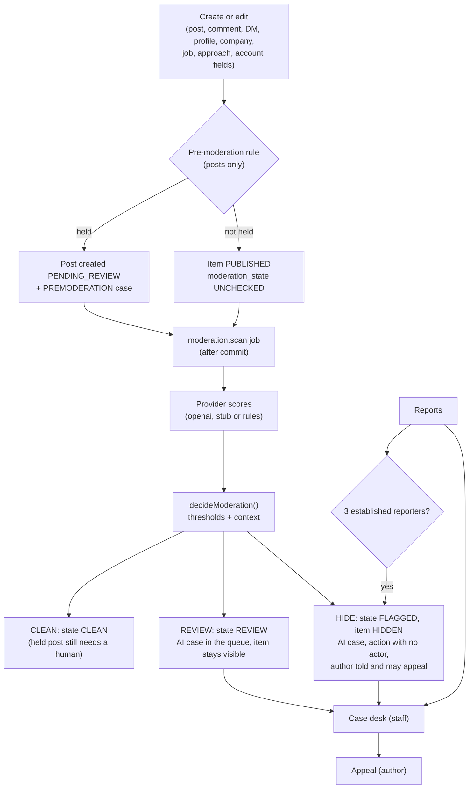

# Moderation

Euron Open Talent moderates what people write and show: posts, comments, direct
messages, talent profiles, company pages, job postings and recruiter approaches. An
automated scan scores every new and edited item; user reports corroborate it; an
optional pre-moderation rule holds the first posts of brand-new accounts; and a case desk
lets platform staff decide, with appeals decided by someone else. One pure function turns
scores into an outcome, so the policy is the same whichever provider produced them.

This page describes the pipeline as built. The day-to-day procedure for staff is in
[moderation-playbook.md](../guides/moderation-playbook.md). Trust features that are not
content moderation (complaints between a candidate and a recruiter, hiding a rating,
recruiter approval) live in the admin console and are covered in
[privacy-and-contact-consent.md](privacy-and-contact-consent.md),
[hiring-pipeline.md](hiring-pipeline.md) and
[recruiter-verification.md](../guides/recruiter-verification.md).

| Piece | File |
| --- | --- |
| Providers (openai, stub, rules) | [`services/moderation/providers.ts`](../../apps/api/src/services/moderation/providers.ts) |
| Scores to outcome | [`domain/moderation-decision.ts`](../../apps/api/src/domain/moderation-decision.ts) |
| The scan job | [`services/moderation/scan.service.ts`](../../apps/api/src/services/moderation/scan.service.ts), registered in [`jobs/moderation.jobs.ts`](../../apps/api/src/jobs/moderation.jobs.ts) |
| One adapter per target type | [`services/moderation/targets.ts`](../../apps/api/src/services/moderation/targets.ts) |
| Reports and the auto-hide rule | [`services/moderation/reports.service.ts`](../../apps/api/src/services/moderation/reports.service.ts), [`domain/report-threshold.ts`](../../apps/api/src/domain/report-threshold.ts) |
| Pre-moderation | [`services/premoderation.service.ts`](../../apps/api/src/services/premoderation.service.ts) |
| Queue, detail, assignment, author view | [`services/moderation/cases.service.ts`](../../apps/api/src/services/moderation/cases.service.ts) |
| Decisions | [`services/moderation/actions.service.ts`](../../apps/api/src/services/moderation/actions.service.ts) |
| Appeals | [`services/moderation/appeals.service.ts`](../../apps/api/src/services/moderation/appeals.service.ts) |
| Moderator deletes through ordinary endpoints | [`services/moderation/removal.ts`](../../apps/api/src/services/moderation/removal.ts) |
| DTOs (no reporter identities, author view) | [`presenters/moderation.presenter.ts`](../../apps/api/src/presenters/moderation.presenter.ts) |
| Settings and defaults | [`services/settings.service.ts`](../../apps/api/src/services/settings.service.ts) |

## 1. Pipeline

- Every service that writes moderatable text enqueues `moderation.scan` on its `Effects`
  buffer, so a rolled-back write is never scanned ([ADR 0009](adr/0009-after-commit-effects.md)).
- The provider call happens outside any transaction. The result is applied in a
  transaction that reloads the target first: if the author deleted it meanwhile, nothing
  happens.
- On provider failure (after its own retries) the job throws, BullMQ retries it (5
  attempts, exponential backoff from 5 s), and the item keeps `moderation_state =
  UNCHECKED` and stays visible ([ADR 0008](adr/0008-bullmq-on-redis.md)).
- With `settings.moderation.enabled = false` the scan touches nothing; reports and the
  desk keep working.

## 2. Targets

`ModerationTarget` is `POST`, `COMMENT`, `DM_MESSAGE`, `USER`, `PROFILE`, `COMPANY`,
`JOB` or `APPROACH`. One adapter per type in
[`targets.ts`](../../apps/api/src/services/moderation/targets.ts) gives the pipeline, reports, actions and appeals the
same three operations: `load` (text, images, author, current status), `visibleTo` (may
this person see it, so reports on anything else are a 404) and `setStatus` (change the
status and, in the same transaction, the counters and realtime signals).

| Target | Scanned when | Text scanned | Status mapping | Hidden means |
| --- | --- | --- | --- | --- |
| `POST` | Create, edit | Body, images | `posts.status` | Gone from every feed; `post:removed` to open viewers; counters move |
| `COMMENT` | Create, edit | Body, image | `comments.status` | Gone from the thread; post and parent counters move |
| `DM_MESSAGE` | Send, edit | Body, images | `dm_messages.status` | Tombstone for the recipient (the sender still sees their words so they can appeal); `dm:message:deleted` |
| `PROFILE` | Edits while `PUBLISHED` or `UNLISTED`, and every publish or unlist ([`profile.service.ts`](../../apps/api/src/services/profile.service.ts)) | Name, headline, title, about, section text, avatar | `PUBLISHED`/`UNLISTED`/`DRAFT` read as `PUBLISHED`, `SUSPENDED` as `HIDDEN` | Profile `SUSPENDED` and every live contact unlock revoked. Restoring sets it to `UNLISTED`, so its owner republishes deliberately ([ADR 0019](adr/0019-explicit-publish.md)) |
| `COMPANY` | Name, tagline, about or website edits ([`company.service.ts`](../../apps/api/src/services/company.service.ts)) | Those fields, logo | `SUSPENDED` reads as `HIDDEN` | Company `SUSPENDED`: a 404 to everyone but staff and its team, its jobs and posts drop out of every list, its recruiters fail `requireRecruiter`. Restoring returns it to `VERIFIED` when it had been verified, else `UNVERIFIED` |
| `JOB` | Published on create, title or description edited while open, moved to `OPEN` ([`job.service.ts`](../../apps/api/src/services/job.service.ts)) | Title, description, location | `jobs.content_status` (separate from the hiring `status`) | Not listed or open to apply; the company's open-job counter follows |
| `APPROACH` | Send ([`approach.service.ts`](../../apps/api/src/services/approach.service.ts)) | Role title, message | `PENDING`/`ACCEPTED` read as `PUBLISHED`, anything else as `HIDDEN` | A pending approach becomes `WITHDRAWN` and disappears from the candidate's inbox |
| `USER` | Display name or avatar changes ([`user.service.ts`](../../apps/api/src/services/user.service.ts)) | Display name, headline, about, avatar | `users.status` | Never hidden by status; account actions (warn, suspend, ban) instead |

`moderation_state` (`UNCHECKED`, `CLEAN`, `REVIEW`, `FLAGGED`) is recorded on posts,
comments, messages, jobs, approaches and scanned images.

### Approaches and the recruiter's quota

An approach the classifier scores at or above a `hide` threshold is set to
`moderation_state = FLAGGED` and withdrawn. Two things follow from that one column:

- the candidate never sees it: `listForCandidate` and the candidate's `get` exclude
  `FLAGGED` rows;
- it does not count against the recruiter's daily quota: `sentToday` counts only rows
  whose `moderation_state` is not `FLAGGED`, so a rejected approach is refunded.

A moderator hiding an approach from the desk withdraws it but leaves its
`moderation_state` as the scan set it, so the refund applies to classifier rejections.
Only the candidate can see, and therefore report, an approach. See
[privacy-and-contact-consent.md](privacy-and-contact-consent.md).

### What is never taken down automatically

Accounts, profiles and company pages are never hidden by the classifier or by a report
count: for `USER`, `PROFILE` and `COMPANY` both `REVIEW` and `HIDE` verdicts only open an
AI case, and `shouldAutoHideFromReports` returns false for them. A moderator decides.
Staff content is never auto-hidden either (section 4).

## 3. Providers

Selected by `settings.moderation.provider` (admin-editable; defaults to
`MODERATION_PROVIDER`). Config is read at call time, so tests can point the stub at an
ephemeral port.

| Provider | What it does | When to use |
| --- | --- | --- |
| `openai` | `POST {OPENAI_BASE_URL}/moderations` with `OPENAI_MODERATION_MODEL` (default `omni-moderation-latest`), text plus signed image URLs in one multimodal request | Production with a key |
| `stub` | The same client pointed at `{MODERATION_STUB_URL}/v1`, served by [`apps/ai-stub`](../../apps/ai-stub/README.md) | Local stack and tests; deterministic scores from text markers |
| `rules` | No network. Blocked terms (`settings.moderation.blockedTerms`, whole-word match) score `harassment = 0.9`; more than five links, or the same body three times in ten minutes by the same author, score `spam = 0.95` | Default without a key; small installs |

- **Retries inside one attempt**: network errors, timeouts (10 s), 429 and 5xx are retried
  twice with backoff (250 ms, 500 ms); a 4xx or a malformed body fails at once.
- **Score folding**: OpenAI categories like `harassment/threatening` are folded into their
  parent with `max`, so a threshold keyed `harassment` covers the subcategories.
- **No key, no outage**: with provider `openai` and no usable `OPENAI_API_KEY` (unset or
  the Terraform placeholder `set-me`), `effectiveProvider` falls back to `rules` and logs
  one warning per process. `assertProductionConfig` also reports it at boot
  ([`core/config.ts`](../../apps/api/src/core/config.ts)).
- `MODERATION_PROVIDER=stub` is refused as a production setting.

See [ADR 0011](adr/0011-pluggable-moderation-providers.md). The AI used for profile import
is a separate, independently configured provider ([ai.md](ai.md)).

## 4. Decision

`decideModeration(scores, thresholds, ctx)` in
[`domain/moderation-decision.ts`](../../apps/api/src/domain/moderation-decision.ts) is pure:

1. **Baseline**: for each category with a threshold, a score at or above `hide` is a hide
   category, at or above `review` a review category. Any hide category makes the outcome
   `HIDE`, else any review category makes it `REVIEW`, else `CLEAN`. Priority is the
   strongest qualifying score times 100. Categories without a threshold are ignored.
2. **Context**: `adjustForContext` downgrades `HIDE` to `REVIEW` when the author is staff
   (`MODERATOR` or `ADMIN`). The context also carries the open report count, the author's
   connection count and account age, so a deployment can add rules there and pin them
   with unit tests.

### Default thresholds

From `DEFAULT_SETTINGS.moderation.thresholds` in
[`settings.service.ts`](../../apps/api/src/services/settings.service.ts); scores are 0 to 1 and every value is
editable at runtime under `/admin` settings.

| Category | Review at | Hide at |
| --- | --- | --- |
| `harassment` | 0.5 | 0.85 |
| `hate` | 0.4 | 0.8 |
| `violence` | 0.5 | 0.85 |
| `sexual` | 0.5 | 0.85 |
| `sexual/minors` | 0.1 | 0.3 |
| `self-harm` | 0.3 | 0.9 |
| `illicit` | 0.6 | 0.9 |
| `spam` | 0.6 | 0.9 |

### Applying the verdict

| Outcome | State | Case | Target |
| --- | --- | --- | --- |
| `CLEAN` | `CLEAN` | None, except a held post (`PENDING_REVIEW`) gets its `PREMODERATION` case ensured | Unchanged |
| `REVIEW` | `REVIEW` | `AI` case with provider, scores, categories, priority | Unchanged |
| `HIDE` | `FLAGGED` | `AI` case | If `PUBLISHED`: `HIDDEN`, a `HIDE` action with `actor_id = NULL` and the categories as reason, the author notified ("hidden automatically ... You can appeal"), staff badge refreshed. Not applied to `USER`, `PROFILE`, `COMPANY` |

## 5. Pre-moderation

`settings.moderation.premoderateNewAccounts` (`enabled: false` by default; `firstPosts: 3`,
`accountAgeDays: 2`). When enabled, a post is held if its author is not staff, the
account is younger than `accountAgeDays`, and the author has fewer than `firstPosts`
published posts.

A held post is created `PENDING_REVIEW` and its `PREMODERATION` case is opened in the
same transaction ([`post.service.ts`](../../apps/api/src/services/post.service.ts)), so it never depends on the scan job
running. While held it is visible to its author and staff only, is not counted, sends no
feed signal and notifies no mentioned person. Approving it publishes it, moves the
counters and sends the skipped mention notifications
([`post-mentions.service.ts`](../../apps/api/src/services/post-mentions.service.ts)).

## 6. Reports

`POST /api/reports { targetType, targetId, reason, details }` (rate limited to 20 per
hour). Reasons: `SPAM`, `HARASSMENT`, `HATE`, `VIOLENCE`, `SEXUAL`, `SELF_HARM`,
`MISINFORMATION`, `IMPERSONATION`, `SCAM`, `FAKE_PROFILE`, `OTHER`.

- **Only what you can see.** The target must pass `visibleTo` for the reporter, or the
  answer is `404 TARGET_NOT_FOUND`, so reports cannot probe for hidden content. An
  approach can be reported only by its candidate; a profile only while `PUBLISHED` or
  `UNLISTED`; a job only while published and not a draft.
- **Not yourself**: `400 CANNOT_REPORT_SELF`. **Once per person per target**:
  `409 ALREADY_REPORTED` (unique `(reporter_id, target_type, target_id)`).
- **One open case per target.** A report joins the target's `OPEN` case or opens a
  `REPORT` case (partial unique index `moderation_cases_open_target_idx`), increments
  `report_count` and raises `priority` by 10, up to 1000 (`bumpPriority`).
- **Auto-hide.** `shouldAutoHideFromReports` hides `PUBLISHED` content once three
  distinct reporters on the open case are `ACTIVE` and have accounts older than one day.
  Only reports on the currently open case count, so content a moderator restored needs
  three new reports. Staff content, accounts, profiles and company pages are never hidden
  this way. The hide is logged as an action with no actor and the author is told.
- **Reporters are never revealed.** Case DTOs show reasons and counts only.

## 7. The desk and who sees what

The case desk (`/api/moderation/*`, the web app's `/moderation` page) is for platform
staff: `MODERATOR` and `ADMIN` (`isStaff`). `RECRUITER_OPS` has no access to cases. The
admin console's areas are a separate table (`requireArea` and
[`domain/admin-permissions.ts`](../../apps/api/src/domain/admin-permissions.ts)): `MODERATOR` opens `overview`,
`moderation`, `people`, `jobs` and `complaints`; `ADMIN` opens everything.

| View | Who | Shows |
| --- | --- | --- |
| Queue `GET /api/moderation/cases` | Staff | Open cases by `priority DESC, opened_at, id` with a keyset cursor; filters by status, source, target type. Resolved cases newest first |
| Detail `GET /api/moderation/cases/:id` | Staff | Snapshot at open time, current target status, AI provider, scores and categories, report reasons with counts, resolution, resolver, appeal |
| Author view `GET /api/moderation/me` and the same detail URL | The subject (their content, or their own account) | The same case without raw AI scores (categories stay) and without the moderator's identity |
| History `GET /api/moderation/history?targetType=&targetId=` | Staff | Every action on the target, cases or not |
| Stats `GET /api/moderation/stats` | Staff | Open cases, open appeals, actions today, auto-hidden today |

Anyone else gets `404 CASE_NOT_FOUND`. The `snapshot` keeps the text (up to 20000
characters), title and media ids as they were when the case opened; a later scan
refreshes scores and snapshot on the open case. Cases can be assigned to a staff member
(`POST /cases/:id/assign`, audited). Connected staff get `moderation:queue` with the open
count whenever a case opens or resolves ([realtime.md](realtime.md)).

## 8. Actions

`POST /api/moderation/cases/:id/actions { action, reason, suspendDays }`.

| Action | Effect | Allowed from |
| --- | --- | --- |
| `APPROVE` | Content `PUBLISHED`, state `CLEAN` | `PENDING_REVIEW`, `HIDDEN`, `PUBLISHED` |
| `HIDE` | Content `HIDDEN` (restorable) | `PUBLISHED`, `PENDING_REVIEW`, `HIDDEN` |
| `REMOVE` | Content `REMOVED` (final unless an appeal wins) | `PUBLISHED`, `PENDING_REVIEW`, `HIDDEN`, `REMOVED` |
| `RESTORE` | Content `PUBLISHED`, state `CLEAN` | `HIDDEN`, `REMOVED`, `PUBLISHED` |
| `DISMISS` | Nothing changes; the case closes | any |
| `WARN` | Notification to the author | account |
| `SUSPEND` | `SUSPENDED` for 1 to 3650 days, sockets disconnected | account |
| `BAN` / `UNBAN` | Ban revokes every session, bumps `token_version`, disconnects | account, `ADMIN` only |

Rules enforced in [`actions.service.ts`](../../apps/api/src/services/moderation/actions.service.ts):

- Acting needs an `ACTIVE` staff account; a suspended moderator has no powers.
- Nobody acts on their own account (`CANNOT_MODERATE_SELF`); admin accounts are out of
  reach (demote first); moderators cannot act on other moderators (`TARGET_PROTECTED`).
- Only an `ADMIN` may act on a case about their own content (`403 SELF_MODERATION`).
- A resolved case cannot be acted on again (`409 CASE_RESOLVED`); a transition from a
  status not listed above is `409 INVALID_TRANSITION`.
- Every decision writes a `moderation_actions` row and an `audit_log` row, resolves the
  case, and notifies the author with a `MODERATION_ACTION` notification that never names
  the moderator. Status changes use conditional updates (`WHERE status = <loaded>`), so a
  concurrent change cannot double count.

The admin console's account actions (warn, suspend, ban from `/admin` people) reuse
`applyAccountAction`, so both paths leave the same trail and disconnect the same way. A
moderator deleting someone else's post or comment through the ordinary delete endpoint
records a `REMOVE` action with no case ([`removal.ts`](../../apps/api/src/services/moderation/removal.ts)).

## 9. Appeals

`POST /api/moderation/cases/:id/appeal { statement }` (10 to 2000 characters, 10 per
hour), by the person the case is about. One appeal per case and person.

- **Appealable**: a resolved case whose resolution was `HIDE`, `REMOVE`, `SUSPEND` or
  `BAN`, within 30 days of resolution; or an open case whose target was hidden
  automatically (a `HIDE` with no actor) and is still `HIDDEN`, so the author need not
  wait for a moderator. Anything else is `400 NOT_APPEALABLE`.
- **Who may appeal**: any signed-in account, `SUSPENDED` included. Banned accounts cannot
  sign in, so they appeal outside the product.
- **Deciding** (`POST /api/moderation/appeals/:id/decide { status, note }`): an active
  staff member who is not the subject (`SELF_MODERATION` unless `ADMIN`), and not the
  moderator who resolved the case (`APPEAL_CONFLICT`), unless an `ADMIN` writes a note so
  the override is on the record.
- **`OVERTURNED`** restores content to `PUBLISHED` (state `CLEAN`) with a `RESTORE`
  action. For a profile that means `UNLISTED`; for an approach the adapter leaves it
  `WITHDRAWN`. An overturned `SUSPEND` or `BAN` sets the account `ACTIVE` only while it is
  still in the state this case put it in and no later action on the account exists;
  otherwise the overturn is recorded and the later decision stands.
- **`UPHELD`** leaves the decision. An appeal on an open case also resolves it (`RESTORE`
  when overturned, `HIDE` when upheld). Either way the appellant gets `APPEAL_DECIDED`.

## 10. Audit trail

| Table | Holds |
| --- | --- |
| `moderation_cases` | One row per case, with source (`AI`, `REPORT`, `PREMODERATION`), priority, AI scores, snapshot, resolution |
| `reports` | Every report, linked to the case it joined |
| `moderation_actions` | Append-only: every decision, automated (`actor_id` NULL) or human |
| `appeals` | One per case and appellant, with the decision and note |
| `audit_log` | Every staff action with the operator's id and IP |

See [data-model.md](data-model.md).

## 11. What is not automated

- Account actions (warn, suspend, ban) are always a human decision.
- Profiles, company pages and accounts are never taken down by a score or a report count.
- Complaints between people who worked together, hiding a rating, recruiter approval and
  closing jobs are admin-console work with their own areas, not cases
  ([moderation-playbook.md](../guides/moderation-playbook.md)).

## 12. Switching provider

Set `settings.moderation.provider` in `/admin` settings (takes effect within the 5 second
settings cache), or `MODERATION_PROVIDER` for the default. For `openai`, set
`OPENAI_API_KEY` (in AWS, through the deployment's secret; see
[configuration.md](../guides/configuration.md)). Thresholds are tuned in the same settings
document. Nothing is rescanned when the provider changes.

## 13. Known gaps

Stated as the code behaves today; the full list is in [security.md](security.md).

- **A missed scan stays unchecked.** If Redis was down when the job should have been
  enqueued, or every retry failed, the item stays `UNCHECKED` and visible. There is no
  sweep that rescans `UNCHECKED` rows.
- **Video, audio and documents are not scanned.** Only text and images go to the provider.
- **Context rules are minimal.** Only the staff downgrade is applied; report counts,
  account age and network size are passed but unused by default.
- **A moderator hiding an approach does not refund the quota.** Only a classifier
  `FLAGGED` verdict does (section 2).
