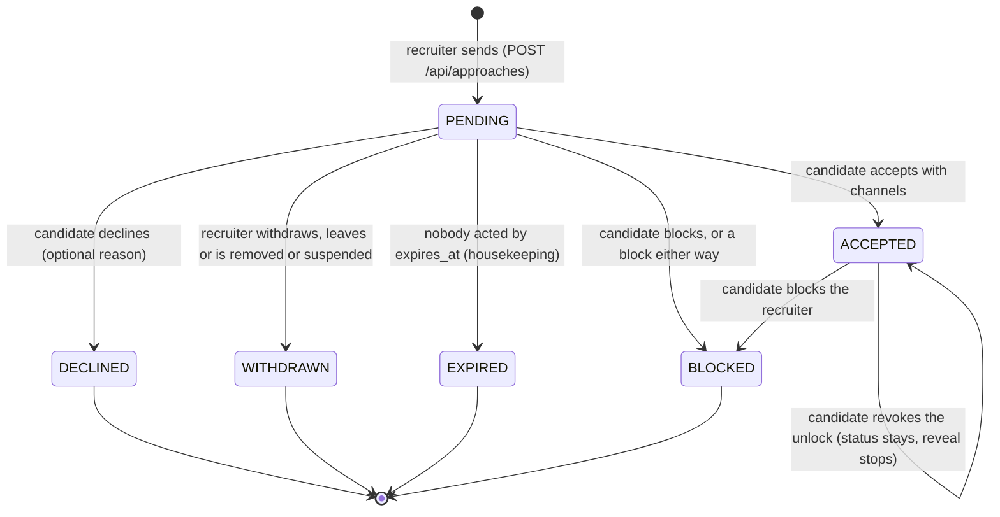

# Privacy and contact consent

A talent network is only useful if recruiters can reach people, and only safe if people
decide who reaches them. Euron Open Talent resolves that tension with one rule: **a
person's contact details leave the API only to a verified recruiter the person said yes
to, only for the channels the person chose, and every reveal is logged and shown to the
person**. This page describes how that rule is built, together with the other privacy
controls on the profile: per-section audiences, the open-to-work signal, view counting and
the AI import's data handling.

Related pages: [hiring-pipeline.md](hiring-pipeline.md) (what happens after a candidate
applies), [security.md](security.md) (the controls in general),
[threat-model.md](threat-model.md) (contact scraping and approach spam),
[ADR 0014](adr/0014-consent-based-contact-unlock.md) (why consent is per channel) and
[ADR 0019](adr/0019-explicit-publish.md) (why nothing is published on anyone's behalf).
Paths are relative to the repository root.

## 1. What is private

Three columns on `talent_profiles` hold the private contact channels
([`db/migrations/0001_init.sql`](../../db/migrations/0001_init.sql)):

| Column | Shape | Channel |
| --- | --- | --- |
| `contact_email` | `citext` | `EMAIL` |
| `contact_phone` | E.164, CHECK `^\+[1-9][0-9]{6,14}$` | `PHONE` |
| `whatsapp_phone` | E.164, same CHECK | `WHATSAPP` |

They are separate from the account email (`users.email`), which is used for sign-in and
transactional mail and is never shown to other members. The owner sets the channels with
`PUT /api/profiles/me/contact` (`updateContact` in
[`apps/api/src/services/profile.service.ts`](../../apps/api/src/services/profile.service.ts)).

Where the contact values can appear:

| Place | Who | How |
| --- | --- | --- |
| `MyProfile.contact` (`GET /api/profiles/me`) | The owner only | [`packages/types/src/talent.ts`](../../packages/types/src/talent.ts) |
| `ContactReveal` (`GET /api/approaches/:id/contact`) | The recruiter on an ACCEPTED approach, for the channels shared, while the unlock is live | `revealContact` in [`apps/api/src/services/approach.service.ts`](../../apps/api/src/services/approach.service.ts) |
| The owner's resume export (`GET /api/profiles/me/resume.pdf` or `.docx`) | The owner only: it is their own document | [`apps/api/src/services/resume.service.ts`](../../apps/api/src/services/resume.service.ts) |
| Nowhere else | | The `Profile`, `TalentCard`, `UserSummary`, `Application` and `ProfileSnapshot` DTOs have no contact fields at all |

The public read is built in one place,
[`apps/api/src/presenters/profile.presenter.ts`](../../apps/api/src/presenters/profile.presenter.ts),
which never selects the contact columns into a `Profile`. A profile snapshot taken when a
candidate applies (headline, location, experience, education, skills) carries no contact
data either ([hiring-pipeline.md](hiring-pipeline.md#easy-apply)).

Other places where personal data could leak are cleaned at write time:

- **Display names** go through `cleanDisplayName()`
  ([`apps/api/src/domain/display-name.ts`](../../apps/api/src/domain/display-name.ts)):
  email addresses, URLs and phone-like digit runs are removed, control and zero-width
  characters stripped, and a name with no letter left is refused. People type their email
  into the name field more often than one might expect; the name is public everywhere.
- **AI import output** has emails and phone numbers stripped from every text field by the
  sanitiser ([`apps/api/src/integrations/ai/schema.ts`](../../apps/api/src/integrations/ai/schema.ts)),
  so a proposal can never move contact details from a resume into a public section. Only
  the owner types contact details. See [ai.md](ai.md).

## 2. Who sees which section

Each of the six list sections (`experience`, `education`, `projects`, `skills`,
`certifications`, `links`; `PROFILE_SECTIONS` in
[`packages/types/src/talent.ts`](../../packages/types/src/talent.ts)) has an audience,
stored in `talent_profiles.section_visibility` and set with
`PUT /api/profiles/me/visibility`. The rule is the pure `canSeeSection()` in
[`apps/api/src/domain/profile.ts`](../../apps/api/src/domain/profile.ts):

| Audience | Owner, staff | Connection | ACTIVE recruiter | Any signed-in member | Signed out |
| --- | --- | --- | --- | --- | --- |
| `PUBLIC` (default) | yes | yes | yes | yes | yes |
| `RECRUITERS` | yes | yes | yes | no | no |
| `CONNECTIONS` | yes | yes | no | no | no |

"ACTIVE recruiter" means a `recruiters` row in status `ACTIVE` for a company that is not
`SUSPENDED`. A missing or unknown value reads as `PUBLIC` (`readAudience`). A hidden section
is emptied in the DTO and listed in `Profile.hiddenSections`, so the page can say "visible
to connections" instead of pretending the section is empty.

The header fields (name, headline, avatar, current title, location) are always visible to
anyone who can open the profile. A person who wants to keep their whole history private
keeps the sections at `CONNECTIONS`, or does not publish.

### Open to work

`talent_profiles.open_to_work` has three modes (`showsOpenToWork()` in the same file):

| Mode | Who sees the signal and the roles, types and availability |
| --- | --- |
| `OFF` | Nobody |
| `RECRUITERS` | The owner, staff and ACTIVE recruiters (who can also filter the directory on it) |
| `PUBLIC` | Everyone who can open the profile, and the green ring on `UserSummary.openToWork` |

In `RECRUITERS` mode the signal is absent from the DTO for everyone else, not merely
hidden by the client. The directory filter on open-to-work is applied only for ACTIVE
recruiters ([`apps/api/src/services/directory.service.ts`](../../apps/api/src/services/directory.service.ts)).

### Profile status

A profile is listed and openable only after its owner publishes it (`POST
/api/profiles/me/status`). `PUBLISHED` profiles appear in the directory and search;
`UNLISTED` ones open by direct link only; `DRAFT` and `SUSPENDED` are a 404 to everyone
but the owner and staff. Publishing needs completeness at or above
`settings.profile.publishThreshold` (default 55) and at least one contact channel
(`publishBlock()` in [`apps/api/src/domain/profile.ts`](../../apps/api/src/domain/profile.ts)),
because a published profile invites approaches and an approach is pointless if there is no
channel to share. Nothing publishes a profile on its owner's behalf: not the AI import, not
an admin. See [ADR 0019](adr/0019-explicit-publish.md).

A block in either direction makes the profile a 404 for the other person
(`getPublic`, [`apps/api/src/services/profile.service.ts`](../../apps/api/src/services/profile.service.ts)),
never a 403, so a blocked person cannot even confirm it exists.

## 3. Approaches

An approach is a verified recruiter's structured outreach: a role title, a message of 30 to
3000 characters, optionally a job of their company, an employment type and a salary range.
It is the only way a recruiter can ask for contact details.

### Sending

`send()` in [`apps/api/src/services/approach.service.ts`](../../apps/api/src/services/approach.service.ts)
requires an ACTIVE recruiter (`requireRecruiter`, 403 `RECRUITER_REQUIRED` otherwise). In one
transaction it locks the recruiter row (so the quota and the pending check are exact under
concurrency), gathers the facts and asks the pure `approachBlock()` in
[`apps/api/src/domain/trust.ts`](../../apps/api/src/domain/trust.ts):

| Check, in order | Answer |
| --- | --- |
| The recruiter is the candidate | 409 `APPROACH_SELF` |
| A block exists either way | 409 `APPROACH_NOT_PUBLISHED` (the same answer as an unpublished profile, so the recruiter learns nothing about the block) |
| The profile is not `PUBLISHED` or `UNLISTED` | 409 `APPROACH_NOT_PUBLISHED` |
| A `PENDING` approach from this recruiter to this person exists | 409 `APPROACH_ALREADY_PENDING` |
| The candidate declined this recruiter less than `settings.recruiter.declineCooldownDays` ago (default 30) | 409 `APPROACH_COOLDOWN` with `details.cooldownUntil` |
| Approaches sent today reached the quota | 429 `APPROACH_QUOTA` |

The quota is `recruiters.approach_quota_daily` when an operator set one for this
recruiter, otherwise `settings.recruiter.approachesPerDay` (default 25). It is counted from
the `approaches` rows created since UTC midnight, **excluding rows the moderation scan
marked `FLAGGED`**: an approach the classifier took down never reached the candidate, so it
is refunded. The route also carries a Redis limit (`approach-send`, 60 per hour).

The insert uses `ON CONFLICT (recruiter_id, candidate_id) WHERE status = 'PENDING' DO
NOTHING` against the partial unique index `approaches_pending_pair_idx`, so two concurrent
sends cannot create two pending approaches even if the lock were bypassed. The approach
expires after `settings.recruiter.approachExpiryDays` (default 14). After commit the
candidate gets an `APPROACH_RECEIVED` notification and an `approach:new` socket event, and a
`moderation.scan` job classifies the message (target `APPROACH`, see
[moderation.md](moderation.md)).

A profile's viewer block (`ProfileViewer.recruiter`) tells a recruiter in advance why a new
approach is not possible (`ALREADY_PENDING`, `COOLDOWN`, `QUOTA`, `NOT_PUBLISHED`) and
whether a live unlock already exists, so the web app can hide the button instead of
letting the request fail.

### Accepting: the contact unlock

`POST /api/approaches/:id/accept` with `{ channels: ["EMAIL", "WHATSAPP"] }` (`accept()`):

1. The approach row is locked. It must be `PENDING` (409 `APPROACH_NOT_PENDING`) and not
   past `expires_at` (409 `APPROACH_EXPIRED`), checked here as well as by housekeeping, so an
   approach is never accepted in the minutes between expiry and the next sweep.
2. At least one channel (400 `CHANNELS_REQUIRED`), and every chosen channel must be filled
   in on the profile (400 `CHANNEL_NOT_SET` with `details.missing`).
3. A block either way answers 404, as if the approach did not exist.
4. A DM thread with context `APPROACH` is opened (or found) with both participants
   `ACTIVE`: accepting is the consent to talk ([ADR 0006](adr/0006-can-message-rule.md)).
5. `UPDATE approaches SET status = 'ACCEPTED' ... WHERE id = ? AND status = 'PENDING'`; if
   it changed no row (a concurrent withdraw won), the transaction aborts with 409.
6. A `contact_unlocks` row records exactly the chosen channels (`channels` is a
   non-empty `contact_channel[]`, one unlock per approach by `UNIQUE (approach_id)`).
7. The recruiter gets `APPROACH_ACCEPTED`, an `approach.accept` audit row stores the
   channels, and both sides get `approach:updated`.

The unlock stores channels, not values: the values are read from the profile at reveal
time, so a candidate who changes their phone number does not leave the old one with
recruiters, and clearing a channel on the profile stops it being revealed.

### Revealing

`GET /api/approaches/:id/contact` (`revealContact()`), rate limited to 120 per hour per
user (`contact-reveal`):

- The caller must be the ACTIVE recruiter row that sent the approach (a teammate at the
  same company cannot use someone else's unlock), the approach must be `ACCEPTED`, the
  unlock unrevoked, and no block may exist either way. Anything else is 403
  `CONTACT_NOT_SHARED`.
- Only the shared channels are filled in; the rest are `null`. WhatsApp also gets a
  `https://wa.me/<digits>` link.
- **Every channel returned is logged** in `contact_access_log` in the same transaction:
  recruiter, candidate, channel, time, a user agent clipped to 300 characters and an HMAC of
  the IP keyed with `VIEW_HASH_SALT` (never the IP itself).

The candidate reads the log through `GET /api/profiles/me/contact-log` (`contactLog()` in
[`apps/api/src/services/profile.service.ts`](../../apps/api/src/services/profile.service.ts)):
who (recruiter and company), which channel, when. The IP hash is not part of the DTO; it
exists for staff investigating abuse.

### Revoking, declining, blocking

| Action | Endpoint | Effect |
| --- | --- | --- |
| Revoke | `POST /api/approaches/:id/revoke` | `contact_unlocks.revoked_at` set (conditional on `revoked_at IS NULL`; 409 `NOTHING_SHARED` otherwise). The thread stays; reveals stop at once. The recruiter gets `CONTACT_REVOKED`. |
| Decline | `POST /api/approaches/:id/decline` | `DECLINED` with an optional reason the recruiter sees; starts the cooldown for this recruiter and person. |
| Block | `POST /api/approaches/:id/block` | `BLOCKED` plus a user block, which cascades (below). |
| Withdraw | `POST /api/approaches/:id/withdraw` (recruiter) | `WITHDRAWN`, only while `PENDING`. |

Revoking does not reach copies a recruiter already made. The log tells the candidate
exactly what was seen and when, which is what the product can honestly promise.

### Everything else that ends an unlock

An unlock is revoked, and pending approaches end, whenever the consent stops making sense:

| Event | Unlocks | Pending approaches | Where |
| --- | --- | --- | --- |
| A block either way | Revoked ("Blocked") | `BLOCKED` | `block()` in [`apps/api/src/repositories/block.repository.ts`](../../apps/api/src/repositories/block.repository.ts) |
| The recruiter leaves the company | Revoked ("Recruiter left the company") | `WITHDRAWN` | `leave()` in [`apps/api/src/services/recruiter.service.ts`](../../apps/api/src/services/recruiter.service.ts) |
| A company admin removes the recruiter | Revoked | `WITHDRAWN` | `removeMember()` in [`apps/api/src/services/company.service.ts`](../../apps/api/src/services/company.service.ts) |
| An operator suspends the recruiter | Revoked ("Recruiter suspended") | `WITHDRAWN` | `suspendRecruiter()` in [`apps/api/src/services/admin.service.ts`](../../apps/api/src/services/admin.service.ts) |
| The profile is suspended (operator or moderation) | Every unlock of the candidate revoked | | `suspendProfile()` in `admin.service.ts`; the `PROFILE` target in [`apps/api/src/services/moderation/targets.ts`](../../apps/api/src/services/moderation/targets.ts) |
| A moderator hides an approach | | The approach is withdrawn and leaves the candidate's inbox | `APPROACH` target in `targets.ts` |
| Account deletion or erasure | Every unlock either side revoked | Withdrawn (recruiter side) or declined (candidate side) | `anonymiseUser` in [`apps/api/src/services/account.service.ts`](../../apps/api/src/services/account.service.ts) |

The consent was given to one recruiter at one company, so it ends when that recruiter
stops being that. Reinstating a recruiter does not restore old unlocks.

### Expiry

`maintenance.talent-housekeeping` runs every 15 minutes in the worker
([`apps/api/src/worker.ts`](../../apps/api/src/worker.ts),
[`apps/api/src/services/housekeeping.service.ts`](../../apps/api/src/services/housekeeping.service.ts))
and turns `PENDING` approaches past `expires_at` into `EXPIRED` with one conditional
`UPDATE` (the partial index `approaches_expiry_idx` serves it). Running it twice, or on two
workers, is harmless.

## 4. Messaging and consent

Messaging follows the same idea: a conversation needs a reason to exist (a connection, an
accepted approach, or an application), and anything else is a capped message request that
the recipient's policy (`ANYONE`, `RECRUITERS` by default, `NOBODY`) may refuse outright.
The full rule is [ADR 0006](adr/0006-can-message-rule.md) and
[`apps/api/src/domain/can-message.ts`](../../apps/api/src/domain/can-message.ts). Contact
details are never sent through messages by the system; what people type to each other in an
accepted conversation is their business.

## 5. Profile views and analytics

`POST /api/profiles/:username/view` records one row per viewer per profile per UTC day
(`profile_views`, primary key `(profile_id, viewer_key, day)`), so refreshing does not
inflate counts. The `viewer_key` is the user id for signed-in viewers and
`ip:` plus an HMAC-SHA256 of the IP keyed with `VIEW_HASH_SALT` (32 hex characters) for
signed-out ones (`recordView`, [`apps/api/src/services/profile.service.ts`](../../apps/api/src/services/profile.service.ts)).
The raw IP is never stored. The production guard refuses to boot with the committed default
salt ([`apps/api/src/core/config.ts`](../../apps/api/src/core/config.ts)).

When the viewer is an ACTIVE recruiter, their company id is stored on the view
(`viewer_company`). The owner's analytics (`GET /api/profiles/me/analytics`) show views over
7 and 30 days, a daily series, approach counts and **which companies' recruiters viewed the
profile in the last 30 days, by company, never by person**. Individual viewers are not
listed.

## 6. AI import data

The import ([ai.md](ai.md)) is the one place a person hands the system a whole resume or a
voice note. Its retention is deliberately short:

- The upload is referenced by id; the job payload carries only the import id, so no
  document or transcript sits in Redis.
- On apply, `input_text` and `upload_id` are cleared and `purged_at` set in the same
  transaction (`apply()` in [`apps/api/src/services/import.service.ts`](../../apps/api/src/services/import.service.ts)).
- Imports never applied are purged by housekeeping after `settings.import.retentionHours`
  (default 72): input text, upload link, extracted proposal and proposed badges are all
  cleared (`purgeExpired()`). The unlinked upload is then removed by
  `maintenance.expire-uploads`.
- The proposal never contains contact details (section 1), and nothing is applied or
  published until the owner picks sections.

## 7. Account deletion and export

`DELETE /api/users/me` anonymises the account in one transaction
([`apps/api/src/services/account.service.ts`](../../apps/api/src/services/account.service.ts)):
the profile goes back to `DRAFT` with every field, section and contact value cleared;
badges, imports, views and endorsements are removed; unlocks are revoked, approaches ended
and open applications withdrawn; connections and follows go; sessions and sockets are cut.
Posts, comments and messages stay under "Deleted user". `GET /api/users/me/export` streams
the person's own data as JSON. An operator can run the same erasure through
`POST /api/admin/users/:id/erase` (ADMIN only, with a reason).

## 8. Summary of guarantees

| Guarantee | Enforced by |
| --- | --- |
| Contact values are in no public DTO | Presenters never select them; only `MyProfile` and `ContactReveal` carry them |
| A recruiter sees only channels the candidate chose, for one approach | `contact_unlocks.channels`, checked in `revealContact` |
| Every reveal is visible to the candidate | `contact_access_log`, written in the reveal transaction; `GET /api/profiles/me/contact-log` |
| Consent can be withdrawn at any time | `POST /api/approaches/:id/revoke`, effective on the next reveal |
| Consent ends when the relationship does | Blocks, leaving, removal, suspension and deletion revoke unlocks in the same transaction |
| A declined recruiter cannot try again at once | `declineCooldownDays` in `approachBlock` |
| Approach volume is bounded per recruiter | Daily quota counted from rows, plus the `approach-send` rate limit |
| Blocks are never revealed | Blocked approaches answer `APPROACH_NOT_PUBLISHED`; blocked profiles and approaches are 404 |
| Signed-out viewers are not tracked by IP | Salted HMAC as the key, raw IP never stored |
| Imported resumes do not linger | Purged on apply or after `retentionHours` |
