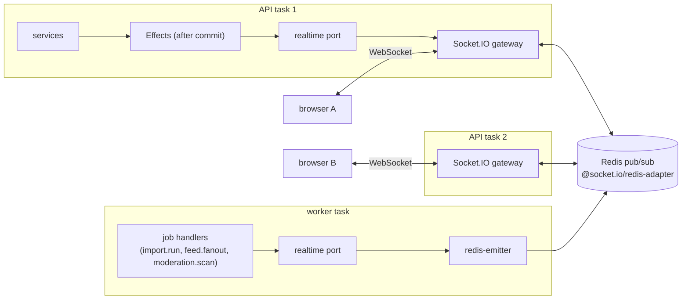

# Realtime

Euron Open Talent pushes live updates over Socket.IO: new messages and message requests,
notifications and header badges, recruiter approaches, application stage changes for
candidates, card moves on a job's pipeline board, live counts on an open post, AI import
progress and presence. This page is the contract between the API and its clients: the
events, the rooms they travel through, who may join which room, what delivery
guarantees exist, and how the transport behaves behind the AWS edge.

The REST API stays the source of truth. A socket event is a hint that something changed;
a client that missed one recovers by reading the REST endpoint again. Related pages:
[HLD.md](HLD.md) (where the gateway sits), [LLD.md](LLD.md) (the Effects buffer and the
realtime port), [hiring-pipeline.md](hiring-pipeline.md) (the board this page feeds),
[security.md](security.md), [threat-model.md](threat-model.md).

## 1. Moving parts

| Piece | File | Role |
| --- | --- | --- |
| Gateway | [`realtime/gateway.ts`](../../apps/api/src/realtime/gateway.ts) | The Socket.IO server inside every API task: handshake auth, rooms, subscribe checks, typing relays, presence, revalidation, abuse limits |
| Port | [`realtime/port.ts`](../../apps/api/src/realtime/port.ts) | `realtime.emit(rooms, event, payload)`, `realtime.disconnectUsers(...)`, `realtime.leaveRooms(...)` and the room name helpers. Services only ever call this |
| Worker emitter | [`realtime/emitter.ts`](../../apps/api/src/realtime/emitter.ts) | The port's transport in the worker process: `@socket.io/redis-emitter` |
| Presence | [`realtime/presence.ts`](../../apps/api/src/realtime/presence.ts) | Online state in Redis sorted sets |
| Effects | [`core/effects.ts`](../../apps/api/src/core/effects.ts) | Buffers emits, disconnects, room exits and jobs during a transaction and flushes them after commit |
| Event types | [`packages/types/src/index.ts`](../../packages/types/src/index.ts) | `ServerToClientEvents`, `ClientToServerEvents`, `Ack` |
| Client | [`packages/api-client/src/socket.ts`](../../packages/api-client/src/socket.ts) | Typed client, token in `auth`, reconnect after a token refresh |
| Web wiring | [`apps/web/src/lib/realtime/provider.tsx`](../../apps/web/src/lib/realtime/provider.tsx) | One socket per tab, events folded into the client cache |

The port starts as a no-op. At boot the API installs the gateway as its transport
(`setRealtimeTransport` in `startGateway`) and the worker installs the Redis emitter
(`startEmitter`). Tests install a recorder or nothing. Services therefore never import
Socket.IO, and a handler is free to emit whether it runs in the API (`JOBS_MODE=inline`)
or in the worker.

## 2. Connecting

- Path: `/socket.io`, same origin as the web app. The server sets `path: "/socket.io"`,
  `serveClient: false` and `addTrailingSlash: false`, so both `/socket.io?EIO=...` and
  `/socket.io/?EIO=...` work (the local Next.js rewrite drops the trailing slash).
- CORS for the polling transport: `allowedOrigins()` from
  [`core/config.ts`](../../apps/api/src/core/config.ts) (`CORS_ORIGINS`, else `APP_WEB_URL`), with credentials.
- Authentication: the access token in `handshake.auth.token`. The gateway calls
  `actorFromToken` from [`middleware/auth.ts`](../../apps/api/src/middleware/auth.ts), the same function the HTTP
  middleware uses, so the user row is reloaded and `token_version` is compared. A refused
  handshake gets an `Error` whose message is the failure code:

| Code | Meaning |
| --- | --- |
| `MISSING` | No token in `auth.token` |
| `INVALID` | Bad signature, expired, or a stale `token_version` |
| `BANNED` | The account is banned |
| `DEACTIVATED` | The account was deleted or erased |
| `TOO_MANY_CONNECTIONS` | The user already has 20 live sockets (`MAX_SOCKETS_PER_USER`), counted from the presence sets so the cap holds across every API task |
| `INTERNAL` | The lookup threw (logged with `where: gateway.auth`) |

A suspended account still authenticates (it can read), so its sockets connect; every
write it attempts over REST answers `403 ACCOUNT_RESTRICTED`.

The socket keeps the actor, the token's `ver` claim, a typing throttle map and its
request budget in `socket.data`.

### Client behaviour

[`packages/api-client/src/socket.ts`](../../packages/api-client/src/socket.ts) connects with the in-memory
access token, prefers WebSocket, reconnects with backoff (1 s to 10 s) and exposes
`reconnectWithFreshToken()`, which the HTTP client calls after a refresh so a long-lived
socket never keeps an expired token. After a reconnect the client re-sends its
subscriptions and refetches what it shows; it does not expect missed events to be
replayed.

## 3. Rooms

Clients never name a room. Every socket joins its own rooms at connect; everything else
is a `*:subscribe` request that the server checks against the same rule the REST read
applies, answering through the ack.

| Room | Joined | Rule (in [`gateway.ts`](../../apps/api/src/realtime/gateway.ts)) | Carries |
| --- | --- | --- | --- |
| `user:<id>` | Automatically, every socket | The socket's own account | Notifications and `counts:update`, every DM event (messages, edits, deletes, reads, typing, requests, thread updates), connection requests and accepts, approaches (candidate and recruiter sides), `application:stage` for the candidate, `feed:new-posts`, `import:status`, `presence:update`, `session:revoked` |
| `staff` | Automatically, for `MODERATOR` and `ADMIN` | `isStaff(actor)` | `moderation:queue` (the open case badge) |
| `thread:<id>` | `thread:subscribe { threadId }` | The viewer is a participant in state `ACTIVE` or `REQUESTED` (`threadParticipants`) | Nothing today: DM events travel through `user:` rooms so every tab gets them. The room marks an open thread and is what a block takes away (section 8) |
| `job:<id>` | `job:subscribe { jobId }` | The viewer is an `ACTIVE` recruiter of the job's company (`canSubscribeJob`: a join of `jobs` and `recruiters` on `company_id`, `user_id` and `status = 'ACTIVE'`) | `pipeline:card` for every move, new application, withdrawal or team note on that job |
| `post:<id>` | `post:subscribe { postId }` | The post is `PUBLISHED`, readable by the viewer (`canReadPost`: `PUBLIC`, or `CONNECTIONS` and connected, or staff) and not blocked either way | `post:updated` (reaction and comment counts), `post:comment`, `post:removed` |

A refused subscribe answers `{ ok: false, code: "NOT_FOUND" }` (never "forbidden", so a
probe cannot tell a hidden job or thread from a missing one) or `VALIDATION_FAILED` when
the id is not a ULID. `*:unsubscribe` takes the same id and always succeeds silently.

Two consequences worth stating:

- **The candidate never sees the board.** `pipeline:card` carries the team's
  `Application` DTO (snapshot, answers, match score, note count, average team rating), so
  it only goes to `job:` rooms. The candidate gets `application:stage` in their own
  `user:` room, which carries the stage and time and never the team note. See
  [hiring-pipeline.md](hiring-pipeline.md).
- **Approach events go to both people's `user:` rooms.** `approach:new` reaches only the
  candidate; `approach:updated` (accepted, declined, revoked, withdrawn) reaches both. The
  DTO never carries contact details: those come only from the logged
  `GET /api/approaches/:id/contact` read. See
  [privacy-and-contact-consent.md](privacy-and-contact-consent.md).

## 4. Event contract

### Server to client

Every event below is defined in `ServerToClientEvents`
([`packages/types/src/index.ts`](../../packages/types/src/index.ts)). "After commit" means the emit is queued on the
transaction's `Effects` buffer (or an `fx.after` callback) and sent only once the write is
durable.

| Event | Payload | Room | Emitted by |
| --- | --- | --- | --- |
| `notification:new` | `Notification` | `user:` | `notify()` in [`notification.service.ts`](../../apps/api/src/services/notification.service.ts), after commit |
| `counts:update` | `NotificationCounts` (`notifications`, `messages`, `messageRequests`, `connectionRequests`) | `user:` | Every notification change, read, message, request accept or decline |
| `dm:message` | `{ threadId, message }` | `user:` of every `ACTIVE` or `REQUESTED` participant | `sendMessage` in [`dm.service.ts`](../../apps/api/src/services/dm.service.ts) |
| `dm:message:updated` | `{ threadId, message }` | same | Edit; a moderator restoring a hidden message |
| `dm:message:deleted` | `{ threadId, messageId }` | same | Delete by the sender; a moderator or the classifier hiding it ([`moderation/targets.ts`](../../apps/api/src/services/moderation/targets.ts)) |
| `dm:read` | `{ threadId, userId, lastReadAt }` | same | `markRead` |
| `dm:typing` | `{ threadId, userId, typing }` | `user:` of the other participants, minus blocks | The gateway relaying a client `dm:typing` |
| `dm:request` | `{ thread }` | `user:` of the recipient | The first message of a message request (the recipient's own view of the thread) |
| `dm:thread:updated` | `{ thread }` | `user:` of the counterpart | The recipient accepted a message request (`acceptRequest`) |
| `connection:request` | `{ connectionId, from, note }` | `user:` of the addressee | [`network.service.ts`](../../apps/api/src/services/network.service.ts), after commit |
| `connection:accepted` | `{ connectionId, user }` | `user:` of the requester | same |
| `approach:new` | `{ approach }` | `user:` of the candidate | `send` in [`approach.service.ts`](../../apps/api/src/services/approach.service.ts) |
| `approach:updated` | `{ approach }` | `user:` of the candidate and the recruiter | Accept, decline, revoke, withdraw |
| `application:stage` | `{ applicationId, jobId, stage, at }` | `user:` of the candidate | A team move in [`application.service.ts`](../../apps/api/src/services/application.service.ts) |
| `pipeline:card` | `{ jobId, application, movedBy }` | `job:` | New application (`movedBy: null`), team move or bulk move, candidate withdrawal, team note |
| `feed:new-posts` | `{ count, latestId }` | `user:` of the author's connections, followers and company followers (capped at 2000) | The `feed.fanout` job (worker) |
| `post:updated` | `{ postId, reactionCount, reactionCounts, commentCount }` | `post:` | Reactions and comments |
| `post:comment` | `{ postId, comment }` | `post:` | A new published comment |
| `post:removed` | `{ postId }` | `post:` | Author delete; a moderator, the classifier or the report threshold hiding it |
| `import:status` | `{ importId, status }` | `user:` of the owner | Each stage of the `import.run` job ([`import.service.ts`](../../apps/api/src/services/import.service.ts)), see [ai.md](ai.md) |
| `presence:update` | `{ userId, online, lastSeenAt }` | `user:` of the person's audience (section 7) | The gateway, when someone's first socket connects or last socket leaves |
| `moderation:queue` | `{ openCases }` | `staff` | Case opened or resolved ([`moderation/cases.service.ts`](../../apps/api/src/services/moderation/cases.service.ts)) |
| `session:revoked` | `{ reason: "SUSPENDED" \| "BANNED" \| "SIGNED_OUT" }` | `user:`, then the sockets are disconnected | `disconnectUsers`, and revalidation (section 8) |

DM events go to `user:` rooms rather than `thread:` rooms on purpose: a person with the
thread list open in one tab and nothing in another still gets the badge and the message.

### Client to server

| Event | Payload | Ack | Notes |
| --- | --- | --- | --- |
| `thread:subscribe` / `thread:unsubscribe` | `{ threadId }` | `{ ok }` or `NOT_FOUND`, `VALIDATION_FAILED`, `RATE_LIMITED` | Participant check |
| `job:subscribe` / `job:unsubscribe` | `{ jobId }` | same | Active recruiter of the job's company |
| `post:subscribe` / `post:unsubscribe` | `{ postId }` | same | Same read rule as `GET /api/posts/:id` |
| `presence:query` | `{ userIds }` (at most 100 used) | `{ ok, data: Record<userId, boolean> }` | People the viewer could not know about are omitted, not reported offline |
| `dm:typing` | `{ threadId, typing }` | none | Relayed to the other participants, minus blocks |

Subscribe and presence requests run a query, so each socket has a fixed-window budget:
`REQUEST_LIMIT` (30) per `REQUEST_WINDOW_MS` (10 s). Past it the ack answers
`RATE_LIMITED` and nothing runs. Any handler error answers `INTERNAL` and is logged; the
socket stays connected.

### Typing throttle

`dm:typing` with `typing: true` is relayed at most once per 2 seconds per socket and
thread; `typing: false` always goes through and clears the throttle. Typing events from
one socket are processed in arrival order through a promise chain, so "stopped" never
overtakes "started". The gateway re-reads the participants and the sender's block set
for every relayed event.

## 5. Delivery guarantees

- **After commit only.** Services queue emits on `Effects`
  ([`core/effects.ts`](../../apps/api/src/core/effects.ts)); `withTransaction` flushes them only after a
  successful commit, and a rolled-back transaction emits nothing. An event therefore never
  describes data that does not exist. See [ADR 0009](adr/0009-after-commit-effects.md).
- **At most once.** There is no outbox and no replay. A crash between commit and flush, a
  Redis blip, or a client that was offline loses the event. The REST read is always
  correct, so clients refetch on reconnect and on navigation.
- **No ordering across rooms.** Events in one room from one task arrive in emit order;
  nothing is promised between rooms or between tasks.
- **Viewer-specific payloads are built per viewer.** `dm:request` and
  `dm:thread:updated` carry a `Thread` DTO, whose `viewerState`, `unreadCount` and
  `canSend` differ per person, so the service presents and emits it once per recipient
  (`pushThread` in [`dm.service.ts`](../../apps/api/src/services/dm.service.ts)).
- **A failing effect never fails the request.** `flush()` logs and continues.

## 6. Fan-out across tasks

Every gateway installs `@socket.io/redis-adapter` with its own publisher and subscriber
pair ([`integrations/redis.ts`](../../apps/api/src/integrations/redis.ts)). An emit on any task is published to
Redis and delivered by whichever task holds the target sockets. The worker publishes
through `@socket.io/redis-emitter`, so `import.run`, `feed.fanout` and `moderation.scan`
reach sockets on every API task. Rooms are names, not task-local objects, which is what
makes horizontal scaling safe ([ADR 0007](adr/0007-socketio-with-redis-adapter.md)).

`disconnectUsers` and `leaveRooms` use the adapter's cluster-wide
`disconnectSockets(true)` and `socketsLeave(...)`, so they also reach every task.

## 7. Presence

[`realtime/presence.ts`](../../apps/api/src/realtime/presence.ts) keeps one Redis sorted set per user,
`presence:<userId>`, whose members are live socket ids scored by their last heartbeat in
milliseconds.

- **Online** means at least one member scored within `ONLINE_WINDOW_MS` (90 s).
- **Heartbeat:** every `HEARTBEAT_MS` (30 s) each task refreshes the score of every socket
  it holds and the key's TTL (120 s), so a task that dies without cleaning up stops
  counting after 90 seconds and abandoned keys expire on their own.
- **Transitions:** `markOnline` reports whether the user went from offline to online,
  `markOffline` whether their last socket left. Only transitions are announced, and on the
  way offline `users.last_seen_at` is written first.
- **Audience:** `presence:update` goes to the user's accepted connections and DM thread
  contacts, minus anyone with a block either way, capped at 200 people.
- **Queries:** `presence:query` answers only for people the viewer could know about: an
  accepted connection, a follow in either direction, or a DM thread in which both are
  `ACTIVE`, never across a block (`knownPeople`). Anyone else is left out of the answer,
  so the query cannot be used to test whether an arbitrary account is online.
- **Shutdown:** presence work still in flight when a gateway closes is awaited before
  Redis connections are closed.

## 8. Revalidation, forced disconnects and room exits

Every 5 minutes (`revalidateMs`) each task re-reads the users behind its sockets in one
query and, per socket:

- user missing, `DEACTIVATED`, or `token_version` different from the handshake: emit
  `session:revoked { reason: "SIGNED_OUT" }` and disconnect;
- `BANNED`: `session:revoked { reason: "BANNED" }` and disconnect;
- otherwise refresh the cached status (an expired suspension counts as `ACTIVE`).

Some changes do not wait for revalidation. They queue an effect that runs after commit:

| Trigger | Effect | Source |
| --- | --- | --- |
| Suspend | `fx.disconnect([userId], "SUSPENDED")` | [`moderation/actions.service.ts`](../../apps/api/src/services/moderation/actions.service.ts) (also used by the admin console) |
| Ban | Sessions revoked, `token_version` bumped, `fx.disconnect([userId], "BANNED")` | same |
| Sign out everywhere, password change or reset | `fx.disconnect([userId], "SIGNED_OUT")` | [`auth.service.ts`](../../apps/api/src/services/auth.service.ts) |
| Account deletion or erasure | `fx.disconnect([id], "SIGNED_OUT")` | [`account.service.ts`](../../apps/api/src/services/account.service.ts) |
| Block | `fx.leave([blocker, blocked], ["thread:<their 1:1 thread>"])` | `block` in [`user.service.ts`](../../apps/api/src/services/user.service.ts) |

`leaveRooms` takes every socket of the named users out of the named rooms on every task.
The next subscribe re-checks the rule, so a blocked person cannot simply join again: the
block also ends the participants' right to send (`canMessage` in
[`domain/can-message.ts`](../../apps/api/src/domain/can-message.ts) and `directSendDecision` in
[`domain/dm-send.ts`](../../apps/api/src/domain/dm-send.ts), [ADR 0006](adr/0006-can-message-rule.md)), so no new
message can be written into the thread and no new DM event is produced for it.

## 9. Behind the load balancer and CDN

| Setting | Value | Where | Why |
| --- | --- | --- | --- |
| ALB path rule | `/api/*`, `/socket.io/*`, `/up` to the API target group | [`modules/deployment/main.tf`](../../infra/terraform/modules/deployment/main.tf) | One origin for pages, API and socket |
| ALB idle timeout | At least 120 s (`alb_idle_timeout`, validated) | [`modules/edge/main.tf`](../../infra/terraform/modules/edge/main.tf) | Above Socket.IO's 25 s ping interval, so a quiet WebSocket is not cut |
| Target group stickiness | On for the API target group | [`modules/deployment/main.tf`](../../infra/terraform/modules/deployment/main.tf), [`modules/service/main.tf`](../../infra/terraform/modules/service/main.tf) | The HTTP long-polling fallback must reach the same task for every request until the upgrade |
| Deregistration delay | 60 s for the API | `modules/deployment/main.tf` | Sockets drain before a task is removed |
| CloudFront behaviors | `/api/*` and `/socket.io/*` uncached, all viewer headers, cookies and query strings forwarded | [`modules/cdn/main.tf`](../../infra/terraform/modules/cdn/main.tf) | CloudFront upgrades WebSockets on these behaviors |
| Redis | TLS, AUTH token, `noeviction` | [`modules/cache/main.tf`](../../infra/terraform/modules/cache/main.tf) | Adapter, presence, rate limits and queues share it |

Locally the browser connects to the web app on port 3520, whose Next.js rewrites proxy
`/socket.io` to the API ([`apps/web/next.config.ts`](../../apps/web/next.config.ts)). Proxies that drop WebSocket
upgrades are covered in [troubleshooting.md](../guides/troubleshooting.md).

## 10. Testing

`listenWithGateway(createApp(), { revalidateMs })`, exported from
[`gateway.ts`](../../apps/api/src/realtime/gateway.ts), runs the gateway in-process on an ephemeral port so
integration tests can drive it with a real `socket.io-client`; the integration harness
([`test/integration/harness.ts`](../../apps/api/test/integration/harness.ts)) can also install a recording
transport to assert on emitted events without sockets. The client side is covered by
[`packages/api-client/test/socket.test.ts`](../../packages/api-client/test/socket.test.ts). See
[testing.md](../guides/testing.md).

## 11. Known gaps

Stated as the code behaves today; the full list is in [security.md](security.md).

- **Team removal does not evict sockets from `job:` rooms.** Removing a recruiter from a
  company team (or a recruiter leaving) does not call `leaveRooms`; a socket already
  subscribed to a job's board keeps receiving `pipeline:card` until it unsubscribes or
  reconnects. The next `job:subscribe` is refused. Revalidation re-reads only the
  account, not the recruiter row.
- **`post:<id>` rooms are left lazily.** A socket already in a post's room keeps its
  counts and new comments after the post becomes unreadable to it (a block, a removed
  connection) until it unsubscribes or reconnects. `post:removed` covers hidden and
  deleted posts.
- **The connection cap is approximate.** It counts presence entries, so a dead task's
  sockets count for up to 90 seconds and simultaneous handshakes can briefly pass 20. The
  per-socket request budget is in memory and per socket.
- **No replay.** A client offline during an event learns about it only by refetching.
