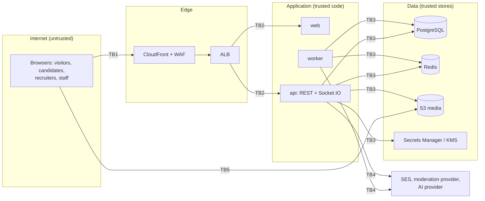

# Threat model

A STRIDE analysis of Euron Open Talent as deployed by the Terraform in `infra/terraform`
(an aws-prod shaped environment, CloudFront and WAF enabled) with the defaults in the code.
Each row names the threat, the control that exists today and what remains. The controls are
described in [security.md](security.md) and, for contact details,
[privacy-and-contact-consent.md](privacy-and-contact-consent.md); the gaps listed under
[Known limitations](security.md#known-limitations) appear here with a rating.

Residual risk is stated plainly. **Accepted** means a design choice; **open** means a known
gap that should be fixed; the rating (low, medium, high) is the impact on a typical network
if exploited. Paths are relative to the repository root.

## Scope and trust boundaries

| Boundary | Crossing |
| --- | --- |
| TB1 | Public internet to the edge: every request and socket frame is untrusted |
| TB2 | Edge to tasks: TLS ends at the ALB; tasks are in private subnets |
| TB3 | Application to its stores: IAM task roles, security groups, TLS to RDS and Redis |
| TB4 | Application to third parties: SES always; the moderation provider when it is `openai`; the AI provider (`openai` or `gemini`) for imports and polish. Resume text, documents, voice notes and content leave the deployment here |
| TB5 | Browser straight to S3 with presigned URLs: the only data path that skips the API |

A further, logical boundary runs **inside** the application between three kinds of
principal, and most of the threats below are attempts to cross it:

| Principal | Holds |
| --- | --- |
| Candidate | Their profile, private contact channels, applications, consent decisions |
| Recruiter (an ACTIVE `recruiters` row, scoped to one company) | Their approaches, unlocks they were granted, their company's jobs, pipelines and notes |
| Operator (`MODERATOR`, `RECRUITER_OPS`, `ADMIN`) | The `/admin` areas their role opens ([security.md](security.md#3-authorisation)) |

## Assets

| Rank | Asset | Why it matters |
| --- | --- | --- |
| 1 | Private contact channels (`contact_email`, `contact_phone`, `whatsapp_phone`) | The thing scrapers, spammers and fake recruiters want; leaking it exposes people to harassment and fraud |
| 2 | Credentials and sessions (password hashes, refresh tokens, TOTP secrets, JWT secrets) | Account takeover, including of recruiters and operators |
| 3 | Recruiter verification state and company identity | A fake "verified recruiter" can approach anyone with the platform's credibility |
| 4 | Application data (snapshots, resumes, screening answers, team notes, stages) | Sensitive career information; tampering harms candidates and companies |
| 5 | Ratings and complaints | Standing on the network; abused, they become retaliation tools |
| 6 | AI import input (resumes, voice notes) | Dense personal data, sent to a provider |
| 7 | Operator powers and the audit trail | Abuse or loss of accountability |
| 8 | Availability of the API, worker and queues | Expiries, purges and moderation depend on them |

## STRIDE by flow

### 1. Contact scraping

The attacker wants many people's contact details, with or without a recruiter account.

| STRIDE | Threat | Control | Residual |
| --- | --- | --- | --- |
| I | Read contact fields from public pages, search or the API | Contact values are in no public DTO; only `MyProfile` (owner) and `ContactReveal` carry them ([`apps/api/src/presenters/profile.presenter.ts`](../../apps/api/src/presenters/profile.presenter.ts)) | Low, accepted: what people write in their own About text is theirs |
| I | Harvest via applications, snapshots or exports | Snapshots carry no contact; the resume export is owner-only | Low |
| I | Mass-approach to collect unlocks | Each reveal needs an ACCEPTED approach the candidate chose channels for; approaches are quota-bound (default 25 per day, plus 60 per hour) and moderated ([`apps/api/src/services/approach.service.ts`](../../apps/api/src/services/approach.service.ts)) | Low: yield depends on people saying yes |
| I | Reuse one unlock from teammates' accounts | The unlock belongs to one recruiter row; reveals check `recruiter_id` | Low |
| I | Keep revealing after consent ends | Every reveal re-checks ACCEPTED, unrevoked and no block; revocation, block, suspension, leaving and removal revoke | Medium, accepted: data copied before revocation stays copied; the access log shows the candidate every reveal |
| R | A recruiter denies having looked | `contact_access_log` row per channel per reveal, with time, recruiter and IP hash | Low |
| I | Scrape names and headlines through the directory | Only PUBLISHED profiles are listed; `search` 90 per minute per IP; WAF rate limit; display names cleaned of emails and phones ([`apps/api/src/domain/display-name.ts`](../../apps/api/src/domain/display-name.ts)) | Medium, accepted: a public directory is the product; sections can be `CONNECTIONS` or `RECRUITERS` only |

### 2. Fake recruiters and impersonated companies

| STRIDE | Threat | Control | Residual |
| --- | --- | --- | --- |
| S | Claim to recruit for a known company with a personal mailbox | Work email confirmed by a one-time code; free-mail domains are flagged in review and never auto-approve ([`apps/api/src/domain/recruiter-verification.ts`](../../apps/api/src/domain/recruiter-verification.ts)) | Low |
| S | Create a lookalike company page and recruit "for" it | New companies start `UNVERIFIED` and every recruiter of an unverified company needs human approval in the `recruiters` area; only operators verify companies | Medium, open: reviewers must look; the queue shows domain match and free-mail flags but cannot judge a plausible lookalike domain |
| S | Guess the work-email code | 6 digits, 15 minutes, 5 attempts counted atomically before comparing, constant-time compare, HMAC at rest, `recruiter-verify` 20 per hour, `recruiter-code` 5 per hour ([`apps/api/src/services/recruiter.service.ts`](../../apps/api/src/services/recruiter.service.ts)) | Low |
| S | Register or overwrite someone else's recruiter record | Identity from the session only; one recruiter row per user, one per work email | Low |
| S | An insider at a company passes the bar and abuses it | Domain auto-approval only for VERIFIED companies that opt in; operators can suspend a recruiter, which withdraws pending approaches and revokes unlocks; candidates can block and complain | Medium, accepted: verification proves a mailbox, not intent ([security.md](security.md#known-limitations) item 7) |
| E | Approve your own recruiter application as `RECRUITER_OPS` | `SELF_REVIEW` refusal; every decision is audited with the operator id | Low |

### 3. Approach spam and harassment

| STRIDE | Threat | Control | Residual |
| --- | --- | --- | --- |
| D | Flood a person with approaches | One PENDING approach per recruiter and person (partial unique index plus `ON CONFLICT`); decline cooldown (30 days); daily quota counted from rows under a row lock; message length 30 to 3000 | Low |
| D | Many recruiters at one company target one person | Each recruiter is bounded; the candidate can decline, block (ends it for good) or set the profile to `UNLISTED` or `DRAFT` | Medium, accepted |
| T | Abusive message content | `moderation.scan` on every approach (target `APPROACH`); a flagged approach is hidden from the candidate and refunded from the quota; candidates can report it | Low |
| I | Learn that a candidate blocked you | Blocked attempts answer `APPROACH_NOT_PUBLISHED`, the same as an unpublished profile | Low |
| T | Accept and withdraw race to leave inconsistent state | Conditional updates `WHERE status = 'PENDING'`, checked row counts; accept also checks `expires_at` | Low |

### 4. Message-request spam

| STRIDE | Threat | Control | Residual |
| --- | --- | --- | --- |
| D | Message strangers at scale | `canMessage()` requires a connection, accepted approach or application link; otherwise a request only if the recipient's policy admits the sender (`RECRUITERS` by default, so ordinary members cannot request at all); `requestsPerDay` (20) and `requestMessageCap` (3) ([`apps/api/src/domain/can-message.ts`](../../apps/api/src/domain/can-message.ts), [`apps/api/src/domain/dm-send.ts`](../../apps/api/src/domain/dm-send.ts)) | Low |
| D | Notification noise from requests | Requests land in a separate folder with one notification and no push per message | Low |
| I | Learn a request was declined | A declined request reads as "only accepts messages from connections" | Low |

### 5. Pipeline tampering

| STRIDE | Threat | Control | Residual |
| --- | --- | --- | --- |
| E | Read or move another company's applications | Every team query is filtered by the caller's own `company_id`; foreign ids are 404 ([`apps/api/src/services/application.service.ts`](../../apps/api/src/services/application.service.ts)) | Low |
| E | Subscribe to another company's board | `job:subscribe` requires an ACTIVE recruiter of the job's company ([`apps/api/src/realtime/gateway.ts`](../../apps/api/src/realtime/gateway.ts)) | Low |
| E | A removed or suspended recruiter keeps watching a board | REST access ends at once; an existing `job:` subscription is not revoked | Medium, open ([security.md](security.md#known-limitations) item 8) |
| T | Forge a stage the rules forbid (unreject to HIRED, move a withdrawn card, withdraw for the candidate) | `canMoveStage()` decides every move from the stored stage ([`apps/api/src/domain/pipeline.ts`](../../apps/api/src/domain/pipeline.ts)); only the candidate withdraws; rejecting needs a reason | Low |
| T | Lost update when two people move one card | Conditional update `WHERE stage = <from>`, 409 `APPLICATION_CHANGED`; bulk moves all-or-nothing | Low |
| T | Candidate edits their profile after applying to look better | The application stores a snapshot at apply time | Low |
| I | Candidate reads team notes or rejection internals | Candidate DTOs carry stage and time only ([`apps/api/src/presenters/application.presenter.ts`](../../apps/api/src/presenters/application.presenter.ts)) | Low |
| R | Deny having moved a card | `application_events` with the actor, plus `audit_log` rows | Low |
| D | Exceed the open-job cap by closing and reopening | The cap is checked on every move to OPEN under a company row lock | Low |

### 6. Rating retaliation and ballot stuffing

| STRIDE | Threat | Control | Residual |
| --- | --- | --- | --- |
| T | Wait for the other side's rating, then retaliate | Double blind: hidden until both rated or the window closed; editable once before reveal and never after ([`apps/api/src/domain/trust.ts`](../../apps/api/src/domain/trust.ts)) | Low |
| S | Rate someone you never worked with | Ratings need a COMPLETED engagement, which needs an ACCEPTED approach or a HIRED application and both sides' confirmation ([`apps/api/src/services/trust.service.ts`](../../apps/api/src/services/trust.service.ts)) | Low |
| T | Stuff ratings with a colluding account | One rating per side per engagement; engagements need a verified recruiter; the displayed score is a Bayesian average with a prior worth three ratings | Medium, accepted ([security.md](security.md#known-limitations) item 10) |
| T | Abusive rating comments | Operators hide ratings with a reason (`complaints` area); the average is recomputed without hidden ratings | Low |

### 7. Complaint abuse

| STRIDE | Threat | Control | Residual |
| --- | --- | --- | --- |
| S | Complain about a stranger to harm them | A complaint must name an approach, application or engagement linking the two (404 `NO_RELATIONSHIP`) | Low |
| D | Flood the complaint queue | `complaintsPer30Days` (3), the `complaints` route limit (5 per day), one open complaint per engagement | Low |
| T | Plant links to malicious files as evidence | Evidence is upload ids claimed by the complainant with purpose `EVIDENCE` (images and PDF), never URLs | Low |
| I | The accused learns who complained | Complaints name both sides by design (they share a dealing); reporters of content are never revealed | Accepted |

### 8. AI import: prompt injection and malicious links

| STRIDE | Threat | Control | Residual |
| --- | --- | --- | --- |
| T | A resume instructs the model to invent awards or badges | Badges need a verbatim quote found in the input or the proposal, confidence at least 0.6, at most 5; seniority is computed from dates, never the model's call ([`apps/api/src/domain/badges.ts`](../../apps/api/src/domain/badges.ts)) | Low |
| T | A crafted resume plants `javascript:` or credential-bearing links on a public page | Every proposed URL passes `safeUrl()`; output is schema-constrained and sanitised ([`apps/api/src/integrations/ai/schema.ts`](../../apps/api/src/integrations/ai/schema.ts), [`apps/api/src/domain/safe-url.ts`](../../apps/api/src/domain/safe-url.ts)) | Low |
| T | Injected text lands on the profile unseen | Nothing is applied until the owner picks sections; nothing is published by the import | Low |
| D | Large documents blow up cost or memory | Text extraction is clamped; `profile-import` limited to `import.perDay` (5); uploads are size-bounded per kind | Low |
| E | The model acts on the system | The provider port has no tools; it returns JSON that the caller sanitises ([`apps/api/src/integrations/ai/provider.ts`](../../apps/api/src/integrations/ai/provider.ts)) | Low |

### 9. PII leakage through the import

| STRIDE | Threat | Control | Residual |
| --- | --- | --- | --- |
| I | Contact details from a resume become public | Emails and phone numbers are stripped from every proposed text field | Low |
| I | Resumes linger in queues or tables | The job payload is the import id; files are fetched by upload id from private storage; input text and file link are purged on apply, everything after `retentionHours` (72) ([`apps/api/src/services/import.service.ts`](../../apps/api/src/services/import.service.ts)) | Low |
| I | The provider retains what it is sent | Inline requests only (no provider file store); `AI_PROVIDER=none` disables the feature | Medium, accepted: provider retention is governed by the operator's agreement with the provider ([ai.md](ai.md)) |

### 10. Account takeover

| STRIDE | Threat | Control | Residual |
| --- | --- | --- | --- |
| S | Credential stuffing | bcrypt, throttling per account and IP and per account, no account-existence signal, WAF limit | Low |
| S | Stolen refresh token | Rotation with reuse detection revokes the family; httpOnly, path-scoped cookie | Low |
| S | Stolen access token after sign-out | Valid up to 15 minutes unless `logout-all` | Low, open ([security.md](security.md#known-limitations) item 1) |
| S | Account lockout used as denial of service | Throttling, not locking; only the account-wide budget can be spent by others | Low, accepted |
| E | A taken-over recruiter account reveals contacts | Reveals are logged and visible to candidates; operators can suspend, which revokes every unlock of that recruiter | Medium |
| S | Phished TOTP code reused | A time step is accepted once | Low |

### 11. Upload abuse

| STRIDE | Threat | Control | Residual |
| --- | --- | --- | --- |
| T | Upload HTML or SVG that runs scripts from the bucket | Allowlist refuses SVG and markup; magic bytes checked; private bucket with signed reads | Low |
| I | Image metadata (GPS) reveals location | Images re-encoded without metadata before anyone else sees them | Low |
| I | Resume or document metadata | Kept as uploaded | Low, open ([security.md](security.md#known-limitations) item 11) |
| E | Attach someone else's upload | Claims check owner, purpose and that it is unattached ([`apps/api/src/services/media-attach.service.ts`](../../apps/api/src/services/media-attach.service.ts)) | Low |
| D | Storage filling with abandoned uploads | Per-kind size limits, `media-upload` budget, `maintenance.expire-uploads` | Low |

### 12. Operator abuse

| STRIDE | Threat | Control | Residual |
| --- | --- | --- | --- |
| E | A moderator or recruiter-ops operator uses powers outside their area | `requireArea` on every admin function from one table; settings, roles and erasure are ADMIN only ([`apps/api/src/domain/admin-permissions.ts`](../../apps/api/src/domain/admin-permissions.ts)) | Low |
| E | Promote yourself or remove the last admin | `CANNOT_CHANGE_OWN_ROLE`, `LAST_ADMIN` under a lock | Low |
| R | Act without a trace | `audit_log` with the operator id for every change; moderation actions also in `moderation_actions` | Low |
| I | Operators read contact details | No admin endpoint returns contact channels; admin rows show the account email only | Low, accepted: database access is outside this model |
| E | Moderate your own content | `SELF_MODERATION` for everyone but an ADMIN | Low |

### 13. Realtime room snooping

| STRIDE | Threat | Control | Residual |
| --- | --- | --- | --- |
| I | Join someone else's `user:` room | Rooms are joined by the server only; `user:<id>` from the authenticated token | Low |
| I | Subscribe to a thread or post you cannot read | Subscribe applies the REST read rule; denial is `NOT_FOUND` | Low |
| I | Presence probing | `presence:query` answers only for people the viewer could know about, minus blocks | Low |
| D | Socket floods | 20 sockets per user, 30 requests per 10 seconds per socket | Low, accepted: per-socket budgets are per task |

### 14. Availability

| STRIDE | Threat | Control | Residual |
| --- | --- | --- | --- |
| D | Request floods | WAF per-IP limit, per-route Redis limits, JSON capped at 1 MB | Low |
| D | Worker down | Jobs wait in Redis with retries; approaches are also checked for expiry at accept time | Medium, open: no queue-depth alarm |
| D | Redis down | Limits fall back to per-task memory; jobs cannot be enqueued (writes still commit) | Medium, accepted |

## Summary of open items

| Item | Rating | Where to fix |
| --- | --- | --- |
| `job:` subscriptions survive team removal | Medium | Leave `job:` rooms when a recruiter is removed, suspended or leaves (the `Effects.leave` path exists) |
| Lookalike company pages | Medium | Reviewer guidance in [recruiter-verification.md](../guides/recruiter-verification.md); optional domain ownership proof |
| Access token outlives sign-out | Low | Bump `token_version` on single-session logout, or shorten the TTL |
| Document metadata kept | Low | Strip metadata from PDFs and documents in `media.process` |
| No queue-depth alarm | Medium | CloudWatch alarm on queue depth and job age |
