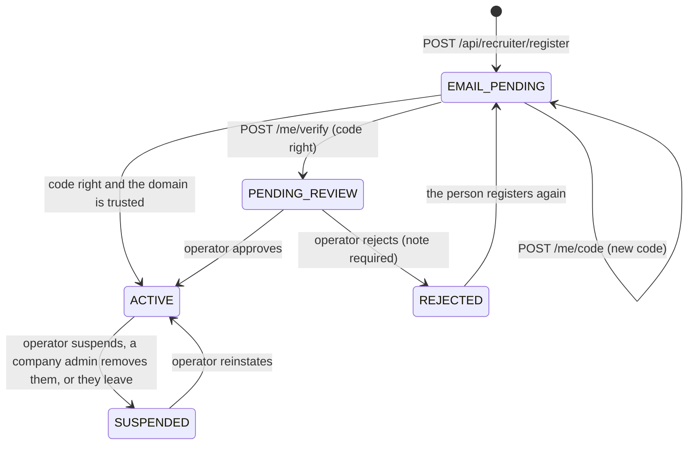

# Recruiter verification (operator guide)

Recruiters can do things ordinary members cannot: search with recruiter-only filters, see
open-to-work signals shared only with recruiters, send approaches that ask for contact
details, post jobs and run hiring pipelines. So a recruiter account is earned in two
steps: the person proves they control a work email, then an operator approves them,
unless the company is verified and trusts its own email domain. This guide is for the
operators who work that queue (platform roles RECRUITER_OPS and ADMIN). The design is in
[ADR 0015](../architecture/adr/0015-recruiter-verification-work-email-and-review.md); the
endpoints are in [rest-contract.md](../api/rest-contract.md#recruiter-workspace-apirecruiter).

## The flow

1. **Register** (`POST /api/recruiter/register`, 10 per day). A signed-in, ACTIVE member
   either names an existing company page (`companySlug`) or creates a new one
   (`newCompany`). Creating a page makes them its OWNER; joining a page that has no
   active or pending owner also makes them OWNER, otherwise RECRUITER. A new page starts
   UNVERIFIED, with its domains taken from its website and from the work email (when the
   work email is not free mail). A suspended company does not accept recruiters
   (`403 COMPANY_SUSPENDED`). One person recruits for one company at a time, and a work
   email belongs to one recruiter (`409 WORK_EMAIL_TAKEN`).
2. **Confirm the work email.** A six-digit code is emailed straight to the work address
   (never through a queue, so it never sits in Redis). Only an HMAC of the code is stored,
   bound to the recruiter row. A code lives 15 minutes. Each check counts the attempt
   with one atomic `UPDATE ... RETURNING` before comparing, so parallel guesses cannot get
   past the cap of 5 attempts per code (`429 CODE_LOCKED`; ask for a new code). Asking for
   a new code (`POST /api/recruiter/me/code`) is limited to 5 per hour and voids the
   earlier code; verifying is limited to 20 per hour.
3. **Route.** With the code right, the work email is marked confirmed and the recruiter
   goes to one of two places
   ([`domain/recruiter-verification.ts`](../../apps/api/src/domain/recruiter-verification.ts)):
   - **ACTIVE at once** when all four hold: the company is VERIFIED, the company allows
     domain auto-approval (`auto_approve_domain`), the platform allows it
     (`settings.recruiter.allowDomainAutoApprove`), and the confirmed email is on one of
     the company's domains (sub-domains count) and is not free mail. The review note says
     "Approved automatically".
   - **PENDING_REVIEW** otherwise: the application waits in `/admin?area=recruiters`.
4. **Decision.** The person is notified (`RECRUITER_APPROVED` or `RECRUITER_REJECTED`) and
   emailed, with the operator's note on a rejection.

Phone verification is not part of the flow (there is no SMS provider, so no toll-fraud
surface); the `phone` columns exist for deployments that add one.

## Statuses

| Status | Meaning | Can do |
| --- | --- | --- |
| `EMAIL_PENDING` | Registered; the work-email code is not confirmed | Nothing recruiter-only |
| `PENDING_REVIEW` | Email confirmed; waiting in the queue | Nothing recruiter-only |
| `ACTIVE` | Approved (by an operator or the trusted domain) | Recruiter search filters, approaches, contact reveals, jobs, pipelines, notes |
| `REJECTED` | An operator said no, with a note | May register again (back to EMAIL_PENDING) |
| `SUSPENDED` | Suspended by an operator, removed by a company admin, or left the company | Nothing recruiter-only |

Every recruiter-only call checks for an ACTIVE recruiter of a company that is not suspended,
and an ACTIVE account (`403 RECRUITER_REQUIRED` otherwise), from fresh data on every
request. Approval takes effect immediately; so does suspension.

## Working the queue

`/admin?area=recruiters` lists PENDING_REVIEW applications oldest first
(`GET /api/admin/recruiters`; pass `status` to see other statuses, newest first, and `q`
to search by company, work email or name). Each row (`AdminRecruiterRow`) carries the
evidence:

| Field | What it tells you |
| --- | --- |
| `user` (with sign-in email) | Who is applying; open their profile to see their history |
| `company` (with `status` and `domains`) | Whether the page is verified, and the domains it claims |
| `workEmail`, `workEmailVerified` | The address they proved they read |
| `domainMatches` | The work email sits on one of the company's domains |
| `freeMail` | The work email is on a free-mail or disposable provider (`settings.recruiter.freeMailDomains`). It can still be approved, but it proves nothing about the company and never auto-approves |
| `title`, `applicationNote` | What they say their role is and why they need recruiter access |
| `approachesSent`, `reviewNote`, `reviewedBy` | History, for a re-application |

### Checklist

1. **Is the company real and the page legitimate?** Check `company.status`. For an
   UNVERIFIED page, look at its website and whether its claimed domains belong to it. If
   the page itself is doubtful, verify or suspend it in `/admin?area=companies` first.
2. **Does the email prove membership?** `domainMatches` true and `freeMail` false is the
   strong case. A free-mail address needs other evidence (the application note, a public
   page naming the person) or a rejection asking them to apply with their work address.
3. **Does the person look like who they claim?** A profile with a matching current role
   helps; a brand-new empty account asking for recruiter access is a reason to ask for more.
4. **Is it a duplicate or a return?** Search the queue and other statuses by name and
   company. A previous rejection or suspension is in `reviewNote`.
5. **Decide.** `POST /api/admin/recruiters/:id/review` with `{ decision: "APPROVE" }`, or
   `{ decision: "REJECT", note }`. A rejection needs a note (`400 NOTE_REQUIRED`) the
   applicant reads, so say what would change your answer. You cannot review your own
   application (`403 SELF_REVIEW`); an application no longer pending is
   `409 NOT_PENDING_REVIEW`.

Every decision is in the audit log (`recruiter.approve`, `recruiter.reject`) with your id.

## After approval

| Action | API | Effect |
| --- | --- | --- |
| Suspend | `POST /api/admin/recruiters/:id/suspend` `{ reason }` | Status SUSPENDED. Every PENDING approach they sent is withdrawn and **every live contact unlock is revoked**, so the details candidates shared stop being revealable at once. The company's member count drops |
| Reinstate | `POST /api/admin/recruiters/:id/reinstate` | Back to ACTIVE, only for a suspended recruiter whose work email was confirmed (`409 NOT_REINSTATABLE` otherwise). Revoked unlocks stay revoked: candidates consent again through a new approach |
| Quota | `PUT /api/admin/recruiters/:id/quota` `{ quota }` | Overrides the daily approach quota (0 to 1000); `null` returns to `settings.recruiter.approachesPerDay` (default 25). Approaches the classifier flags do not count against it |

Suspend when a recruiter's approaches draw complaints or moderation cases, when the
company says they no longer work there, or when the account itself is suspended for
abuse. Complaints against a recruiter show `priorComplaintsAgainst` in
`/admin?area=complaints`; see the [moderation playbook](moderation-playbook.md#complaints).

## Companies and trusted domains

`/admin?area=companies` (`PATCH /api/admin/companies/:id`):

- **Verify** (`status: VERIFIED`) when you are satisfied the page represents the company.
  It records who verified it and when. **Unverify** clears that.
- **Domains.** Up to 10, normalised to their base domain (`jobs.northwind.example` becomes
  `northwind.example`). Company admins can edit them too, but they only matter for
  auto-approval while the company is VERIFIED.
- **Auto-approval** (`autoApproveDomain`) lets confirmed work emails on the company's
  domains skip the queue. Turn it on only for a verified company whose domains you checked;
  it is the switch that decides who can approach candidates on that company's behalf. The
  platform-wide switch `settings.recruiter.allowDomainAutoApprove` (default on) can turn
  auto-approval off everywhere at once.
- **Suspend** (reason required). A suspended company recruits nobody: its pending
  approaches are withdrawn, its open jobs close, its page, jobs and posts disappear for
  everyone but staff and its own team, and every member fails the recruiter check.
- **Free-mail list.** `settings.recruiter.freeMailDomains` (in `/admin?area=settings`,
  ADMIN) ships with the common free-mail and disposable providers. Add any provider that
  appears in your queue; a domain on the list never matches a company and never
  auto-approves.

## Teams

The `recruiters` row is both the team membership and the verification record. Team roles
are separate from platform roles:

| Team role | Can |
| --- | --- |
| `OWNER` | Everything a company admin can, plus change admins and owners and remove owners. A page always keeps at least one owner (`409 LAST_OWNER`) |
| `ADMIN` | Edit the company page (name, logo, about, domains, auto-approval), post as the company, remove recruiters (`403 OWNER_ONLY` for anything touching admins or owners) |
| `RECRUITER` | Recruit: search, approach, post and manage jobs, work pipelines |

Company admins cannot approve anyone: joining a team still goes through the email code and
the queue (or a trusted domain). A company admin removing a teammate
(`DELETE /api/companies/team/:recruiterId`) withdraws their pending approaches, revokes
their unlocks, hands their jobs to the remover and sets them SUSPENDED.

## Leaving

A recruiter stops with `DELETE /api/recruiter/me`. Their pending approaches are withdrawn
and live unlocks revoked (a candidate consented to this recruiter at this company), their
jobs pass to another active teammate or close if there is none, and the last owner of a
team with other members must hand ownership over first (`409 OWNER_MUST_TRANSFER`).
Deleting the account does the same through account deletion.

## Seeing it locally

The demo seed (`make demo`) leaves two applications in the queue: one on a matching
company domain at an unverified company, and one using a free-mail address. Sign in as the
recruiter-ops demo account and open `/admin?area=recruiters`; the
[walkthrough](walkthrough.md#5-an-operator-approves-a-recruiter) has the steps.
